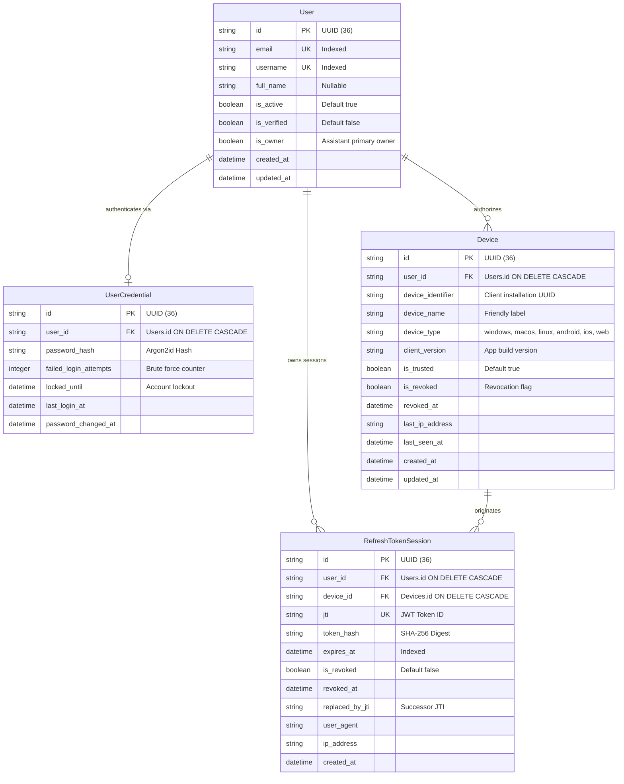
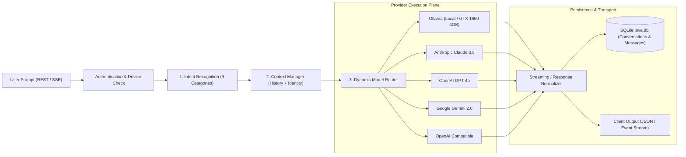
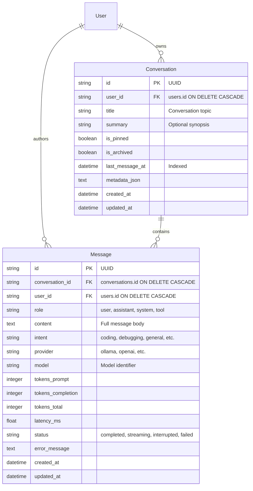
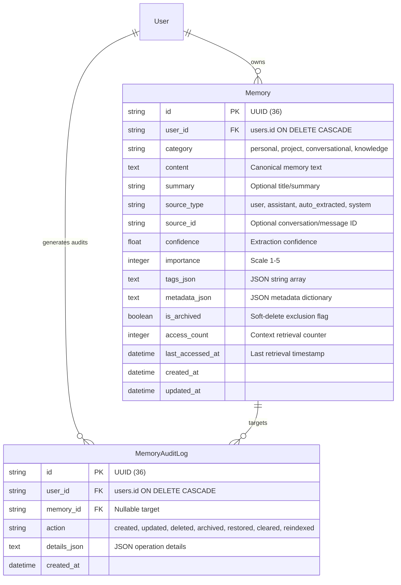
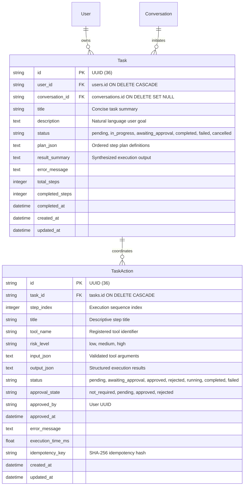

# LOVE Architecture Specification

## 1. Executive Summary & Design Philosophy

**LOVE** is an independent, modular, extensible, multi-platform personal AI assistant ecosystem inspired by the capabilities of Iron Man's JARVIS and FRIDAY.

LOVE functions as a general-purpose, persistent, and intelligent companion capable of operating seamlessly across **Windows, macOS, Linux, Android, iOS, and Web**.

### Core Architectural Principles:
1. **Decoupled Modularity:** Every functional subsystem (intelligence, memory, voice, productivity, automation, security) is encapsulated in its own domain module with strict interface boundaries.
2. **Platform-Agnostic Core:** The backend exposes standardized async REST, Server-Sent Events (SSE), and WebSocket interfaces consumed uniformly by Desktop (Tauri), Web (React), and Mobile (Flutter) clients.
3. **Local-First & Privacy Conscious:** User data, persistent memories, private keys, and on-device inference models are housed locally with zero unsolicited external telemetry.
4. **Resilient Asynchrony:** Non-blocking asynchronous I/O across database operations, API requests, tool executions, and full-duplex streaming audio pipelines.
5. **Absolute Project Isolation:** Zero dependency, code, or configuration coupling with external or legacy projects (e.g. KURO, FRIDAY).

---

## 2. Permanent Core Capabilities

LOVE is designed around 14 permanent core capabilities:

1. **General Intelligent Conversations:** High-context, fluid multi-turn natural dialogue.
2. **Software Development & Programming:** Multi-language code authoring, refactoring, and architecture.
3. **Website & Application Development:** Full-stack development across web, desktop, and mobile.
4. **Debugging & Code Analysis:** Automated diagnostics, syntax auditing, and optimization.
5. **Image & Creative Assistance:** Multimodal generation, editing, SVG design, and wireframing.
6. **Document Creation & Analysis:** Comprehensive synthesis and generation of Markdown, PDF, and reports.
7. **Research & Problem Solving:** Deep-dive literature retrieval, citation validation, and analytical synthesis.
8. **Personal Productivity:** Contextual task management, reminders, scheduling, and morning briefings.
9. **File Operations:** Intelligent file search, workspace organization, and bulk content manipulation.
10. **Desktop Automation:** Multi-platform OS interaction, window management, and controlled scripting.
11. **Local & Cloud AI Models:** Dynamic routing between on-device GGUF models and frontier cloud LLMs.
12. **Persistent Personal Memory:** Working context, episodic recall, and semantic vector embeddings.
13. **Voice Interaction:** Ultra-low latency voice loop with "Hey Love" wake-word activation.
14. **Cross-Device Availability:** Synchronized state across desktop, web, and mobile with E2EE.

---

## 3. Authentication, User Identity & Device Security (Phase 02)

LOVE is architected as a **single-owner personal assistant ecosystem** supporting multiple authorized devices across desktop, mobile, and web.

### A. Authentication Entity-Relationship Model



### B. Security Architecture & Cryptographic Controls:
1. **Argon2id Password Hashing:**
   - Password hashes use the official Argon2id profile (`time_cost=2`, `memory_cost=65536 KiB`, `parallelism=1`, `hash_len=32`).
   - Resistant to GPU, ASIC, and side-channel timing attacks.
   - Plaintext passwords are never logged or stored.
2. **Dual-Token Lifecycle with Cryptographic Rotation:**
   - **Access Token:** Short-lived JWT (default 60 minutes) containing signed identity claims (`sub`, `email`, `is_owner`, `device_id`, `iss`, `aud`, `exp`, `jti`).
   - **Refresh Token:** Long-lived JWT (default 14 days) stored in the database **strictly as SHA-256 hashes**.
   - Every refresh operation issues a brand new access token and a brand new refresh token, invalidating the previous one.
3. **Token Reuse Detection & Automated Breach Containment:**
   - If an already-rotated or revoked refresh token is presented, the system detects a token reuse attack (theft of an in-transit token).
   - In response, the system immediately **revokes all active sessions for that user on that device**, halting unauthorized access.
4. **Sliding-Window Brute Force Rate Limiting:**
   - IP-level and account-level sliding window rate limiter protects endpoints from credential stuffing and dictionary attacks.
   - Consecutive failures incur incremental delays and temporary lockouts.
5. **Constant-Time Error Handling:**
   - Login failures return a generic `"Invalid email/username or password."` message regardless of whether the username or email exists, eliminating user enumeration vectors.
6. **First-Owner Bootstrap Architecture:**
   - The first account registered automatically claims Owner status (`is_owner=True`).
   - Once an owner exists, public registration automatically locks (`ALLOW_OPEN_REGISTRATION=false`), securing the personal assistant.

---

## 4. The Universal Intelligence Layer (Phase 03)

The **Universal Intelligence Layer (UIL)** is the cognitive brain of LOVE. It mediates all interactions between raw model inference, conversation persistence, context budgeting, and autonomous capability execution:



### A. Conversation & Message Data Model



### B. Core Intelligence Capabilities:
1. **Multi-Category Intent Recognition:** Deterministic classification into 9 domains (coding, debugging, reasoning, research, writing, creative, productivity, mathematical, general) with automated parameter tuning.
2. **Multi-Provider Adapter Interface:** Decoupled vendor adapters (`OllamaProvider`, `OpenAIProvider`, `AnthropicProvider`, `GeminiProvider`, `OpenAICompatibleProvider`).
3. **Hardware-Aware Model Routing:** Optimizes local inference for 4GB VRAM GPU (NVIDIA GTX 1650) with `llama3.2:3b` and `qwen2.5-coder:1.5b`.
4. **Strict Local-Only Privacy Mode:** Enforces zero cloud routing when `LOCAL_ONLY_MODE=True` or `local_only=True` is specified.
5. **Context Token Budgeting:** Sliding context window respecting model token budgets and prepend of central Indian English female persona system prompt.
6. **Resilient SSE Streaming:** Real-time token streaming with interruption state persistence. Incomplete output is never saved as a successful completed answer.

---

## 5. Persistent Personal Memory & Vector Retrieval (Phase 04)

LOVE incorporates an independent, durable cognitive memory system with semantic and lexical retrieval.

### A. Memory Entity-Relationship Model



### B. Core Memory Capabilities:
1. **Model-Decoupled Persistence:** Memory records are stored in canonical SQLite tables independent of active LLM models.
2. **Local Vector Storage:** `LocalVectorStore` provides on-disk, user-partitioned vector indexing (`database/vectors/{user_id}.json`) with parallel NumPy cosine similarity calculation.
3. **Multi-Provider Embedding Abstraction:** Pluggable adapters (`DeterministicEmbeddingProvider` 128-dim zero-network fallback, `OllamaEmbeddingProvider`, `GeminiEmbeddingProvider`).
4. **Privacy & Sensitive Data Gate:** `SensitiveDataSanitizer` permanently blocks API keys, bearer tokens, passwords, private keys, and payment cards from memory persistence.
5. **Hybrid Multi-Strategy Retrieval:** Blends semantic vector cosine similarity ($0.55$), token lexical overlap ($0.25$), importance boost ($0.15$), and recency decay ($0.05$).
6. **Automatic Context Injection:** Retrieved memories are injected into model system prompts under `<relevant_memories>` tags to maintain cross-session continuity.
7. **Automated Candidate Extraction:** `MemoryExtractionService` scans incoming conversation prompts for explicit directives, user preferences, and architectural decisions.

---

## 6. Universal Work Intelligence & Safe Tool Orchestration (Phase 05)

LOVE provides an autonomous, provider-independent work orchestration layer that dynamically determines whether user requests require tool execution, breaks complex goals into structured plans, enforces human-in-the-loop approvals, and manages sandbox-confined actions.

### A. Entity-Relationship Model



### B. Core Work Intelligence Capabilities:
1. **Universal Intent & Action Recognition:** Automatic detection of action requirements without requiring manual user category picking.
2. **Provider-Independent Execution:** Complete offline operation for mathematical, datetime, file, and coding tools without reliance on external LLM availability.
3. **Strict Sandbox & Traversal Guards:** All workspace file access enforces canonical common-path confinement; blocked access to `.env*`, `*.pem`, `*.key`, `id_rsa*`, secrets, and databases.
4. **Human-in-the-Loop Risk Governance:** Low risk auto-permitted; Medium risk (file creation, modification, patch application) and High risk (destructive changes) require user confirmation or approval.
5. **Safe Tool Registry:** Built-in suite including AST Calculator (no `eval()`), DateTime Tool, Workspace File Tools, Coding Workspace Tools (static inspection, symbol search, diffs, patches), and Research Search Provider with citations.
6. **Robust Execution Engine:** Idempotency tracking, per-tool timeout limits, exception isolation, and synthesized result summaries.

---

## 7. Official LOVE Voice Specification

- **Assistant Identity:** LOVE
- **Vocal Style:** Hybrid Cinematic + Natural (JARVIS/FRIDAY poise combined with human warmth and cadence).
- **Vocal Gender:** Female.
- **Accent:** Indian English (articulate, elegant, cultured).
- **Personality:** Intelligent, elegant, calm, confident, and proactive.
- **Provider Strategy:**
  - *Primary Cloud:* **Azure Speech Services** (`en-IN-NeerjaNeural` / `en-IN-KavyaNeural`).
  - *Secondary Cloud:* **ElevenLabs** expressive neural cloning.
  - *Offline Local:* **Piper Neural TTS** (100% on-device).
  - *Speech-to-Text:* **`faster-whisper`** (CTranslate2 backend).
  - *Wake-Word:* **`openWakeWord`** on-device detection for `"Hey Love"`.
  - *Decoupling Guarantee:* Voice subsystem operates independently of the LLM core.

---

## 8. Database Strategy & Migrations

- **Development & Standalone Desktop:** Asynchronous SQLite (`sqlite+aiosqlite:///./database/love.db`).
- **Production & Distributed Server:** PostgreSQL (`postgresql+asyncpg://...`).
- **Schema Migrations:** Managed strictly via **Alembic** (`database/migrations/`).
  - Async-compatible migration runner using `async_engine_from_config`.
  - Batch operations enabled (`render_as_batch=True`) to support SQLite ALTER TABLE limitations.
  - Linear 7-migration dependency chain up to current head `c0e81b379d42`.

---

## 9. Universal Client Ecosystem (Desktop, Web & Mobile)

LOVE provides a unified assistant experience across desktop, browser, and mobile environments, connecting to the singular sovereign FastAPI backend.

```
+---------------------------------------------------------------------------------------------+
|                                    LOVE Client Ecosystem                                    |
+------------------------------+------------------------------+-------------------------------+
|   Desktop Client (Electron)  |   Web Application (Browser)  | Native Mobile (Android & iOS) |
| - React 19 + TypeScript      | - React 19 + TypeScript      | - Capacitor 6 + React 19 + TS |
| - OS Window & Tray Control   | - Universal Browser Access   | - Android Keystore / Keychain |
| - Hardware-Backed DPAPI      | - In-Memory + HttpOnly Auth  | - Biometric Prompt / Face ID  |
| - Native Sync & Voice Loop   | - Responsive Multi-Device UI | - Push-to-Talk Voice & SSE    |
| - System Notifications       | - Work Approvals & Memory    | - Touch-First HUD Design      |
+------------------------------+------------------------------+-------------------------------+
                                               |
                          JSON REST & Server-Sent Events (SSE)
                                               |
+---------------------------------------------------------------------------------------------+
|                            LOVE Sovereign Core (FastAPI Backend)                            |
| - Auth & Devices   - Intelligence & LLMs   - Personal Episodic Memory                       |
| - Work Orchestration (HITL) - Synchronization - Hardware Telemetry                          |
| - SQLite WAL Database (`database/love.db` - Revision `c0e81b379d42`)                        |
+---------------------------------------------------------------------------------------------+
```

### Web Client Architectural Standards (Phase 11):
1. **Security Posture:** Zero long-lived refresh tokens in browser storage (`localStorage`/`sessionStorage`). Access tokens are kept in short-lived memory; sessions persist via `HttpOnly`, `SameSite=Lax` cookies.
2. **Real-Time Token Streaming:** Server-Sent Events (SSE) with `AbortController` cancellation for immediate stream interruption.
3. **Decoupled Architecture:** Clean separation of domain contracts (`web/src/types`), communication services (`web/src/services`), state providers (`web/src/context`), and modular UI components (`web/src/components`).
4. **Human-in-the-Loop Integrity:** Explicit user authorization cards for destructive/external actions (`ApprovalQueue.tsx`) and explicit consent approvals for inferred personal memories (`SuggestionCard.tsx`).
5. **Zero Cloud Dependencies:** Full local operation with local Ollama LLMs, local deterministic vector store, and SQLite WAL database.

---

## 10. Native Mobile Application Architecture (Android & iOS — Phase 12)

The native mobile application (`mobile/`) extends LOVE's capabilities to smartphones and tablets via **Capacitor 6** with **React 19, TypeScript, Vite, and Tailwind CSS**.

### Key Architectural Tenets:
1. **Unified Identity & Backend Brain:** Uses the same sovereign FastAPI backend (`/api/v1/*`). Mobile is an ergonomic window into LOVE's intelligence, not a secondary brain.
2. **Hardware-Backed Cryptographic Vault:**
   - Access tokens remain strictly ephemeral in `MobileApiClient` memory.
   - Long-lived refresh tokens are stored in hardware-backed storage (`EncryptedSharedPreferences` on Android, Keychain on iOS).
   - Zero plaintext tokens exist in `localStorage` or unencrypted preferences.
3. **Native Biometric Unlock Gating:**
   - Platform biometrics (`BiometricPrompt` on Android, `FaceID` / `TouchID` on iOS) gate local credential retrieval.
   - Revoked sessions on the backend invalidate access immediately upon network verification regardless of local biometric state.
4. **Autonomous Work & Human-in-the-Loop Supervision:**
   - Dedicated mobile Work Intelligence view displaying pending task approvals.
   - Explicit "Authorize & Run" or "Reject" actions for high-risk tool operations.
5. **Personal Memory Consent Gate:**
   - Categorized memory exploration (`core`, `preferences`, `knowledge`, `episodic`, `contacts`).
   - Explicit user approval required for memory suggestions before insertion into canonical memory.
6. **Mobile Voice & Wake-Word Privacy Boundary:**
   - Push-to-talk voice recording with real-time audio transcription and speech synthesis.
   - Continuous wake-word listening is deliberately disabled on mobile to conserve battery and enforce personal privacy.
7. **Native Platform Integration:**
   - Configurable host endpoint switcher supporting Android emulator loopback (`10.0.2.2:8000`), LAN WiFi IPs, and HTTPS reverse proxies.
   - Native Android hardware back-button navigation handling and virtual keyboard awareness.
   - Production Android APK assembled and verified at `mobile/android/app/build/outputs/apk/debug/app-debug.apk`.


