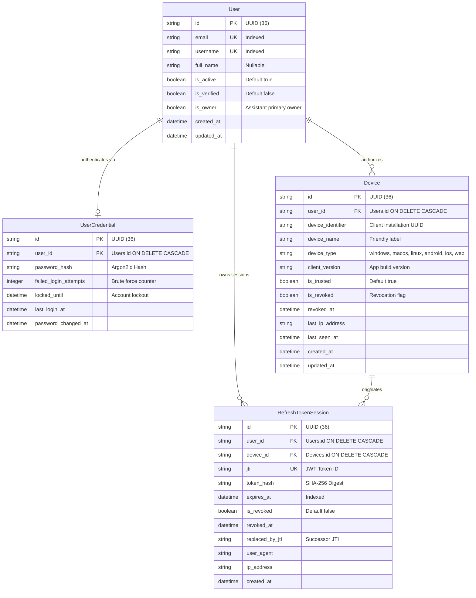
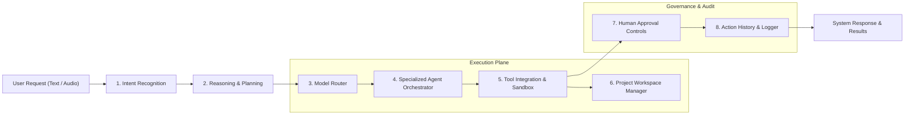

# LOVE Architecture Specification

## 1. Executive Summary & Design Philosophy

**LOVE** is an independent, modular, extensible, multi-platform personal AI assistant ecosystem inspired by the capabilities of Iron Man's JARVIS and FRIDAY.

LOVE functions as a general-purpose, persistent, and intelligent companion capable of operating seamlessly across **Windows, macOS, Linux, Android, iOS, and Web**.

### Core Architectural Principles:
1. **Decoupled Modularity:** Every functional subsystem (intelligence, memory, voice, productivity, automation, security) is encapsulated in its own domain module with strict interface boundaries.
2. **Platform-Agnostic Core:** The backend exposes standardized async REST, Server-Sent Events (SSE), and WebSocket interfaces consumed uniformly by Desktop (Tauri), Web (React), and Mobile (Flutter) clients.
3. **Local-First & Privacy Conscious:** User data, persistent memories, private keys, and on-device inference models are housed locally with zero unsolicited external telemetry.
4. **Resilient Asynchrony:** Non-blocking asynchronous I/O across database operations, API requests, tool executions, and full-duplex streaming audio pipelines.
5. **Absolute Project Isolation:** Zero dependency, code, or configuration coupling with external or legacy projects (e.g. KURO, FRIDAY).

---

## 2. Permanent Core Capabilities

LOVE is designed around 14 permanent core capabilities:

1. **General Intelligent Conversations:** High-context, fluid multi-turn natural dialogue.
2. **Software Development & Programming:** Multi-language code authoring, refactoring, and architecture.
3. **Website & Application Development:** Full-stack development across web, desktop, and mobile.
4. **Debugging & Code Analysis:** Automated diagnostics, syntax auditing, and optimization.
5. **Image & Creative Assistance:** Multimodal generation, editing, SVG design, and wireframing.
6. **Document Creation & Analysis:** Comprehensive synthesis and generation of Markdown, PDF, and reports.
7. **Research & Problem Solving:** Deep-dive literature retrieval, citation validation, and analytical synthesis.
8. **Personal Productivity:** Contextual task management, reminders, scheduling, and morning briefings.
9. **File Operations:** Intelligent file search, workspace organization, and bulk content manipulation.
10. **Desktop Automation:** Multi-platform OS interaction, window management, and controlled scripting.
11. **Local & Cloud AI Models:** Dynamic routing between on-device GGUF models and frontier cloud LLMs.
12. **Persistent Personal Memory:** Working context, episodic recall, and semantic vector embeddings.
13. **Voice Interaction:** Ultra-low latency voice loop with "Hey Love" wake-word activation.
14. **Cross-Device Availability:** Synchronized state across desktop, web, and mobile with E2EE.

---

## 3. Authentication, User Identity & Device Security (Phase 02)

LOVE is architected as a **single-owner personal assistant ecosystem** supporting multiple authorized devices across desktop, mobile, and web.

### A. Authentication Entity-Relationship Model

### B. Security Architecture & Cryptographic Controls:
1. **Argon2id Password Hashing:**
   - Password hashes use the official Argon2id profile (`time_cost=2`, `memory_cost=65536 KiB`, `parallelism=1`, `hash_len=32`).
   - Resistant to GPU, ASIC, and side-channel timing attacks.
   - Plaintext passwords are never logged or stored.
2. **Dual-Token Lifecycle with Cryptographic Rotation:**
   - **Access Token:** Short-lived JWT (default 60 minutes) containing signed identity claims (`sub`, `email`, `is_owner`, `device_id`, `iss`, `aud`, `exp`, `jti`).
   - **Refresh Token:** Long-lived JWT (default 14 days) stored in the database **strictly as SHA-256 hashes**.
   - Every refresh operation issues a brand new access token and a brand new refresh token, invalidating the previous one.
3. **Token Reuse Detection & Automated Breach Containment:**
   - If an already-rotated or revoked refresh token is presented, the system detects a token reuse attack (theft of an in-transit token).
   - In response, the system immediately **revokes all active sessions for that user on that device**, halting unauthorized access.
4. **Sliding-Window Brute Force Rate Limiting:**
   - IP-level and account-level sliding window rate limiter protects endpoints from credential stuffing and dictionary attacks.
   - Consecutive failures incur incremental delays and temporary lockouts.
5. **Constant-Time Error Handling:**
   - Login failures return a generic `"Invalid email/username or password."` message regardless of whether the username or email exists, eliminating user enumeration vectors.
6. **First-Owner Bootstrap Architecture:**
   - The first account registered automatically claims Owner status (`is_owner=True`).
   - Once an owner exists, public registration automatically locks (`ALLOW_OPEN_REGISTRATION=false`), securing the personal assistant.

---

## 4. The Universal Intelligence Layer

The **Universal Intelligence Layer (UIL)** is the cognitive brain of LOVE. It mediates all interactions between raw model inference and autonomous capability execution:

---

## 5. Official LOVE Voice Specification

- **Assistant Identity:** LOVE
- **Vocal Style:** Hybrid Cinematic + Natural (JARVIS/FRIDAY poise combined with human warmth and cadence).
- **Vocal Gender:** Female.
- **Accent:** Indian English (articulate, elegant, cultured).
- **Personality:** Intelligent, elegant, calm, confident, and proactive.
- **Provider Strategy:**
  - *Primary Cloud:* **Azure Speech Services** (`en-IN-NeerjaNeural` / `en-IN-KavyaNeural`).
  - *Secondary Cloud:* **ElevenLabs** expressive neural cloning.
  - *Offline Local:* **Piper Neural TTS** (100% on-device).
  - *Speech-to-Text:* **`faster-whisper`** (CTranslate2 backend).
  - *Wake-Word:* **`openWakeWord`** on-device detection for `"Hey Love"`.
  - *Decoupling Guarantee:* Voice subsystem operates independently of the LLM core.

---

## 6. Database Strategy & Migrations

- **Development & Standalone Desktop:** Asynchronous SQLite (`sqlite+aiosqlite:///./database/love.db`).
- **Production & Distributed Server:** PostgreSQL (`postgresql+asyncpg://...`).
- **Schema Migrations:** Managed strictly via **Alembic** (`database/migrations/`).
  - Async-compatible migration runner using `async_engine_from_config`.
  - Batch operations enabled (`render_as_batch=True`) to support SQLite ALTER TABLE limitations.
