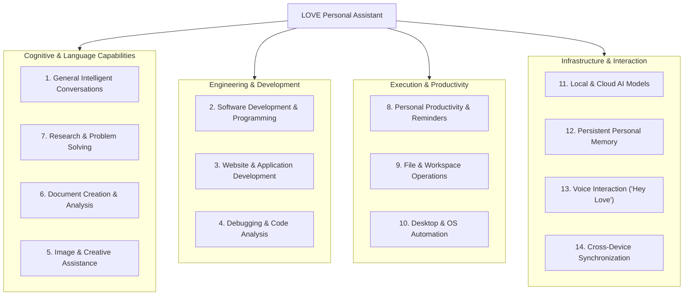
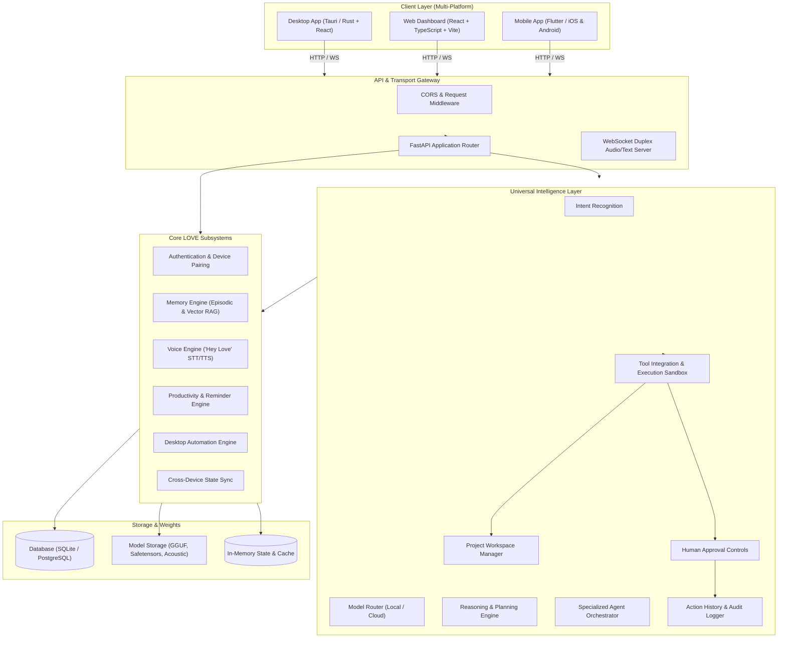
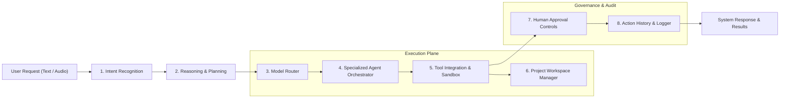
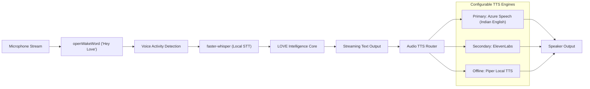
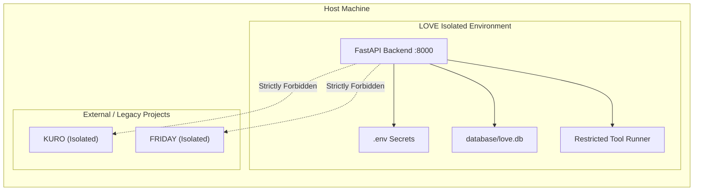

# LOVE Architecture Specification

## 1. Executive Summary & Design Philosophy

**LOVE** is an independent, modular, extensible, multi-platform personal AI assistant ecosystem inspired by the capabilities of Iron Man's JARVIS and FRIDAY.

LOVE functions as a general-purpose, persistent, and intelligent companion capable of operating seamlessly across **Windows, macOS, Linux, Android, iOS, and Web**.

### Core Architectural Principles:
1. **Decoupled Modularity:** Every functional subsystem (intelligence, memory, voice, productivity, automation, security) is encapsulated in its own domain module with strict interface boundaries.
2. **Platform-Agnostic Core:** The backend exposes standardized async REST, Server-Sent Events (SSE), and WebSocket interfaces consumed uniformly by Desktop (Tauri), Web (React), and Mobile (Flutter) clients.
3. **Local-First & Privacy Conscious:** User data, persistent memories, private keys, and on-device inference models are housed locally with zero unsolicited external telemetry.
4. **Resilient Asynchrony:** Non-blocking asynchronous I/O across database operations, API requests, tool executions, and full-duplex streaming audio pipelines.
5. **Absolute Project Isolation:** Zero dependency, code, or configuration coupling with external or legacy projects (e.g. KURO, FRIDAY).

---

## 2. Permanent Core Capabilities

LOVE is designed to fulfill 14 permanent capability pillars:



1. **General Intelligent Conversations:** Natural, context-rich multi-turn dialogues with dynamic personality adaptation.
2. **Software Development & Programming:** Multi-language code authoring, refactoring, test generation, and architectural design.
3. **Website & Application Development:** Full-stack development capabilities covering modern frontend, backend, and database paradigms.
4. **Debugging & Code Analysis:** Automated stack-trace diagnostics, syntax checking, security auditing, and performance profiling.
5. **Image & Creative Assistance:** Image generation, editing pipelines, SVG authoring, UI wireframing, and creative drafting.
6. **Document Creation & Analysis:** Parsing, synthesis, and authoring of Markdown, PDF, Office documents, and structured reports.
7. **Research & Problem Solving:** Deep web exploration, multi-source literature synthesis, citations, and analytical deduction.
8. **Personal Productivity:** Context-aware task lists, reminders, calendars, schedules, and proactive morning briefings.
9. **File Operations:** Intelligent file search, bulk organization, content-based deduplication, and workspace manipulation.
10. **Desktop Automation:** Multi-platform OS interaction, window management, screen inspection, and controlled shell scripting.
11. **Local & Cloud AI Models:** Fluid routing between on-device models (via GGUF / llama.cpp) and frontier cloud models (Gemini, Claude, OpenAI).
12. **Persistent Personal Memory:** Multi-tiered memory combining working context, episodic history, and semantic vector embeddings.
13. **Voice Interaction:** Ultra-low latency voice loop with "Hey Love" wake-word activation and an Indian English female acoustic profile.
14. **Cross-Device Availability:** Synchronized state across desktop, browser, and mobile devices with end-to-end encryption.

---

## 3. High-Level Ecosystem Topology



---

## 4. The Universal Intelligence Layer

The **Universal Intelligence Layer (UIL)** is the cognitive brain of LOVE. It mediates all interactions between raw model inference and autonomous capability execution:



### Subsystem Components:

1. **Intent Recognition:**
   - Evaluates incoming conversational turns, voice utterances, and events.
   - Dispatches tasks into conversational queries, coding tasks, research queries, productivity items, or system commands.
2. **Model Routing:**
   - Dynamically routes prompts based on privacy, task complexity, context length, network availability, and latency tolerance:
     - *Zero-latency / Offline / Sensitive:* Local GGUF models via `llama.cpp` (e.g. 7B/14B Q4_K_M).
     - *Complex Reasoning / Large Codebases / Creative:* Frontier cloud APIs (Gemini, Claude, OpenAI).
3. **Reasoning & Planning:**
   - Generates multi-step execution graphs (`Plan -> Execute -> Observe -> Refine`).
   - Maintains execution state, intermediate milestones, and failure recovery trees.
4. **Specialized Agent Orchestration:**
   - Coordinates domain-specific worker agents:
     - *Software Architect Agent:* Project structuring, dependency validation.
     - *Full-Stack Coding Agent:* Implementation, unit test generation, file edits.
     - *Code Reviewer & Debugger Agent:* Linting, syntax inspection, security audit.
     - *Research Agent:* Information retrieval, documentation synthesis.
     - *Automation Agent:* OS automation and shell operations.
5. **Tool Integration:**
   - Standardized tool interface with schema validation (Pydantic).
   - Dynamic tool discovery, execution sandboxing, and output formatting.
6. **Project Workspace Management:**
   - Scoped file tree tracking, working directory persistence, git status awareness, and scratchpad management.
7. **Human Approval Controls (Interactive Gates):**
   - Destructive actions (e.g., file deletion, shell execution, external network calls, permission elevation) require explicit user authorization before execution.
   - Provides clear diff views and operation previews.
8. **Action History & Audit Logger:**
   - Immutable audit trail recording tool invocations, user approvals, execution parameters, and status for full traceability and rollback capability.

---

## 5. Official LOVE Voice Specification

The voice subsystem delivers a distinctive, elegant, and production-grade conversational experience.



### Approved Voice Identity:
- **Name:** LOVE
- **Identity Style:** Hybrid Cinematic + Natural (JARVIS/FRIDAY poise combined with human warmth and cadence).
- **Voice Gender:** Female.
- **Accent:** Indian English (sophisticated, articulate, natural inflection).
- **Personality Profile:** Intelligent, elegant, calm, confident, and proactive.
- **Addressing Mode:** Speaks with concise authority, avoiding robotic boilerplate or excessive servility.

### Technical Implementation Standards:
- **Decoupled Architecture:** The voice pipeline is completely independent of the LLM engine. Voice generation and transcription operate as modular services via standard streaming interfaces (PCM/Opus over WebSockets).
- **Wake-Word Detection:** `openWakeWord` running locally on-device for instantaneous, privacy-preserving "Hey Love" activation with negligible CPU utilization.
- **Speech-to-Text (STT):** Local high-accuracy transcription using `faster-whisper` (CTranslate2 backend) supporting streaming audio buffers and voice activity detection (VAD).
- **Text-to-Speech (TTS) Strategy:**
  1. *Primary Cloud Provider:* **Azure Speech Services** (en-IN neural female voices, e.g., `en-IN-NeerjaNeural` or `en-IN-KavyaNeural`) tuned for conversational elegance.
  2. *Alternative Cloud Provider:* **ElevenLabs** for ultra-expressive, high-fidelity emotional nuance.
  3. *Offline Local Fallback:* **Piper TTS** (or on-device VITS) ensuring complete voice functionality without internet access.

---

## 6. Backend Subsystem Layout

```
backend/app/
├── api/
│   └── v1/
│       ├── endpoints/
│       │   └── health.py          # Liveness, readiness, and diagnostics
│       └── api.py                 # Aggregated v1 routing table
├── authentication/                # JWT issuance, refresh, and device authorization
├── automation/                    # OS automation, shell sandbox, file operations
├── config/
│   └── settings.py                # Pydantic Settings loaded from .env
├── core/
│   ├── exceptions.py              # Domain exceptions and standardized JSON handlers
│   └── logging.py                 # Structured text and JSON logging configuration
├── database/
│   ├── base.py                    # SQLAlchemy DeclarativeBase and Timestamp mixins
│   └── session.py                 # Async engine, sessionmaker, and health checks
├── intelligence/                  # Universal Intelligence Layer (UIL)
├── memory/                        # Episodic memory, vector storage, and profile facts
├── productivity/                  # Tasks, schedules, reminders, and briefings
├── security/                      # Cryptography, token verification, audit logger
├── synchronization/               # Cross-device state sync (CRDT/E2EE)
├── voice/                         # Wake-word detection, STT, and TTS engines
└── main.py                        # FastAPI entry point and lifecycle manager
```

---

## 7. Database Strategy & Evolution

### Local Development & Standalone Desktop
- **Engine:** Asynchronous SQLite via `aiosqlite`.
- **URL Schema:** `sqlite+aiosqlite:///./database/love.db`
- **Characteristics:** Zero-configuration, local single-file persistence, embedded directly inside desktop bundle.

### Distributed Multi-Device & Production
- **Engine:** PostgreSQL via `asyncpg`.
- **URL Schema:** `postgresql+asyncpg://<user>:<pwd>@<host>:<port>/<db>`
- **Migrations:** Automated schema versioning via Alembic under `database/migrations/`.
- **Vector Search:** `pgvector` extension for scalable high-dimensional semantic search.

---

## 8. Security & Isolation Architecture



1. **Isolation from KURO and FRIDAY:**
   - LOVE runs strictly in its own isolated workspace, virtual environment, and database schema.
   - No cross-project code imports, shared tables, or shared state.
2. **Environment Variable Hygiene:**
   - Zero hardcoded keys or secrets.
   - Pydantic Settings reads from `.env` (ignored by version control).
3. **Execution Sandboxing:**
   - Desktop and shell automation run within isolated subprocess wrappers requiring user confirmation gates for any irreversible operation.

---

## 9. Multi-Platform Client Roadmap

| Platform | Technology Stack | Target Packaging | Focus Area |
| :--- | :--- | :--- | :--- |
| **Desktop** | Tauri (Rust) + React / TS | Windows (MSI), macOS (DMG), Linux (AppImage) | System tray, global hotkeys, audio capture, OS automation |
| **Web** | React + Vite + Tailwind CSS | Modern Browsers (SPA / PWA) | Dashboard, chat, memory inspector, admin controls |
| **Mobile** | Flutter (Dart) | Android (APK/AAB), iOS (IPA) | On-the-go voice, push notifications, offline memory |
