# LOVE Command Dashboard & System Observability Architecture (Phase 08)

## 1. Executive Overview

The LOVE Command Dashboard is the primary operational observability and control interface of the LOVE personal AI assistant desktop workstation. Integrated directly into the native React 19 + TypeScript + Electron application, it provides an authoritative, un-simulated overview of assistant state, model routing, host hardware consumption, canonical memory, task orchestration, voice subsystems, device security, and unified chronological events.

LOVE is built to be a sovereign, self-contained personal AI assistant. The Command Dashboard is an active management surface, not a decorative mockup.

---

## 2. Visual Design & Interface Identity

The Command Dashboard establishes LOVE's own distinct visual identity rather than mimicking fictional assistant interfaces:
- **Palette & Lighting:** Cyber-dark foundations (`#090a0f`), glassmorphic panels (`#12151f/90`), subtle cyan (`#22d3ee`), violet (`#a855f7`), and cobalt blue (`#3b82f6`) illumination.
- **Surface Elevation:** 2px subtle borders (`border-border-subtle`), restrained backdrop blur (`backdrop-blur-md`), and selective depth shadowing.
- **Typography & Technical Hierarchy:** Clean sans-serif hierarchy paired with monospaced telemetry indicators for latency, memory dimensions, tokens, and hardware specifications.
- **Restrained Motion:** Polished status pulses for active/running states, smooth 500ms CSS progress transitions for hardware bars, and rotation animations during metric polling.

---

## 3. Dashboard Architecture & Subsystem Centres

```mermaid
flowchart TD
    subgraph DesktopClient["Desktop Client (React + TypeScript + Electron)"]
        Sidebar["Sidebar Navigation (Dashboard as Primary)"]
        AppLayout["AppLayout Frame"]
        Dashboard["CommandDashboard Container"]
        
        subgraph DashboardCentres["Dashboard Observability Centres"]
            Identity["IdentityStateCard (State, Routing, Uptime)"]
            Hardware["HardwareMetricsCard (CPU, RAM, GPU, VRAM)"]
            Intel["IntelligenceCard (Models, Ollama, Routing)"]
            Memory["MemorySummaryCard (Categories, Suggestions, Vectors)"]
            Work["WorkActivityCard (Tasks, Approvals, Steps)"]
            Voice["VoiceStatusCard (STT, TTS, Wake-Word)"]
            Security["SecurityDeviceCard (DPAPI Vault, Devices, CSP)"]
            Timeline["ActivityTimeline (Unified Chronological Events)"]
        end
    end

    subgraph BackendAPI["FastAPI Backend (http://127.0.0.1:8000)"]
        SysMetrics["GET /api/v1/system/metrics"]
        SysActivity["GET /api/v1/system/activity"]
        IntelStatus["GET /api/v1/intelligence/status"]
        IntelProv["GET /api/v1/intelligence/providers"]
        MemStats["GET /api/v1/memory/stats"]
        WorkTasks["GET /api/v1/work/tasks"]
        WorkAppr["GET /api/v1/work/approvals"]
        VoiceStat["GET /api/v1/voice/status"]
        DevList["GET /api/v1/devices"]
    end

    Dashboard --> Identity
    Dashboard --> Hardware
    Dashboard --> Intel
    Dashboard --> Memory
    Dashboard --> Work
    Dashboard --> Voice
    Dashboard --> Security
    Dashboard --> Timeline

    Hardware --> SysMetrics
    Timeline --> SysActivity
    Intel --> IntelStatus & IntelProv
    Memory --> MemStats
    Work --> WorkTasks & WorkAppr
    Voice --> VoiceStat
    Security --> DevList
```



### 3.1 Centre Specifications & Data Sources

| Centre | Component | Data Source & Endpoints | Metrics & Controls |
| :--- | :--- | :--- | :--- |
| **A. LOVE Identity & State** | `IdentityStateCard.tsx` | `AppContext.assistantState`, `/api/v1/health`, `/api/v1/intelligence/status` | Assistant State (`idle`, `thinking`, `responding`, `listening`, `speaking`, `awaiting_approval`, `offline`), backend connectivity, active model pill, routing mode (`balanced`/`local_only`), process uptime, last-refreshed timestamp. |
| **B. Intelligence Centre** | `IntelligenceCard.tsx` | `GET /api/v1/intelligence/status`, `GET /api/v1/intelligence/providers` | Active model (`safe_orchestrator`), total registered models, provider availability status (Ollama, Gemini, Work Intelligence) with roundtrip ping latency, routing policy, quick jump to Chat. |
| **C. Hardware & Resources** | `HardwareMetricsCard.tsx` | `GET /api/v1/system/metrics` | Instantaneous CPU usage (%), System RAM allocation (used/total/percent), GPU designation (`NVIDIA GeForce GTX 1650`), dedicated VRAM allocation (used/total/percent), GPU core utilization (%), Ollama service status & latency. **Zero estimated or simulated values.** |
| **D. Memory Centre** | `MemorySummaryCard.tsx` | `GET /api/v1/memory/stats`, `GET /api/v1/memory/suggestions?status=pending`, `GET /api/v1/memory?limit=5` | Approved memories count, breakdown by canonical category (`personal`, `project`, `conversational`, `knowledge`), pending suggestion consent alert banner, vector index size and dimension, quick jump to Memory workspace. |
| **E. Work & Tasks** | `WorkActivityCard.tsx` | `GET /api/v1/work/tasks`, `GET /api/v1/work/approvals` | Tasks breakdown by state (`in_progress`, `completed`, `awaiting_approval`, `failed`, `cancelled`), pending action authorizations critical warning banner, recent task timeline with step counts, quick jump to Work workspace. **Zero auto-approvals.** |
| **F. Voice Engine** | `VoiceStatusCard.tsx` | `GET /api/v1/voice/status` | STT provider availability (`faster_whisper`), TTS provider availability (`mock`), Wake-Word model availability (`hey_love.onnx` honest warning), ephemeral RAM-only audio policy notice, quick jump to Voice workspace. |
| **G. Security & Devices** | `SecurityDeviceCard.tsx` | `GET /api/v1/devices`, `AuthContext.user`, `window.loveDesktop.safeStorage` | User identity & owner role, Windows DPAPI hardware-encrypted credential vault status, sandbox context isolation, automatic 401 token rotation, authorized hardware devices count and recent device listings. |
| **H. Activity Timeline** | `ActivityTimeline.tsx` | `GET /api/v1/system/activity?limit=25` | Unified chronological stream of real database events (conversations, tasks, action approvals/rejections, canonical memories, device registrations) with category badges and domain filtering. |

---

## 4. Controlled Refresh & Polling Strategy

To prevent unnecessary API pressure while providing responsive telemetry:
1. **Background Polling:** Controlled interval executes every 25 seconds while the dashboard is mounted.
2. **Component Lifecycle Teardown:** The polling timer is cleared and outstanding asynchronous responses are discarded if the component unmounts (`isMountedRef.current = false`).
3. **Manual Refresh Trigger:** A prominent refresh button in the header triggers an immediate concurrent refresh of all subsystems with visual loading indicators.
4. **Resilient Concurrency:** Data fetching uses `Promise.allSettled`. If an individual subsystem is offline or temporarily slow (e.g. Ollama daemon restarting), all other dashboard cards render uninterrupted.

---

## 5. Electron Version Discrepancy Diagnosis & Resolution

During Phase 07.5 and pre-implementation audits, a potential version discrepancy was noted:
- `package.json` specified `"electron": "^45.4.1"`.
- A historical check in previous logs referenced Electron `31.7.7`.

### Concrete Diagnostic Findings:
1. Direct inspection of [desktop/package.json](file:///F:/LOVE/desktop/package.json) confirms `"electron": "^45.4.1"`.
2. Direct inspection of [desktop/node_modules/electron/package.json](file:///F:/LOVE/desktop/node_modules/electron/package.json) confirms `"version": "45.4.1"`.
3. Executing an in-runtime audit inside the compiled Electron application (`desktop/node_modules/electron/dist/electron.exe`) returned:
   ```json
   {
     "electron": "45.4.1",
     "chrome": "156.0.8078.100",
     "node": "24.22.3",
     "v8": "15.6.75.57-electron.c2a1644ee688c616"
   }
   ```
4. **Root Cause:** Version 31.7.7 was an artifact from an older global npm installation on the host system or earlier test runner. The project's local dependency tree, local `node_modules`, and running desktop executable are **100% consistent on Electron 45.4.1**. No package alterations or downgrades are required.

---

## 6. Security Posture

1. **Context Isolation & Zero Shell/FS Exposure:** The Electron BrowserWindow enforces `nodeIntegration: false`, `contextIsolation: true`, `sandbox: true`, and `webSecurity: true`. The renderer cannot spawn child processes, execute shell commands, or access the native filesystem directly.
2. **Windows DPAPI Vault:** Credentials (`access_token`, `refresh_token`, `user_info`) are encrypted via native Windows Data Protection API (`safeStorage.encryptString()`). Raw disk inspection verifies zero plaintext strings on disk.
3. **Content Security Policy (CSP):** Enforced in both session headers and `index.html`, restricting network egress strictly to `http://127.0.0.1:8000`, `http://localhost:8000`, and WebSockets.
4. **Endpoint Protection:** All `/api/v1/system/metrics` and `/api/v1/system/activity` endpoints require active JWT authentication (`get_current_active_user`) and enforce strict user data isolation.

---

## 7. Known Limitations

- **Wake-Word Acoustic Model:** The "Hey LOVE" custom acoustic model (`hey_love.onnx`) is not yet trained or installed. The dashboard honestly surfaces this limitation with a visible warning and disables activation.
- **Hardware Telemetry Environment:** On non-Windows platforms or hosts without NVIDIA drivers, GPU core utilization from `nvidia-smi` gracefully reports "Unavailable" rather than failing or fabricating an estimated value.
- **Offline Mode:** If the backend daemon is stopped, the dashboard displays "Backend Offline" and pauses live polling until connection is restored.
