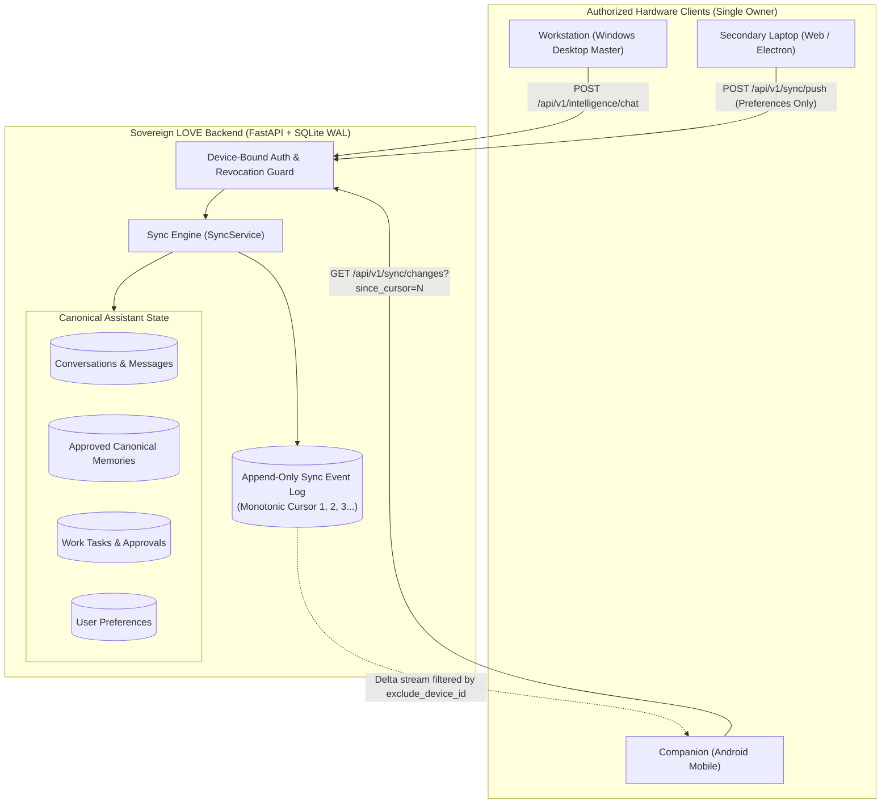

# LOVE Cross-Device State Synchronization & Secure Connectivity Architecture (Phase 09 & 09.5)

## 1. Executive Overview

The LOVE Cross-Device State Synchronization layer provides the architectural foundation allowing LOVE to operate cohesively across multiple authorized hardware clients (such as Windows desktop workstations, secondary laptops, future companion apps, or web clients) through a single, shared, local-first backend.

LOVE is first and foremost a sovereign, self-contained personal AI assistant. Cross-device synchronization is an **opt-in capability**, not a prerequisite for operation. When disabled (the factory default), LOVE operates in zero-overhead **Standalone Desktop Mode**, persisting state exclusively to the local database without remote polling or network synchronization.

When enabled by the assistant owner, LOVE activates an append-only, delta-based event log governed by **monotonically increasing 64-bit sequence cursors**, **origin-based echo suppression**, **strict Push API allowlists**, **deterministic Last-Write-Wins (LWW) conflict resolution for preferences**, and **database-backed server-side revocation enforcement**.



---

## 2. Sovereign Architectural Guarantees & Constraints

1. **Standalone-First Sovereign Architecture:**
   - Factory default is `sync_mode: "standalone"`, `sync_enabled: false`.
   - Standalone mode incurs zero distributed overhead. The desktop workstation operates completely independently, persisting data to local SQLite.
   - The system never calls out to external cloud infrastructure, third-party sync relays, or unvetted hosted endpoints. All communication occurs over user-controlled networks (local LAN, WireGuard, Tailscale, or private TLS tunnels).
   - Local event recording in SQLite continues even while synchronization is disabled, ensuring that if the user subsequently enables multi-device mode, the historical event stream remains unbroken.
2. **Single-Owner Security Model:**
   - LOVE is a dedicated personal assistant, not a multi-tenant corporate platform. Public user registration is permanently sealed after the owner registers during Phase 02.
   - Multiple devices do not represent multiple user accounts; they represent **authorized hardware clients belonging to the same verified owner**.
3. **Zero Data Loss & Immutable Delta Log:**
   - State modifications across conversations, messages, approved memories, tasks, and settings append discrete, immutable `SyncEvent` records.
   - Deleted items append a `deleted` action record; raw deletions do not corrupt client reconciliation.

---

## 3. State Partitioning: Synchronized vs. Local-Only

To prevent distributed thrashing and preserve device sovereignty, LOVE rigorously partitions state:

| Subsystem / Data Domain | Sync Classification | Justification & Storage Mechanism |
| :--- | :--- | :--- |
| **Conversations & Chat Threads** | **Synchronized** | User conversations, human prompts, and assistant streaming responses persist canonically and replicate across all authorized devices. |
| **Messages & Responses** | **Synchronized** | Message text, token counts, latency metrics, and role attributes replicate via delta logs. |
| **Approved Canonical Memory** | **Synchronized** | Long-term personal memories, user preferences, project facts, and world knowledge explicitly approved by the user replicate globally. |
| **Pending Memory Suggestions** | **Local / Host Only** | Unapproved candidate memory proposals remain local until the user explicitly grants consent. **Never enter canonical sync stream.** |
| **Work Tasks & Step Plans** | **Synchronized** | Work tasks, structured execution plans, task status, and execution outputs replicate to allow task review from any screen. |
| **Action Approvals (HITL)** | **Synchronized** | Pending tool approval requests replicate so high-risk tool operations can be inspected and approved/rejected from a companion device. |
| **Host Hardware Telemetry** | **Local Only** | CPU utilization, RAM usage, NVIDIA GTX 1650 4GB VRAM usage, and GPU temperatures belong strictly to the host workstation hardware. |
| **Local Model Sockets & Ollama** | **Local Only** | Local model daemons (Ollama localhost:11434, Whisper sockets) are host-specific and not synchronized. |
| **Ephemeral Raw Audio & VAD** | **Local Only** | Ephemeral voice buffers, microphone feeds, and Web Audio streams are processed in RAM on the local client and discarded. |
| **Hardware Encryption Vaults** | **Local Only** | Refresh tokens and encryption keys are hardware-bound using platform-native vaults (Windows DPAPI, Android Keystore, macOS Keychain). Tokens are never synchronized over the wire. |

---

## 4. Push API Security & Strict Allowlists

The `POST /api/v1/sync/push` endpoint allows secondary clients to synchronize offline or client-originated state changes. To protect the assistant from malicious injections, forged events, or privilege escalations, the endpoint enforces a strict multi-layer allowlist:

### 4.1 Client-Pushable Entity Allowlist
- **Allowed Entity Types:** ONLY `"preference"`.
- **Prohibited Entity Types (Strictly Blocked with HTTP 400):**
  - `"task"`: Work tasks cannot be forged via sync push; must use `/api/v1/work/tasks`.
  - `"action_approval"`: High-risk Human-in-the-Loop approvals **cannot** be forged via sync push; must use the dedicated `/api/v1/work/approvals/{id}` endpoint.
  - `"memory"`: Canonical memories **cannot** be injected via sync push without existing consent rules; must use `/api/v1/memory`.
  - `"message"` & `"conversation"`: Cannot forge conversation turns from another client; must use `/api/v1/intelligence/chat`.
  - `"user"` & `"device"`: Device credentials and user roles cannot be modified via sync push.

### 4.2 Preference Key Allowlist
For `entity_type == "preference"`, only explicitly supported keys are permitted:
- `mobile_haptic_feedback`
- `theme`
- `notifications_enabled`
- `sound_volume`
- `audio_preferences`
- `client_preferences`
- `ui_preferences`

Any unlisted preference key is rejected with HTTP 400 Bad Request (`"Preference key '{key}' is not in the client-pushable allowlist"`).

### 4.3 Forbidden Server-Authoritative Fields
Payloads cannot contain server-generated or privileged fields:
`{"cursor", "event_id", "user_id", "created_at", "origin_device_id", "is_owner", "is_revoked", "role", "password", "token"}`.
Attempting to push any forbidden field immediately results in HTTP 400 Bad Request.

### 4.4 Origin Device Identity Binding
The `origin_device_id` is extracted strictly from the authenticated JWT session claims on the server. Clients cannot spoof another hardware device's identity. If the token is not bound to an active registered device, push operations are rejected with HTTP 403 Forbidden.

---

## 5. Conflict Resolution Model

LOVE rejects indiscriminate Last-Write-Wins (LWW) across all subsystems. Instead, each data domain operates under its authoritative conflict policy:

| Data Domain | Conflict Policy | Resolution Semantics |
| :--- | :--- | :--- |
| **Conversations & Messages** | **Append-Only Immutable Turns** | Messages are never overwritten by LWW. Each message turn is assigned a unique UUIDv4 and recorded sequentially. Concurrent messages from different devices form an interleaved thread. |
| **Approved Memories** | **Explicit Consent & Audit Log** | Memories require explicit owner consent. They cannot be overwritten or injected via generic synchronization push. Any update creates an audit trail in `memory_audit_logs`. |
| **Work Tasks & Approvals** | **Deterministic State Machine** | Tasks transition strictly through valid states (`pending` -> `in_progress` -> `awaiting_approval` -> `completed` / `failed`). Action approvals must be submitted to the HITL endpoint with cryptographic role validation. |
| **Client Preferences** | **Server-Authoritative LWW** | Supported preferences resolve collisions via Last-Write-Wins sequenced by the server's database commit order. The transaction that commits second receives the higher sequence cursor and becomes the canonical active setting. |

---

## 6. Monotonic Cursor & Pagination Integrity

### 6.1 Database Schema & Migration Revision
- **Alembic Revision:** `a30798731d0a_create_cross_device_sync_tables.py` (down-revision `322b6c8a37b0`).
- **Tables Created:**
  - `sync_events`: 64-bit autoincrement `cursor` PK, unique `event_id`, `user_id` FK (CASCADE), `entity_type`, `entity_id`, `action`, `origin_device_id`, `payload_json`, `created_at`. Composite index `ix_sync_events_user_cursor` on `(user_id, cursor)`.
  - `user_sync_settings`: `user_id` PK FK (CASCADE), `sync_enabled`, `sync_mode`, `auto_sync_interval_seconds`, `conflict_resolution`, `updated_at`.
  - `device_sync_cursors`: `id` PK, `device_id` FK (CASCADE), `user_id` FK (CASCADE), `last_acknowledged_cursor`, `last_synced_at`. Unique constraint `uq_device_sync_cursors_dev_user` on `(device_id, user_id)`.

### 6.2 Sequence Guarantees & Boundary Validation
1. **Monotonic Sequence Ordering:** In SQLite, an `INTEGER PRIMARY KEY AUTOINCREMENT` behaves as an append-only 64-bit monotonically increasing sequence rowid.
2. **Negative Cursor Rejection:** Acknowledging `cursor < 0` is rejected with HTTP 400 / 422.
3. **Future Cursor Prevention:** Clients cannot acknowledge a cursor greater than the highest event recorded on the server (`cursor > latest_cursor`). Rejected with HTTP 400 Bad Request.
4. **Cursor Rollback Prevention:** A device cannot roll back its watermark (`cursor < dev_cursor.last_acknowledged_cursor`). Rejected with HTTP 400 Bad Request.
5. **Repeated Acknowledgement Idempotence:** Submitting the same cursor multiple times is idempotent and safely updates `last_synced_at`.
6. **No Gap Echo Suppression:** When querying `/api/v1/sync/changes?exclude_device_id=X`, events originating from Device X are filtered at the SQL layer without creating skipped index gaps or blocking subsequent events from other devices.

---

## 7. Device Security & Revocation Enforcement

### 7.1 Database-Backed Server-Side Revocation Enforcement
LOVE implements **database-backed server-side revocation enforcement** rather than relying on loose JWT expiry windows:
1. Every authenticated API request passes through `get_current_user` in `backend/app/authentication/dependencies.py`.
2. The dependency extracts `device_id` from the JWT claims and performs a real-time query against the `Device` table:
   ```python
   dev_stmt = select(Device).where(Device.id == device_id, Device.user_id == user.id)
   device = (await db.execute(dev_stmt)).scalar_one_or_none()
   if not device or device.is_revoked:
       raise HTTPException(
           status_code=status.HTTP_401_UNAUTHORIZED,
           detail="Device authorization has been revoked.",
       )
   ```
3. When an owner revokes a hardware device via `DELETE /api/v1/devices/{id}` or `POST /api/v1/devices/{id}/revoke`, the device is **instantly rejected on its very next network request with HTTP 401 Unauthorized**.
4. Revoked devices cannot fetch status, pull changes, acknowledge cursors, or push state.

### 7.2 Anti-Spoofing Protections
- In `POST /api/v1/sync/acknowledge`: If the request body specifies a `device_id` that does not match the authenticated session's token claims, the request is rejected with HTTP 403 Forbidden (`"Device ID mismatch: cannot acknowledge cursor on behalf of another device"`).
- In `GET /api/v1/sync/changes`: If `exclude_device_id` references a device not owned by the authenticated user, the request is rejected with HTTP 403 Forbidden.

---

## 8. Desktop Client & Dashboard Status Honesty

### 8.1 Workstation Architectural Role Disclosure
The Electron desktop workstation is the **primary canonical master** communicating directly with the local FastAPI backend and SQLite database. 

To maintain strict truth-in-advertising:
- The desktop UI **never displays "Fully Synchronized"** merely because Multi-Device Mode is toggled on.
- The desktop client does not run an unneeded background delta-polling worker because it reads directly from the canonical backend.
- The Preferences & System Settings modal features an explicit **Workstation Architectural Posture** disclosure banner:
  > *"This desktop client connects directly to the canonical local backend. Background delta-sync workers and push synchronization are implemented for secondary/companion clients (such as companion mobile apps). The desktop workstation remains the primary canonical host."*
- The Command Dashboard `SecurityDeviceCard` displays:
  - In Standalone Mode: `Standalone (Local SQLite)`
  - In Multi-Device Mode: `Multi-Device Backend (#${cursor})`

---

## 9. Offline State Boundaries & Limitations

1. **Server-Authoritative Canonical Store:** The local FastAPI backend is the sole source of truth for conversations, messages, memories, and tasks.
2. **Offline Draft Isolation:** Text typed into a client composer while disconnected remains strictly local in client RAM or local storage. Uncommitted drafts **never** enter the server sync event stream until explicitly submitted by the user.
3. **No Fabricated Offline Replication:** Full bidirectional offline database replication requires an independent client database engine (e.g. SQLite/Room on Android or IndexedDB in browser). Future companion clients in Phase 10 will manage their own local cache and sync deltas using the endpoints verified in Phase 09.5.

---

## 10. Comprehensive Verification & Test Metrics

### 10.1 Backend Pytest Regression Suite
- **Total Backend Tests:** **201 / 201 passed** across 19 test modules in 63.80s (**0 regressions**).
- **Core Sync Tests (`tests/test_sync_api.py`):** 9/9 passed.
- **Audit & Integrity Tests (`tests/test_sync_integrity.py`):** 11/11 passed covering:
  - Push API strict entity and field allowlisting.
  - Forbidden field injection prevention.
  - Device spoofing prevention.
  - Foreign device exclusion prevention.
  - Database-backed server-side revocation on all sync endpoints.
  - Boundary conditions and rollback rejection.
  - Monotonic pagination without skipping.
  - Deterministic LWW resolution on preferences.
  - Push retry idempotency.
  - Standalone vs Multi-device mode persistence.

### 10.2 Desktop Vitest Suite & Production Build
- **Vitest Suite:** **30 / 30 passed** across 10 test suites in 3.46s.
- **TypeScript Typecheck:** Clean (`tsc` exited 0).
- **Vite Production Build:** Compiled cleanly in 1.01s (`dist/index.html` 0.55 kB, CSS 34.98 kB, JS 381.25 kB).

### 10.3 Live Multi-Client Verification (`scripts/verify_phase09_sync_twoclient.py`)
14-step live execution simulating Device A (Windows Workstation) and Device B (Android Mobile):
- State generation (conversation, Ollama streaming turn, memory, task execution).
- Delta retrieval, exact payload verification, cursor acknowledgement.
- Echo suppression verification.
- Push state propagation.
- Immediate 401 revocation enforcement.

### 10.4 Restart, Offline & Reconnect Verification (`scripts/verify_phase09_restart_offline.py`)
8 runtime scenarios passed:
1. Event persistence before/after cold restart (Cursor #24 intact).
2. Missed event retrieval after cold restart.
3. Cursor acknowledgement persistence across restarts (0 pending events).
4. 5 repeated pull requests executed (zero duplicates).
5. Expired token rejection (401 Unauthorized).
6. Non-replay of destructive actions (404 on replay).
7. Revoked client reconnection prevention (401 Unauthorized).
8. Zero uncommitted drafts in event stream.

### 10.5 Visual Verification Artifacts
- `desktop/sync_screenshot.png` (145 kB): Live Electron capture showing the Cross-Device Sync Settings UI with the Workstation Architectural Posture banner, sequence cursor #36, and authorized client list.
- `desktop/dashboard_screenshot.png` (135 kB): Live Electron capture showing the updated Command Dashboard with real-time host hardware metrics and sync posture indicator.
