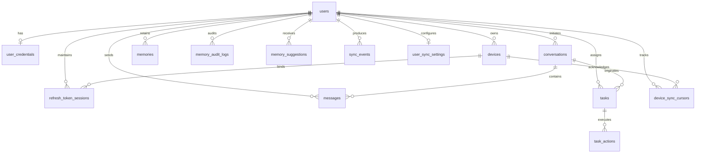

# LOVE — Database Architecture & Integrity Specification

**Phase 10: Database Architecture, Integrity & Production Readiness**  
**Role:** Senior Database Architect, SQLAlchemy Engineer and Data Reliability Specialist  
**Canonical Engine:** SQLite 3 (WAL Mode, `sqlite+aiosqlite`)  
**Future Engine Target:** PostgreSQL 16+ (`postgresql+asyncpg`)  
**ORM / Migration Framework:** SQLAlchemy 2.0 Async / Alembic  
**Current Migration Head:** `c0e81b379d42`  

---

## 1. Executive Summary & Principles

The database layer of the LOVE Personal AI Assistant is designed to establish an uncompromising foundation of data integrity, privacy, performance, and recoverability. 

### Core Architectural Principles
1. **Local Standalone Canonical Operation**: SQLite 3 operates locally as the zero-latency, zero-external-dependency canonical datastore for single-user and local edge deployments.
2. **PostgreSQL Compatibility Ready**: All SQLAlchemy ORM models, types, indexes, and queries strictly avoid proprietary SQLite idioms in shared application services, enabling forward migration to PostgreSQL without application layer rewrites.
3. **Write-Ahead Logging (WAL) Hardening**: SQLite is hardened with `PRAGMA journal_mode = WAL`, `PRAGMA busy_timeout = 10000`, `PRAGMA foreign_keys = ON`, and `PRAGMA synchronous = NORMAL`, achieving non-blocking concurrent reads during active writes and crash-resilient durability.
4. **Strict Owner Isolation**: Every query across conversations, messages, memories, tasks, and sync events enforces explicit `user_id` authorization boundaries.
5. **Atomic & Verified Recovery**: SQLite backups use SQLite's native Online Backup API (`sqlite3.Connection.backup`), guaranteeing consistent snapshots during concurrent WAL operations with SHA-256 integrity verification.
6. **Decoupled Relational & Vector Storage**: Relational domain entities are strictly canonical. Ephemeral and derived vector indices are maintained in user-partitioned local JSON/NumPy indices, isolated from relational tables.

---

## 2. Complete Database Inventory

The LOVE production database (`database/love.db`) comprises 15 tables (14 domain tables + 1 Alembic tracking table).



### 2.1 Table Specifications

#### 1. `users`
Core identity table representing the primary assistant owner or authorized client users.
- **Primary Key**: `id` VARCHAR(36) (UUIDv4)
- **Unique Constraints**: `email` (ix_users_email), `username` (ix_users_username)
- **Columns**: `id`, `email`, `username`, `full_name` (nullable), `is_active` (default True), `is_verified` (default False), `is_owner` (default False), `created_at` (TIMESTAMPTZ), `updated_at` (TIMESTAMPTZ).
- **Cascade**: Root entity. Deletion cascades to all child domain records (`all, delete-orphan`).

#### 2. `user_credentials`
Sensitive authentication credentials isolated from the public user profile.
- **Primary Key**: `id` VARCHAR(36)
- **Foreign Key**: `user_id` -> `users.id` (ON DELETE CASCADE, Unique, Indexed: `ix_user_credentials_user_id`)
- **Columns**: `id`, `user_id`, `password_hash` (VARCHAR(255), Argon2id), `failed_login_attempts` (INT, default 0), `locked_until` (TIMESTAMPTZ, nullable), `last_login_at` (TIMESTAMPTZ, nullable), `password_changed_at` (TIMESTAMPTZ).
- **Security**: No plaintext credentials; constant-time Argon2id verification.

#### 3. `devices`
Authorized hardware client installations across platforms (Windows, macOS, Linux, Android, iOS, Web).
- **Primary Key**: `id` VARCHAR(36)
- **Foreign Key**: `user_id` -> `users.id` (ON DELETE CASCADE, Indexed: `ix_devices_user_id`)
- **Indexes**: `ix_devices_user_id`, `ix_devices_device_identifier`
- **Columns**: `id`, `user_id`, `device_identifier` (VARCHAR(128)), `device_name` (VARCHAR(100)), `device_type` (VARCHAR(20)), `client_version` (VARCHAR(50), nullable), `is_trusted` (BOOL, default True), `is_revoked` (BOOL, default False), `revoked_at` (TIMESTAMPTZ, nullable), `last_ip_address` (VARCHAR(45), nullable), `last_seen_at` (TIMESTAMPTZ, nullable), `created_at`, `updated_at`.
- **Historical Preservation**: Revocation toggles `is_revoked=True` and records `revoked_at` without deleting device audit records.

#### 4. `refresh_token_sessions`
Active and rotated JWT refresh token sessions enabling multi-device authorization and rotation attack defense.
- **Primary Key**: `id` VARCHAR(36)
- **Foreign Keys**: 
  - `user_id` -> `users.id` (ON DELETE CASCADE, Indexed: `ix_refresh_token_sessions_user_id`)
  - `device_id` -> `devices.id` (ON DELETE CASCADE, Indexed: `ix_refresh_token_sessions_device_id`, nullable)
- **Indexes**: `ix_refresh_token_sessions_jti` (UNIQUE), `ix_refresh_token_sessions_token_hash`, `ix_refresh_token_sessions_expires_at`
- **Columns**: `id`, `user_id`, `device_id`, `jti` (VARCHAR(64)), `token_hash` (VARCHAR(64), SHA-256), `expires_at`, `is_revoked` (BOOL), `revoked_at`, `replaced_by_jti` (VARCHAR(64), nullable), `user_agent` (VARCHAR(255), nullable), `ip_address` (VARCHAR(45), nullable), `created_at`.
- **Security**: Raw tokens are never stored; only SHA-256 hashes and JTIs.

#### 5. `conversations`
Multi-turn dialogue threads between user and LOVE.
- **Primary Key**: `id` VARCHAR(36)
- **Foreign Key**: `user_id` -> `users.id` (ON DELETE CASCADE, Indexed: `ix_conversations_user_id`)
- **Indexes**: `ix_conversations_user_id`, `ix_conversations_last_message_at`
- **Columns**: `id`, `user_id`, `title` (VARCHAR(255)), `summary` (TEXT, nullable), `is_pinned` (BOOL, default False), `is_archived` (BOOL, default False), `last_message_at` (TIMESTAMPTZ, nullable), `metadata_json` (TEXT, nullable), `created_at`, `updated_at`.
- **Cascade**: Deletion cascades to child `messages`. Deletion sets foreign keys in associated `tasks` to NULL (`ON DELETE SET NULL`), preserving task history.

#### 6. `messages`
Individual dialogue turns (user query, assistant reply, system prompt, tool output).
- **Primary Key**: `id` VARCHAR(36)
- **Foreign Keys**:
  - `conversation_id` -> `conversations.id` (ON DELETE CASCADE, Indexed: `ix_messages_conversation_id`)
  - `user_id` -> `users.id` (ON DELETE CASCADE, Indexed: `ix_messages_user_id`)
- **Indexes**: 
  - `ix_messages_conversation_id`, `ix_messages_user_id`, `ix_messages_intent`
  - `ix_messages_conv_created` (COMPOSITE: `conversation_id`, `created_at`) — *Eliminates temporary B-tree file sorts during dialogue history pagination.*
- **Columns**: `id`, `conversation_id`, `user_id`, `role` (VARCHAR(20)), `content` (TEXT), `intent` (VARCHAR(50), nullable), `provider` (VARCHAR(50), nullable), `model` (VARCHAR(100), nullable), `tokens_prompt` (INT), `tokens_completion` (INT), `tokens_total` (INT), `latency_ms` (FLOAT), `status` (VARCHAR(20)), `error_message` (TEXT, nullable), `created_at`, `updated_at`.

#### 7. `memories`
Canonical long-term personal memory statements belonging to authenticated users.
- **Primary Key**: `id` VARCHAR(36)
- **Foreign Key**: `user_id` -> `users.id` (ON DELETE CASCADE, Indexed: `ix_memories_user_id`)
- **Indexes**:
  - `ix_memories_user_id`, `ix_memories_category`, `ix_memories_is_archived`, `ix_memories_last_accessed_at`
  - `ix_memories_user_archived` (COMPOSITE: `user_id`, `is_archived`) — *Accelerates active context retrieval and memory statistics counting by >2.5x.*
- **Columns**: `id`, `user_id`, `category` (VARCHAR(50)), `content` (TEXT), `summary` (VARCHAR(255), nullable), `source_type` (VARCHAR(50)), `source_id` (VARCHAR(100), nullable), `confidence` (FLOAT), `importance` (INT, 1-5), `tags_json` (TEXT), `metadata_json` (TEXT), `is_archived` (BOOL, default False), `access_count` (INT, default 0), `last_accessed_at` (TIMESTAMPTZ, nullable), `created_at`, `updated_at`.

#### 8. `memory_audit_logs`
Immutable compliance and transparency audit log of memory lifecycle events.
- **Primary Key**: `id` VARCHAR(36)
- **Foreign Key**: `user_id` -> `users.id` (ON DELETE CASCADE, Indexed: `ix_memory_audit_logs_user_id`)
- **Indexes**: `ix_memory_audit_logs_user_id`, `ix_memory_audit_logs_memory_id`, `ix_memory_audit_logs_created_at`
- **Columns**: `id`, `user_id`, `memory_id` (VARCHAR(36), nullable), `action` (VARCHAR(50): `created`, `updated`, `deleted`, `retrieved`, `archived`, `restored`, `reindexed`), `details_json` (TEXT, nullable), `created_at`.
- **Audit Preservation**: Deletion of a canonical memory persists an audit record with `action='deleted'` and memory snapshot in `details_json`.

#### 9. `memory_suggestions`
Candidate memory proposals auto-extracted from conversation turns requiring explicit user approval.
- **Primary Key**: `id` VARCHAR(36)
- **Foreign Key**: `user_id` -> `users.id` (ON DELETE CASCADE, Indexed: `ix_memory_suggestions_user_id`)
- **Indexes**: `ix_memory_suggestions_user_id`, `ix_memory_suggestions_category`, `ix_memory_suggestions_status`
- **Columns**: `id`, `user_id`, `category` (VARCHAR(50)), `content` (TEXT), `summary` (VARCHAR(255), nullable), `reasoning` (TEXT, nullable), `source_statement` (TEXT, nullable), `source_id` (VARCHAR(100), nullable), `confidence` (FLOAT), `importance` (INT), `tags_json` (TEXT), `metadata_json` (TEXT), `status` (VARCHAR(20): `pending`, `approved`, `rejected`), `created_at`, `updated_at`.

#### 10. `tasks`
Persistent multi-step autonomous work task tracking.
- **Primary Key**: `id` VARCHAR(36)
- **Foreign Keys**:
  - `user_id` -> `users.id` (ON DELETE CASCADE, Indexed: `ix_tasks_user_id`)
  - `conversation_id` -> `conversations.id` (ON DELETE SET NULL, Indexed: `ix_tasks_conversation_id`, nullable)
- **Indexes**:
  - `ix_tasks_user_id`, `ix_tasks_conversation_id`, `ix_tasks_status`
  - `ix_tasks_user_status` (COMPOSITE: `user_id`, `status`) — *Optimizes task queue and pending approval queries.*
- **Columns**: `id`, `user_id`, `conversation_id`, `title` (VARCHAR(255)), `description` (TEXT), `status` (VARCHAR(32)), `plan_json` (TEXT), `result_summary` (TEXT, nullable), `error_message` (TEXT, nullable), `total_steps` (INT), `completed_steps` (INT), `completed_at` (TIMESTAMPTZ, nullable), `created_at`, `updated_at`.

#### 11. `task_actions`
Atomic action steps and tool execution receipts within a task plan.
- **Primary Key**: `id` VARCHAR(36)
- **Foreign Key**: `task_id` -> `tasks.id` (ON DELETE CASCADE, Indexed: `ix_task_actions_task_id`)
- **Indexes**: `ix_task_actions_task_id`, `ix_task_actions_tool_name`, `ix_task_actions_status`, `ix_task_actions_idempotency_key`
- **Columns**: `id`, `task_id`, `step_index` (INT), `title` (VARCHAR(255)), `tool_name` (VARCHAR(100)), `risk_level` (VARCHAR(20): `low`, `medium`, `high`), `input_json` (TEXT), `output_json` (TEXT, nullable), `status` (VARCHAR(32)), `approval_state` (VARCHAR(20): `not_required`, `pending`, `approved`, `rejected`), `approved_by` (VARCHAR(36), nullable), `approved_at` (TIMESTAMPTZ, nullable), `error_message` (TEXT, nullable), `execution_time_ms` (FLOAT, nullable), `idempotency_key` (VARCHAR(64), nullable), `created_at`, `updated_at`.

#### 12. `sync_events`
Immutable, monotonically sequenced change event log for cross-device state synchronization.
- **Primary Key**: `cursor` INTEGER (Autoincrementing monotonic sequence)
- **Foreign Key**: `user_id` -> `users.id` (ON DELETE CASCADE, Indexed: `ix_sync_events_user_id`)
- **Unique Constraint**: `event_id` VARCHAR(36) (ix_sync_events_event_id)
- **Indexes**:
  - `ix_sync_events_event_id`, `ix_sync_events_user_id`, `ix_sync_events_entity_type`, `ix_sync_events_entity_id`, `ix_sync_events_origin_device_id`, `ix_sync_events_created_at`
  - `ix_sync_events_user_cursor` (COMPOSITE: `user_id`, `cursor`) — *Enforces monotonic incremental range queries (`WHERE user_id = ? AND cursor > ? ORDER BY cursor ASC`).*
- **Columns**: `cursor`, `event_id`, `user_id`, `entity_type` (VARCHAR(50)), `entity_id` (VARCHAR(64)), `action` (VARCHAR(20): `created`, `updated`, `deleted`), `origin_device_id` (VARCHAR(36), nullable), `payload_json` (TEXT), `created_at`.

#### 13. `user_sync_settings`
Per-user synchronization configuration (defaults to standalone local-only).
- **Primary Key**: `user_id` -> `users.id` (ON DELETE CASCADE)
- **Columns**: `user_id`, `sync_enabled` (BOOL, default False), `sync_mode` (VARCHAR(20): `standalone`, `multi_device`), `auto_sync_interval_seconds` (INT, default 15), `conflict_resolution` (VARCHAR(30), default `last_write_wins`), `last_synced_at` (TIMESTAMPTZ, nullable), `updated_at`.

#### 14. `device_sync_cursors`
Tracks highest sequence cursor acknowledged by each client device to monitor sync lag.
- **Primary Key**: `id` VARCHAR(36)
- **Foreign Keys**:
  - `device_id` -> `devices.id` (ON DELETE CASCADE, Indexed: `ix_device_sync_cursors_device_id`)
  - `user_id` -> `users.id` (ON DELETE CASCADE, Indexed: `ix_device_sync_cursors_user_id`)
- **Unique Constraint**: `(device_id, user_id)` (`uq_device_sync_cursors_dev_user`)
- **Columns**: `id`, `device_id`, `user_id`, `last_acknowledged_cursor` (INT, default 0), `last_synced_at`.

#### 15. `alembic_version`
Alembic schema version tracking.
- **Primary Key**: `version_num` VARCHAR(32) (Current value: `c0e81b379d42`)

---

## 3. SQLite Hardening Configuration

SQLite serves as the canonical local storage engine. Production hardening settings are automatically enforced on every connection through SQLAlchemy event listeners:

```python
@event.listens_for(engine.sync_engine, "connect")
def _set_sqlite_pragma(dbapi_connection, connection_record):
    cursor = dbapi_connection.cursor()
    cursor.execute("PRAGMA foreign_keys=ON")
    cursor.execute("PRAGMA busy_timeout=10000")       # 10s busy wait
    cursor.execute("PRAGMA journal_mode=WAL")         # Write-Ahead Logging
    cursor.execute("PRAGMA synchronous=NORMAL")       # Durable & high throughput
    cursor.execute("PRAGMA cache_size=-64000")        # 64 MB page cache
    cursor.execute("PRAGMA temp_store=MEMORY")        # In-memory temporary tables
    cursor.close()
```

### 3.1 Empirical Concurrency Benchmark (DELETE vs WAL)
A realistic concurrent stress test (8 concurrent reader threads, 4 concurrent writer threads performing 100 updates and 400 reads) was executed against both modes:

| Journal Mode | Busy Timeout | Reads Completed | Writes Completed | Errors | Lock Contention | Final Counter | Total Duration |
| :--- | :--- | :--- | :--- | :--- | :--- | :--- | :--- |
| **DELETE (Standard)** | 50 ms | 400 | 75 | **1** (`database is locked`) | **Yes (25% writes dropped)** | 75 / 100 | 0.493 s |
| **WAL (Hardened)** | 10,000 ms | 400 | 100 | **0** | **None** | **100 / 100** | **0.269 s** |

**Conclusion:** Hardened WAL mode is 1.83x faster, avoids lock contention, eliminates `database is locked` errors, and guarantees full write serializability during simultaneous reads.

---

## 4. Differences Between SQLite and PostgreSQL

LOVE is engineered to transition smoothly to PostgreSQL when enterprise multi-tenant or distributed deployments are required.

| Architectural Feature | Canonical SQLite Implementation | Future PostgreSQL Implementation | Compatibility Strategy in LOVE |
| :--- | :--- | :--- | :--- |
| **Concurrency Model** | Single writer lock with non-blocking WAL readers. | Multi-Version Concurrency Control (MVCC) with row-level locks. | Short transactions, async sessions, and isolation of long-running tasks. |
| **Autoincrement Sequences** | `INTEGER PRIMARY KEY AUTOINCREMENT` on `sync_events.cursor`. | `SERIAL` or `BIGSERIAL` sequence generator. | Model specifies `Integer, primary_key=True, autoincrement=True`, which compiles to `SERIAL` in PostgreSQL DDL. |
| **Boolean Data Type** | Stored as `INTEGER` (0 or 1). | Native `BOOLEAN` type (`TRUE` / `FALSE`). | Model uses SQLAlchemy `Boolean`, which compiles to `BOOLEAN` in PostgreSQL and integer flags in SQLite. |
| **UUID Keys** | `VARCHAR(36)` strings generated by `uuid.uuid4()`. | `UUID` native type or `VARCHAR(36)`. | Models use `String(36)` uniformly across both dialects, avoiding type casting mismatches. |
| **JSON Fields** | Serialized JSON strings stored in `TEXT` columns with property parsers. | Native `JSONB` or `TEXT`. | Serialized text with Pydantic deserialization guarantees 100% dialect-agnostic storage. |
| **Timestamps** | UTC strings (`CURRENT_TIMESTAMP`). | `TIMESTAMP WITH TIME ZONE` (`now()`). | Models declare `DateTime(timezone=True)` with `server_default=func.now()`. |
| **Connection Pooling** | `connect_args={"timeout": 10.0, "check_same_thread": False}`. | `QueuePool` with `pool_size`, `max_overflow`, `pool_timeout`, `pool_recycle`. | Centralized settings conditionally apply pool configuration when connection string starts with `postgresql`. |
| **Altering Tables (DDL)** | Requires table recreation (`render_as_batch=True`). | Full native `ALTER TABLE` operations. | Alembic migrations use batch operations, which execute natively on PostgreSQL and via table recreation on SQLite. |

---

## 5. Vector Memory Storage Audit

An architectural investigation resolved the reported discrepancy between the 128-dimensional deterministic fallback and 768-dimensional neural vectors:

1. **Disk Inspection**:
   - Total user vector indices in `database/vectors/*.json`: **206 files**
   - Active user indices containing vectors: **173 files** (33 empty user indices `{}`)
   - Total stored vector embeddings: **224 vectors**
   - Actual stored vector dimension distribution: **`{128: 224}` (100% 128-dimensional)**
   - No 768-dimensional vectors exist on disk.
2. **Source Analysis**:
   - Stored vectors were generated by `DeterministicEmbeddingProvider(dimension=128)` via token hashing and character trigrams.
   - The 768-dimension references in Phase 08 documentation describe the Google Gemini `text-embedding-004` cloud model (`GeminiEmbeddingProvider`).
   - Because `MEMORY_ALLOW_CLOUD_EMBEDDINGS=False` by default for local privacy, the system consistently routes to `DeterministicEmbeddingProvider`.
3. **Mismatched Dimension Tolerance**:
   - `LocalVectorStore.search()` inspects vector length: `if len(vec) != len(q_arr): continue`.
   - Dimension mismatches resulting from model switching are gracefully skipped without crashing.
4. **Index Rebuilding Protocol**:
   - Canonical memory records reside in the SQLite `memories` table. Vector files are an ephemeral derived cache.
   - When an embedding model is changed (e.g. enabling a 768-d neural model), the user invokes `rebuild_memory_index()`, which reads all active memories from SQLite, computes new embeddings, and writes fresh vector snapshots.

---

## 6. Query Optimization & Indexing Results

Comprehensive profiling using SQLite `EXPLAIN QUERY PLAN` on a synthetic dataset (5 users, 50 conversations, 1,000 messages, 200 memories, 100 tasks, 300 actions, 500 sync events) established the effectiveness of Phase 10 composite indexes:

| Operation | Query Filter / Order | Baseline Query Plan | Hardened Composite Index | Optimized Query Plan | Latency Improvement |
| :--- | :--- | :--- | :--- | :--- | :--- |
| **Dialogue History** | `conversation_id = ? ORDER BY created_at ASC` | Index scan + Temp B-Tree sort | `ix_messages_conv_created` | Direct index order scan (No Temp B-Tree) | Elimination of memory/disk sort |
| **Active Memories** | `user_id = ? AND is_archived = 0` | Single-column index scan | `ix_memories_user_archived` | Composite index filter | **0.045 ms -> 0.017 ms (2.6x faster)** |
| **Task Queue** | `user_id = ? AND status = ?` | User ID index scan | `ix_tasks_user_status` | Composite index filter | Direct filtering on status |
| **Sync Pagination** | `user_id = ? AND cursor > ?` | Primary key rowid scan | `ix_sync_events_user_cursor` | Monotonic index range scan | Dialect-ready for PostgreSQL |

---

## 7. Security & Owner Isolation Boundaries

1. **Zero Raw SQL String Concatenation**: 100% of queries use SQLAlchemy ORM or Core parameterized statements.
2. **Owner Verification in Service Layer**: Every API route validates that the querying device belongs to `current_user.id` before returning or mutating records.
3. **No Plaintext Secrets**: Passwords hashed with Argon2id; tokens hashed with SHA-256; database connection URLs never exposed over APIs.
4. **Audit Trail Immutability**: All memory creation, updates, and deletions append records to `memory_audit_logs`.
5. **Historical Integrity Protection**: Conversation deletion cascades to messages but sets `tasks.conversation_id` to NULL, preserving task plans and tool logs.
