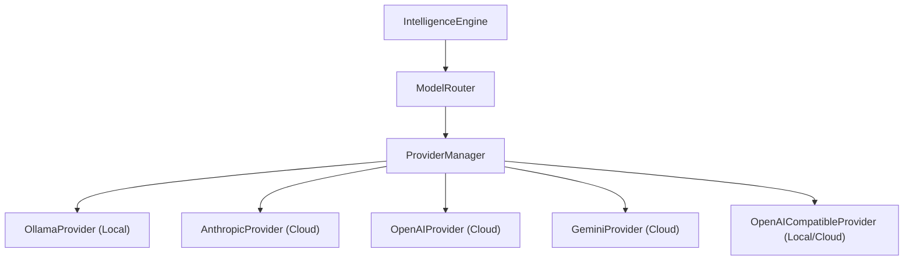
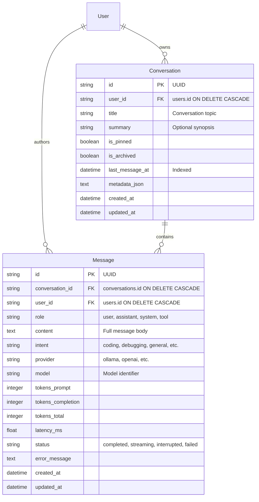

# Universal Intelligence Layer & Model Routing (Phase 03)

## 1. Overview & Architectural Philosophy

The **Universal Intelligence Layer (UIL)** is the cognitive core of the **LOVE** personal AI assistant ecosystem. It provides a unified, general-purpose cognitive pipeline that understands natural language, classifies user intent, prepares conversational context, routes requests to the optimal AI model (local or cloud), and delivers synchronous or streaming responses.

LOVE operates as **one coherent, intelligent entity**. Users interact through a single conversational interface without needing to manually categorize their requests into predefined buckets (e.g. "coding bot", "writing bot", "math bot").

---

## 2. Core Architecture & Responsibilities

The subsystem is modularly partitioned under `backend/app/intelligence/`:

```
backend/app/intelligence/
  ├── identity.py             # System identity, persona (Indian English, calm/confident), guidelines
  ├── intent.py               # Deterministic, multi-category natural language intent classifier
  ├── model_registry.py       # Catalog of known model profiles, capabilities, and 4GB VRAM ratings
  ├── model_router.py         # Configurable multi-criteria model selection engine
  ├── provider_manager.py     # Provider lifecycle, live health checks, and model discovery
  ├── context.py              # Context window assembly, token budgeting, and system prompt formatting
  ├── conversation.py         # Persistent CRUD management for conversations and messages
  ├── streaming.py            # SSE chunk transport, lifecycle tracking, and interrupted state handling
  ├── response.py             # Response normalization, latency measurement, and token tracking
  ├── engine.py               # Primary subsystem facade and entry point
  ├── exceptions.py           # Normalized domain-specific exceptions
  ├── schemas.py              # Pydantic data models and API schemas
  └── providers/              # Provider adapters
      ├── base.py             # Abstract BaseModelProvider contract
      ├── ollama.py           # Local inference via Ollama REST API
      ├── openai.py           # OpenAI official API adapter
      ├── anthropic.py        # Anthropic Messages API adapter
      ├── gemini.py           # Google Gemini REST & SSE adapter
      └── openai_compatible.py # Generic adapter for LM Studio, LocalAI, vLLM, Groq
```

---

## 3. Natural Language Intent Recognition

The `IntentClassifier` evaluates user prompts using syntax analysis, regex patterns, and heuristic indicators to categorize requests into one of 9 domain intents:

1. **`CODING`**: Code implementation, algorithms, syntax queries, refactoring, type definitions.
2. **`DEBUGGING`**: Stack traces, compiler/runtime errors, troubleshooting, regression diagnosis.
3. **`REASONING`**: Logical dilemmas, trade-off comparisons, architectural evaluations.
4. **`RESEARCH`**: Conceptual overviews, deep dives, state-of-the-art syntheses.
5. **`WRITING`**: Professional emails, letters, documentation, proofreading, style editing.
6. **`CREATIVE`**: Brainstorming, ideation, storylines, conceptual metaphors.
7. **`PRODUCTIVITY`**: Action checklists, daily briefings, agenda planning, prioritization.
8. **`MATHEMATICAL`**: Formulas, calculus, algebra, algorithmic formulations.
9. **`GENERAL`**: Conversational pleasantries, multi-turn dialogue, open questions.

The classifier automatically adjusts generation parameters (e.g., lower temperature of `0.2` for debugging and math; higher temperature of `0.85` for creative ideation).

---

## 4. Multi-Provider Architecture

LOVE does not depend on a single proprietary vendor. It abstracts model runtimes behind the `BaseModelProvider` interface:



### Provider Matrix

| Provider | Type | Transport | Default Endpoint | Availability Check |
| :--- | :---: | :---: | :--- | :--- |
| **Ollama** | Local | HTTP REST / SSE | `http://127.0.0.1:11434` | `GET /api/version` |
| **Anthropic** | Cloud | HTTP Messages / SSE | `https://api.anthropic.com/v1` | `POST /messages` (probe) |
| **OpenAI** | Cloud | HTTP / SSE | `https://api.openai.com/v1` | `GET /models` |
| **Google Gemini** | Cloud | HTTP / SSE | `https://generativelanguage.googleapis.com/v1beta` | `GET /models` |
| **OpenAI-Compatible** | Any | HTTP / SSE | Configurable | `GET /models` |

A provider remains disabled until its endpoint and credentials are provided. Unconfigured or offline providers never crash the application.

---

## 5. Model Routing Engine & Hardware Awareness

The development machine features an **NVIDIA GeForce GTX 1650 (4GB VRAM)**. The routing engine accounts for this hardware profile:

- **Local Model Sizing:** Prioritizes lightweight models (`llama3.2:3b`, `llama3.2:1b`, `qwen2.5-coder:1.5b`) that fit entirely within 4GB VRAM for zero-latency local execution.
- **No Automatic Downloads:** Models are never downloaded automatically without explicit operator consent.
- **Resource Delegation:** Local process lifecycle is managed by Ollama.

### Configurable Routing Policies (`ROUTING_PREFERENCE`):

- **`auto` (Default):** Evaluates query complexity and capabilities. Simple or general questions route to local models. Complex coding, reasoning, or deep research tasks route to capable cloud models if configured.
- **`local_first`:** Always prefers local models if Ollama is running. Falls back to cloud models only when local is offline.
- **`cloud_first`:** Prefers frontier cloud models (Claude, GPT, Gemini). Falls back to local if cloud endpoints fail.
- **`local_only`:** Strict privacy mode. Cloud routing is strictly prohibited; if local inference is unavailable, an error is returned immediately (`LocalOnlyViolationError`).

---

## 6. Database Schema: Conversations & Messages

Conversations and turns are persisted in SQLite (`database/love.db`) with Alembic migration `b272d69a2753`:



---

## 7. Streaming Response Protocol (SSE)

Real-time token streaming is exposed over standard Server-Sent Events (`text/event-stream`):

```http
POST /api/v1/intelligence/chat/stream
Content-Type: application/json
Authorization: Bearer <access_token>

{
  "message": "Explain quicksort in Python."
}
```

Stream payload format:
```text
data: {"conversation_id": "...", "message_id": "...", "delta": "Quick", "is_done": false, "status": "streaming"}

data: {"conversation_id": "...", "message_id": "...", "delta": "sort", "is_done": false, "status": "streaming"}

data: {"conversation_id": "...", "message_id": "...", "delta": "", "is_done": true, "status": "completed"}
```

If the client disconnects or an error occurs mid-stream, the message status is updated to `"interrupted"` or `"failed"`. Incomplete answers are never stored as completed.

---

## 8. API Endpoints Reference

All intelligence endpoints require Bearer token authentication via `get_current_active_user`.

| Method | Endpoint | Description |
| :--- | :--- | :--- |
| `POST` | `/api/v1/intelligence/chat` | Synchronous chat turn with automatic model routing |
| `POST` | `/api/v1/intelligence/chat/stream` | Real-time SSE token streaming |
| `GET` | `/api/v1/intelligence/conversations` | List conversation threads for current user (paginated) |
| `POST` | `/api/v1/intelligence/conversations` | Create a new conversation thread |
| `GET` | `/api/v1/intelligence/conversations/{id}` | Get conversation metadata and full message history |
| `DELETE` | `/api/v1/intelligence/conversations/{id}` | Delete a conversation and cascade-delete its messages |
| `GET` | `/api/v1/intelligence/providers` | Query configuration and live availability for all providers |
| `GET` | `/api/v1/intelligence/models` | List all cataloged and discovered models with capability ratings |
| `GET` | `/api/v1/intelligence/status` | Global intelligence status, hardware profile, and active counts |

---

## 9. Local & Cloud Setup Instructions

### A. Local AI Setup with Ollama

1. Download and install Ollama from [ollama.com](https://ollama.com).
2. Start the Ollama background daemon:
   ```powershell
   ollama serve
   ```
3. Pull a recommended model for the 4GB VRAM GPU:
   ```powershell
   # Ultra-fast general dialogue
   ollama pull llama3.2:3b

   # Specialized code assistant
   ollama pull qwen2.5-coder:1.5b
   ```
4. Verify connectivity:
   ```powershell
   curl http://127.0.0.1:11434/api/tags
   ```

### B. Cloud AI Setup

Add provider API keys to `.env` (never commit keys to version control):

```bash
# OpenAI
OPENAI_API_KEY="sk-..."

# Anthropic Claude
ANTHROPIC_API_KEY="sk-ant-..."

# Google Gemini
GEMINI_API_KEY="AIzaSy..."
```

---

## 10. Automated Testing

Run the test suite:
```powershell
# Run Universal Intelligence unit tests
.\.venv\Scripts\pytest.exe tests/test_intelligence_unit.py -v

# Run Universal Intelligence API tests
.\.venv\Scripts\pytest.exe tests/test_intelligence_api.py -v

# Run entire test suite (all 63 tests)
.\.venv\Scripts\pytest.exe -v
```
