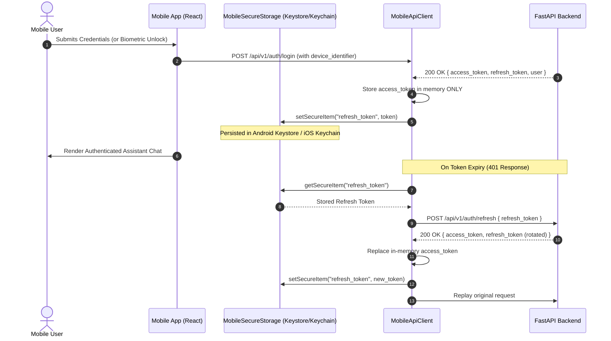

# LOVE Mobile Application Architecture

## 1. Executive Summary & Design Philosophy

The LOVE Mobile Application is the third official client tier in the LOVE personal AI ecosystem, joining the Electron Desktop application and the React Web application. LOVE remains **one unified personal AI assistant** with a single identity, canonical intelligence engine, and sovereign data boundary.

The mobile client is engineered using **Capacitor 6** with **React 19, TypeScript, Vite, and Tailwind CSS**. It communicates directly with LOVE's existing FastAPI backend over standard REST and Server-Sent Events (SSE) interfaces. It does **not** duplicate the backend intelligence engine, replicate local neural inference on low-power mobile silicon, or maintain a secondary disconnected database.

---

## 2. Monorepo & Client Boundary Isolation

The mobile application is strictly isolated in the `mobile/` directory:

```
LOVE/
├── backend/                  # Canonical FastAPI, SQLAlchemy Async, SQLite backend
├── desktop/                  # Electron Desktop application (Phase 1-9)
├── web/                      # React Web application (Phase 11)
├── mobile/                   # Native Mobile application (Phase 12)
│   ├── android/              # Native Android project (Capacitor 6, Gradle 9, AGP 8.8)
│   ├── ios/                  # Native iOS project (Capacitor 6, Xcode project workspace)
│   ├── public/               # Static assets & favicon
│   ├── screenshots/          # Captured mobile viewports (390x844)
│   ├── scripts/              # Build & Electron screenshot automation
│   ├── src/
│   │   ├── components/       # Mobile UI views & responsive components
│   │   ├── context/          # Mobile Auth & Application state contexts
│   │   ├── services/         # Hardware vault, API client, SSE streaming, Voice adapters
│   │   ├── test/             # Vitest & Testing Library mobile test suites
│   │   └── types/            # Strict TypeScript domain interfaces
│   ├── capacitor.config.json # Capacitor runtime configuration
│   ├── package.json          # Dependencies & build scripts
│   ├── tailwind.config.js    # Mobile design system tokens & safe-area utilities
│   └── vite.config.ts        # Vite 8 bundler configuration
└── documentation/            # Architectural & operational specifications
```

---

## 3. Technology Stack & Platform Mapping

| Component | Technology | Rationale |
|---|---|---|
| **Runtime Container** | Capacitor 6 | Provides clean native Android & iOS bridges without monolithic hybrid runtime overhead |
| **UI Framework** | React 19 + TypeScript | Reuses core React architectural patterns while catering to touch-first ergonomic constraints |
| **Bundler & Tooling** | Vite 8 + Vitest | Sub-second HMR and native ESM compilation with jsdom test runners |
| **Styling & Theming** | Tailwind CSS 3.4 | Dark futuristic HUD styling (`#090a0f`) with CSS safe-area-inset padding |
| **Icons** | Lucide React | High-contrast vector icons for mobile tab bars and status indicators |
| **Secure Vault** | `@capacitor/preferences` + Keystore/Keychain | Hardware-backed cryptographic key and token storage |
| **Platform APIs** | App, Device, Keyboard, Status Bar, Splash Screen | Native status bar styling, virtual keyboard handling, and Android hardware back button |

---

## 4. Mobile Authentication & Dual-Token Security

LOVE Mobile enforces an ephemeral, hardware-backed token security architecture:



### Storage Security Guarantees
1. **Access Token In-Memory Storage**: The short-lived bearer `access_token` exists strictly in the JavaScript runtime closure within `MobileApiClient`. It is **never** written to `localStorage`, `sessionStorage`, cookies, SQLite, or unencrypted preferences files.
2. **Hardware-Backed Refresh Token**: The long-lived `refresh_token` is stored exclusively through `MobileSecureStorage`, leveraging Android Keystore (`EncryptedSharedPreferences`) on Android and Secure Enclave Keychain on iOS.
3. **Biometric Unlock Gating**: Biometric authentication (`BiometricPrompt` / `LocalAuthentication`) gates access to retrieve stored credentials from the local vault upon app foregrounding. It does **not** bypass backend token validation or authorization revocation.
4. **Hardware Identifier Privacy**: The mobile application does **not** query or transmit IMEI, IMSI, MAC address, serial number, or device hardware IDs. A persistent installation UUID is generated locally via `crypto.randomUUID()` (`mobile-android-<uuid>` / `mobile-ios-<uuid>`).

---

## 5. Streaming Intelligence & Voice Interaction

- **SSE Streaming**: Natural conversational responses stream from `/api/v1/intelligence/chat` via standard Server-Sent Events. An `AbortController` signal allows the mobile user to cancel mid-flight responses instantly with one touch.
- **Push-to-Talk Voice**: Audio is captured via HTML5 `MediaRecorder` (`audio/webm;codecs=opus` or `audio/mp4`), packaged into a multipart payload, and transcribed on the host backend via local Whisper. Synthesized audio responses stream back via Piper TTS.
- **Always-on Wake Word Boundary**: Continuous background audio listening is deliberately **not implemented** on mobile due to OS battery conservation policies and privacy protection. The user is explicitly informed in the voice modal that push-to-talk is the active voice mode.

---

## 6. Work Intelligence & Human-in-the-Loop Safeguards

Mobile users maintain full supervisory authority over autonomous background tasks:
- **Pending Approvals Queue**: Actions marked `high` or `critical` risk (e.g. database backups, file modifications, external API executions) enter `awaiting_approval`.
- **Card-Based Risk Badging**: Actions display structured risk badges, tool names, target parameters, and step indices.
- **Instant Decisioning**: One-touch "Authorize & Run" or "Reject" calls `/api/v1/work/approvals/{action_id}/resolve` and refreshes pending counts across clients.

---

## 7. Personal Memory & Explicit User Consent

- **Episodic Knowledge Retrieval**: View categorized memories (`core`, `preferences`, `knowledge`, `episodic`, `contacts`) with keyword search and importance rating indicators.
- **Consent Gate**: Memory suggestions extracted by the host intelligence engine remain in a `pending` state until the mobile user explicitly taps "Approve" or "Reject". No unverified facts enter canonical memory.

---

## 8. Offline Resilience & Degraded Operation

- **Network Detection**: Uses `@capacitor/network` and client ping checks to detect connectivity transitions immediately.
- **Graceful Degradation**: When the host server is unreachable, the mobile client displays cached diagnostic metrics and clearly disables reasoning interactions with an explanatory toast, preventing hung states or unhandled promise crashes.
