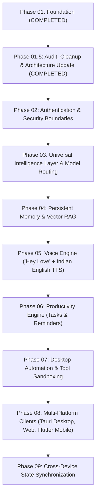

# LOVE Project Status & Execution Roadmap

**Project Name:** LOVE — Personal AI Assistant  
**Current Phase:** Phase 01.5 — Project Cleanup, File Audit & Architecture Update  
**Phase Status:** ✅ **COMPLETED**  
**Lead Architecture:** Senior Software Architect / Repository Maintenance Lead  
**Verification Date:** November 2026  

---

## 1. Phase 01.5 Execution Summary

In Phase 01.5, a full repository audit was conducted followed by a surgical cleanup and architectural expansion:
1. **Repository Audit:** Audited all 81 project files across 12 criteria (Part A).
2. **Safe Cleanup:** Removed redundant directory `shared/constants/` that shadowed module `shared/constants.py`; added `.gitkeep` to preserve `database/migrations/`.
3. **Artifact Cleanup:** Cleared all runtime `__pycache__` and `.pytest_cache` build artifacts prior to git checkpoint.
4. **Architecture Expansion:** Updated `documentation/ARCHITECTURE.md` with:
   - 14 Permanent Core Capability Pillars.
   - Universal Intelligence Layer (UIL) specifications (Intent Recognition, Model Routing, Planning, Agent Orchestration, Tool Sandboxing, Workspace Management, Human Approval Controls, Action History).
   - Official Voice Identity & Engine Specification.
5. **Dedicated Voice Specification:** Authored `documentation/VOICE_SPECIFICATION.md` defining the Indian English female voice profile (Azure Speech primary, ElevenLabs expressive, Piper offline, `faster-whisper` STT, `openWakeWord` wake-word).
6. **Git Initialization:** Verified and prepared Git repository initialization with checkpoint commit.

---

## 2. Capability Pillar Matrix

| ID | Capability Pillar | Target Module | Implementation Phase |
| :---: | :--- | :--- | :---: |
| **01** | General Intelligent Conversations | `backend/app/intelligence/` | Phase 03 |
| **02** | Software Development & Programming | `backend/app/intelligence/` | Phase 03 |
| **03** | Website & Application Development | `backend/app/intelligence/` | Phase 03 |
| **04** | Debugging & Code Analysis | `backend/app/intelligence/` | Phase 03 |
| **05** | Image & Creative Assistance | `backend/app/intelligence/` | Phase 03 |
| **06** | Document Creation & Analysis | `backend/app/intelligence/` | Phase 03 |
| **07** | Research & Problem Solving | `backend/app/intelligence/` | Phase 03 |
| **08** | Personal Productivity & Reminders | `backend/app/productivity/` | Phase 06 |
| **09** | File & Workspace Operations | `backend/app/automation/` | Phase 07 |
| **10** | Desktop & OS Automation | `backend/app/automation/` | Phase 07 |
| **11** | Local & Cloud AI Models | `backend/app/intelligence/` | Phase 03 |
| **12** | Persistent Personal Memory | `backend/app/memory/` | Phase 04 |
| **13** | Voice Interaction ("Hey Love") | `backend/app/voice/` | Phase 05 |
| **14** | Cross-Device Synchronization | `backend/app/synchronization/` | Phase 09 |

---

## 3. Automated Test Verification

All 11 unit and integration tests passed cleanly:

```text
tests/test_config.py::test_default_settings PASSED                       [  9%]
tests/test_config.py::test_settings_environment_override PASSED          [ 18%]
tests/test_config.py::test_cors_origins_parsing PASSED                   [ 27%]
tests/test_config.py::test_cached_get_settings PASSED                    [ 36%]
tests/test_database.py::test_database_connection_check PASSED            [ 45%]
tests/test_database.py::test_database_session_execution PASSED           [ 54%]
tests/test_database.py::test_orm_model_lifecycle PASSED                  [ 63%]
tests/test_health.py::test_health_endpoint_root PASSED                   [ 72%]
tests/test_health.py::test_health_endpoint_v1 PASSED                     [ 81%]
tests/test_health.py::test_root_info_endpoint PASSED                     [ 90%]
tests/test_health.py::test_health_endpoint_async PASSED                  [100%]

============================= 11 passed in 0.32s ==============================
```

---

## 4. Multi-Phase Roadmap



### Readiness for Phase 02:
The repository is 100% clean, verified, and ready to begin **Phase 02: Authentication & Security Boundaries**.
