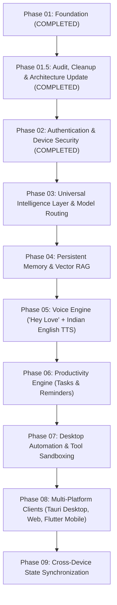

# LOVE Project Status & Execution Roadmap

**Project Name:** LOVE — Personal AI Assistant  
**Current Phase:** Phase 02 — Authentication, User Identity & Device Security  
**Phase Status:** ✅ **COMPLETED**  
**Lead Architecture:** Senior Backend Engineer & Security Architect  
**Verification Date:** November 2026  

---

## 1. Phase 02 Execution Summary

In Phase 02, production-grade authentication, user identity management, and multi-platform device security were implemented:

| Subsystem | Implemented Components | Security & Standards |
| :--- | :--- | :--- |
| **User Identity & Credentials** | `User`, `UserCredential` SQLAlchemy 2.0 ORM models | Argon2id password hashing, constant-time verification, password policy |
| **Token Management** | Dual-token issuance (Access + Refresh JWTs) | Short-lived access JWT, hashed refresh tokens (SHA-256), cryptographic rotation |
| **Breach Containment** | Automated token reuse detection | Reusing an already rotated token revokes all active device sessions |
| **Brute Force Protection** | Sliding window login rate limiter | Configurable attempt thresholds with automatic reset on login |
| **First-Owner Bootstrap** | Single-owner architecture with auto-closing signup | First user becomes Owner; public signup auto-locks (`ALLOW_OPEN_REGISTRATION=false`) |
| **Device Management** | `Device` model across 6 platform categories | Hardware UUID identification, device listing, remote revocation, session termination |
| **Database Migrations** | Alembic migration infrastructure (`alembic.ini`, `env.py`) | Async SQLite & PostgreSQL support with SQLite batch mode |
| **Automated Testing** | 33 comprehensive unit and integration tests | 100% test passing rate across security, auth APIs, devices, and health endpoints |

---

## 2. API Endpoints Implemented

| Method | Path | Protected | Description |
| :---: | :--- | :---: | :--- |
| `POST` | `/api/v1/auth/register` | No | Registers user or initial primary assistant owner |
| `POST` | `/api/v1/auth/login` | No | Authenticates credentials, registers device, issues token pair |
| `POST` | `/api/v1/auth/refresh` | No | Rotates refresh token, issues new access token, detects reuse |
| `POST` | `/api/v1/auth/logout` | **Yes** | Revokes active refresh token session |
| `GET` | `/api/v1/auth/me` | **Yes** | Retrieves authenticated user profile |
| `POST` | `/api/v1/devices/register` | **Yes** | Registers or updates client device record |
| `GET` | `/api/v1/devices` | **Yes** | Lists all devices authorized under user account |
| `DELETE` | `/api/v1/devices/{device_id}` | **Yes** | Revokes device authorization and terminates all its sessions |

---

## 3. Test Execution Verification

All 33 unit and integration tests passed cleanly:

```text
tests/test_auth_api.py::test_first_user_registration_becomes_owner PASSED [  3%]
tests/test_auth_api.py::test_duplicate_email_registration_fails PASSED   [  6%]
tests/test_auth_api.py::test_duplicate_username_registration_fails PASSED [  9%]
tests/test_auth_api.py::test_public_registration_disabled_after_owner_created PASSED [ 12%]
tests/test_auth_api.py::test_login_success_with_email_and_username PASSED [ 15%]
tests/test_auth_api.py::test_login_failure_invalid_credentials PASSED    [ 18%]
tests/test_auth_api.py::test_current_user_profile_endpoint PASSED        [ 21%]
tests/test_auth_api.py::test_refresh_token_rotation PASSED               [ 24%]
tests/test_auth_api.py::test_refresh_token_reuse_detection PASSED        [ 27%]
tests/test_auth_api.py::test_logout_session_revocation PASSED            [ 30%]
tests/test_auth_security.py::test_argon2id_password_hashing PASSED       [ 33%]
tests/test_auth_security.py::test_password_policy_validation PASSED      [ 36%]
tests/test_auth_security.py::test_access_token_creation_and_decoding PASSED [ 39%]
tests/test_auth_security.py::test_refresh_token_creation_and_decoding PASSED [ 42%]
tests/test_auth_security.py::test_expired_token_rejection PASSED         [ 45%]
tests/test_auth_security.py::test_invalid_token_type_rejection PASSED    [ 48%]
tests/test_auth_security.py::test_tampered_token_rejection PASSED        [ 51%]
tests/test_auth_security.py::test_hash_token PASSED                      [ 54%]
tests/test_auth_security.py::test_login_rate_limiter PASSED              [ 57%]
tests/test_config.py::test_default_settings PASSED                       [ 60%]
tests/test_config.py::test_settings_environment_override PASSED          [ 63%]
tests/test_config.py::test_cors_origins_parsing PASSED                   [ 66%]
tests/test_config.py::test_cached_get_settings PASSED                    [ 69%]
tests/test_database.py::test_database_connection_check PASSED            [ 72%]
tests/test_database.py::test_database_session_execution PASSED           [ 75%]
tests/test_database.py::test_orm_model_lifecycle PASSED                  [ 78%]
tests/test_device_api.py::test_device_registration_and_listing PASSED    [ 81%]
tests/test_device_api.py::test_device_re_registration_updates_metadata PASSED [ 84%]
tests/test_device_api.py::test_device_revocation PASSED                  [ 87%]
tests/test_health.py::test_health_endpoint_root PASSED                   [ 90%]
tests/test_health.py::test_health_endpoint_v1 PASSED                     [ 93%]
tests/test_health.py::test_root_info_endpoint PASSED                     [ 96%]
tests/test_health.py::test_health_endpoint_async PASSED                  [100%]

============================= 33 passed in 5.51s ==============================
```

---

## 4. Multi-Phase Roadmap



### Readiness for Phase 03:
The authentication foundation and device security boundary are in place, tested, and ready for **Phase 03: Universal Intelligence Layer & Model Routing**.
