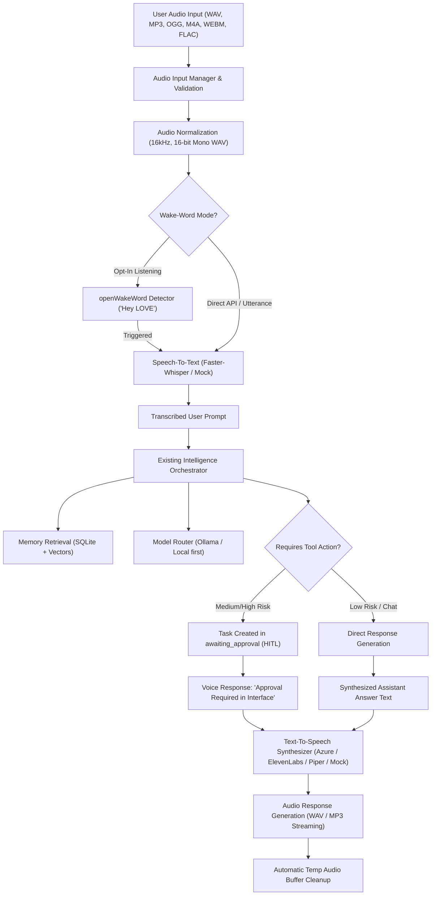
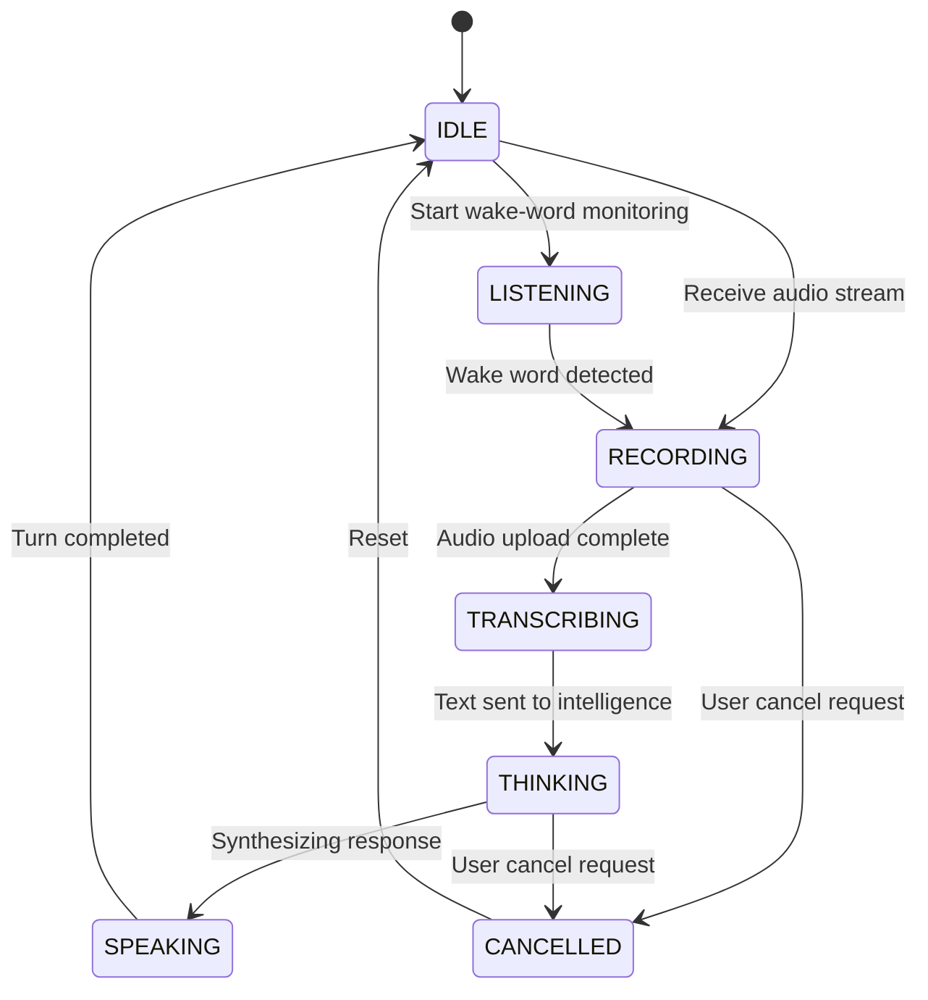

# LOVE — Voice Engine, Speech Recognition & Wake Word Architecture

**Phase:** Phase 06  
**Version:** 0.6.0  
**Status:** IMPLEMENTED & VERIFIED  
**Date:** November 2026  
**Hardware Target:** Host NVIDIA GeForce GTX 1650 (4GB VRAM) & CPU fallback  

---

## 1. Executive Summary & Design Philosophy

LOVE's **Voice Engine** establishes an independent, conversational acoustic interface for the assistant. Voice is not a detached chatbot or an external voicebot: it is a **first-class modality directly integrated into LOVE's existing Universal Intelligence Layer, Persistent Memory, and Safe Work Execution engines**.

### Architectural Pillars

1. **Provider Independence:** Interchangeable STT runtimes (Faster-Whisper on CTranslate2, Mock) and TTS runtimes (Azure Speech, ElevenLabs, Piper, Mock). LOVE is never permanently dependent on any proprietary cloud vendor.
2. **Authentic Voice Personality:** An intelligent, elegant, calm, confident, warm and natural female voice with authentic Indian English pronunciation and subtle futuristic cinematic elegance.
3. **Hardware-Conscious Optimization (GTX 1650 4GB):** Default Whisper models are bounded (`base` / `small`) with int8 quantization and automatic CPU fallback to guarantee zero out-of-memory (OOM) crashes on 4GB VRAM.
4. **Transparent & Opt-In Wake Word ("Hey LOVE"):** openWakeWord detection is strictly opt-in and disabled by default. The engine verifies that standard pre-trained models do not support "Hey LOVE" and requires an explicitly trained custom acoustic model (`hey_love.onnx`) without substituting unrelated wake words.
5. **Human-in-the-Loop (HITL) Work Approval Preservation:** If a voice prompt triggers a workspace operation that requires user confirmation or approval, the engine informs the user verbally and pauses. **Voice commands never auto-approve actions.**
6. **Strict Local Privacy & Audio Hygiene:** Raw audio recordings are never stored permanently by default (`VOICE_RETAIN_AUDIO = False`). Under `LOCAL_ONLY_MODE = True`, cloud TTS/STT calls are strictly forbidden.

---

## 2. Voice Pipeline Architecture & Data Flow

---

## 3. Speech-to-Text (STT): Faster-Whisper Adapter

The STT subsystem (`backend/app/voice/stt/`) provides on-device speech transcription using Faster-Whisper powered by CTranslate2.

### Features
- **Configurable Model Sizes:** `tiny`, `base` (default), `small`, `medium`.
- **Hardware Bound (GTX 1650 4GB):** 
  - GPU Mode: Automatically selected if CUDA is available, utilizing `int8` or `float16` quantization.
  - CPU Mode: Graceful fallback when GPU is under load or CUDA is disabled.
- **Indian English Prompt Conditioning:** Injects contextual guidance:  
  `"Indian English pronunciation, technical terminology, clean conversational speech for LOVE AI assistant."`
- **Segment Timestamps & Confidence:** Captures start/end offsets and average log-probabilities per utterance segment.
- **Strict Model Readiness Reporting:** Does **not** download models in the background. If model weights are missing, accurately reports `is_available = False` and directs the user to the installation directory (`models/whisper/<model_size>`).

---

## 4. Wake-Word Detection: openWakeWord & "Hey LOVE" Custom Model

The wake-word subsystem (`backend/app/voice/wake_word/`) provides acoustic keyword spotting.

### Critical Finding: "Hey LOVE" Requires a Custom Acoustic Model
Standard openWakeWord pre-trained models include:
- `alexa`, `hey_mycroft`, `hey_jarvis`, `hey_rhasspy`, `timer`, `weather`.

**None of the standard models support "Hey LOVE".** In strict adherence to LOVE's architectural principles, the system **never** substitutes an unrelated wake word (such as "Hey Jarvis" or "Alexa") to fake "Hey LOVE" support.

### Custom Model Requirements & Training Pipeline
To enable acoustic detection of "Hey LOVE", a custom model (`hey_love.onnx`) must be placed in `models/wakeword/`.

#### Training Procedure:
1. **Synthetic Data Generation:** Use an Indian English TTS voice (or Piper) to generate 1,500+ varied acoustic samples of "Hey LOVE", "Hey Love", "hey love" across different speeds (0.8x to 1.2x) and pitches.
2. **Negative Acoustic Samples:** Mix with 10,000+ negative audio samples (ambient noise, conversational dialogue, podcasts).
3. **Feature Extraction:** Pass samples through openWakeWord's `melspectrogram.tflite` and `embedding_model.tflite`.
4. **Model Training:** Train an openWakeWord custom verifier classifier (`openwakeword.train_custom_verifier`).
5. **Export:** Export the trained weights as `models/wakeword/hey_love.onnx`.

### Opt-In & Privacy Invariants
- `VOICE_WAKE_WORD_ENABLED` defaults to `False`.
- The microphone is **never** turned on at application boot.
- Calling `POST /api/v1/voice/wake-word/toggle` requires explicit user microphone consent (`mic_permission_granted = True`).
- Immediate deactivation is supported at any time.

---

## 5. Text-to-Speech (TTS) Architecture

The TTS subsystem (`backend/app/voice/tts/`) provides modular speech synthesis across four interchangeable engines:

| Provider | Type | Latency | Quality | Privacy | Requirements |
| :--- | :--- | :--- | :--- | :--- | :--- |
| **Azure Speech** (Primary) | Cloud Neural | ~250ms | Exceptional (Indian English Neural) | Cloud | `VOICE_AZURE_SPEECH_KEY`, `VOICE_AZURE_SPEECH_REGION` |
| **ElevenLabs** (Alternative) | Cloud Generative | ~400ms | Expressive Cinematic | Cloud | `VOICE_ELEVENLABS_API_KEY`, `VOICE_ELEVENLABS_VOICE_ID` |
| **Piper** (Local Fallback) | On-Device VITS | ~80ms | Natural Offline | 100% Local | `VOICE_PIPER_BINARY_PATH`, `VOICE_PIPER_MODEL_PATH` |
| **Mock TTS** (Test Fallback) | Synthetic PCM | <5ms | Test Tone / Offline | 100% Local | Built-in (Standard Library) |

### Routing & Local Fallback Policy
1. When `LOCAL_ONLY_MODE = True`, cloud providers (Azure, ElevenLabs) are strictly blocked with `HTTP 403 Forbidden`. The system routes exclusively to Piper or Mock.
2. When a provider is unconfigured, the system reports `NOT CONFIGURED` and falls back according to policy:  
   `Azure -> ElevenLabs -> Piper -> Mock (if local fallback enabled)`.
3. Secret credentials are never logged or exposed in API responses.

---

## 6. LOVE Voice Personality

Configured via `backend/app/voice/personality.py`:

- **Identity:** LOVE Classic
- **Gender:** Female
- **Accent:** Indian English (`en-IN`)
- **Tone & Character:** Intelligent, elegant, calm, confident, warm, natural, subtle futuristic character, cinematic but not robotic, expressive without exaggeration.
- **Delivery Rules:**
  - Conversational pacing (1.0 rate multiplier).
  - Appropriate pauses: Automatically inserts `<break time="220ms"/>` after sentence ends and `<break time="120ms"/>` after commas/colons in SSML.
  - Avoids unnecessarily dramatic or excessively enthusiastic inflections.
  - Adapts delivery to context: Succinct and precise for mathematical/work actions; warm and engaging for personal memory and dialogue.
- **Voice Mappings:**
  - Azure: `en-IN-NeerjaNeural` (default), `en-IN-AnanyaNeural`
  - ElevenLabs: `love_indian_female_v1`
  - Piper: `en_IN-cmu_indic-medium`
  - Mock: `mock_love_female_in`

---

## 7. Audio Processing & Hygiene

- **Supported Ingest Formats:** WAV, MP3, OGG, M4A, WEBM, FLAC.
- **Normalization:** Converts input audio to standard 16,000 Hz, 16-bit PCM, single-channel (mono) WAV.
- **Constraints Enforced:**
  - Maximum upload size: 15 MB (`VOICE_AUDIO_MAX_FILE_SIZE_BYTES`).
  - Maximum audio duration: 120 seconds (`VOICE_AUDIO_MAX_DURATION_SECONDS`).
- **Temporary Buffer Cleanup:** Files buffered in `workspace/audio_temp/` are deleted immediately upon turn completion unless `VOICE_RETAIN_AUDIO = True`.

---

## 8. Voice Session Management

Managed via `backend/app/voice/session.py`:

- **Single Active Session Per User:** Eliminates audio crosstalk and concurrent runaway generation. Attempting to start a session while another is recording/thinking raises `HTTP 409 Conflict`.
- **Cancellation:** In-flight tasks can be stopped immediately via `POST /api/v1/voice/sessions/{id}/cancel`.

---

## 9. REST API Reference (`/api/v1/voice`)

All endpoints require JWT Bearer authentication and enforce owner-level isolation.

| Method | Endpoint | Description |
| :--- | :--- | :--- |
| `GET` | `/api/v1/voice/status` | Comprehensive status of STT, TTS, wake-word, and GPU hardware. |
| `GET` | `/api/v1/voice/stt/providers` | List STT providers, availability, and model profiles. |
| `GET` | `/api/v1/voice/tts/providers` | List TTS providers, configuration state, and local flags. |
| `GET` | `/api/v1/voice/tts/voices` | Catalog of Indian English neural voices by provider. |
| `GET` | `/api/v1/voice/profile` | Active voice personality profile parameters. |
| `POST` | `/api/v1/voice/sessions` | Create a new isolated voice dialogue session. |
| `GET` | `/api/v1/voice/sessions/{id}` | Inspect current session state and metrics. |
| `POST` | `/api/v1/voice/sessions/{id}/cancel` | Immediately cancel active audio generation. |
| `POST` | `/api/v1/voice/transcribe` | Multipart audio file upload for Faster-Whisper transcription. |
| `POST` | `/api/v1/voice/synthesize` | Synthesize speech text to Base64 JSON or binary audio/wav. |
| `POST` | `/api/v1/voice/chat` | Full voice conversational turn (Audio in -> Intelligence -> Audio out). |
| `GET` | `/api/v1/voice/wake-word/status` | Wake-word status, model presence, and mic permission. |
| `POST` | `/api/v1/voice/wake-word/toggle` | Opt-in microphone listening toggle. |

---

## 10. Hardware Bounds & Resource Management (GTX 1650 4GB)

- **Whisper Confinement:** Defaulting to `base` (145 MB weights) or `small` (460 MB weights) with `int8` quantization ensures total model memory footprint stays under **700 MB VRAM**, leaving ample headroom on the 4GB GTX 1650 for Ollama local LLMs (`qwen2.5:3b`).
- **Resource Reclaim:** PyTorch and CTranslate2 model instances are garbage collected cleanly when not in active use.
- **CPU Fallback:** Faster-Whisper automatically reverts to CPU execution if CUDA memory is exhausted.
