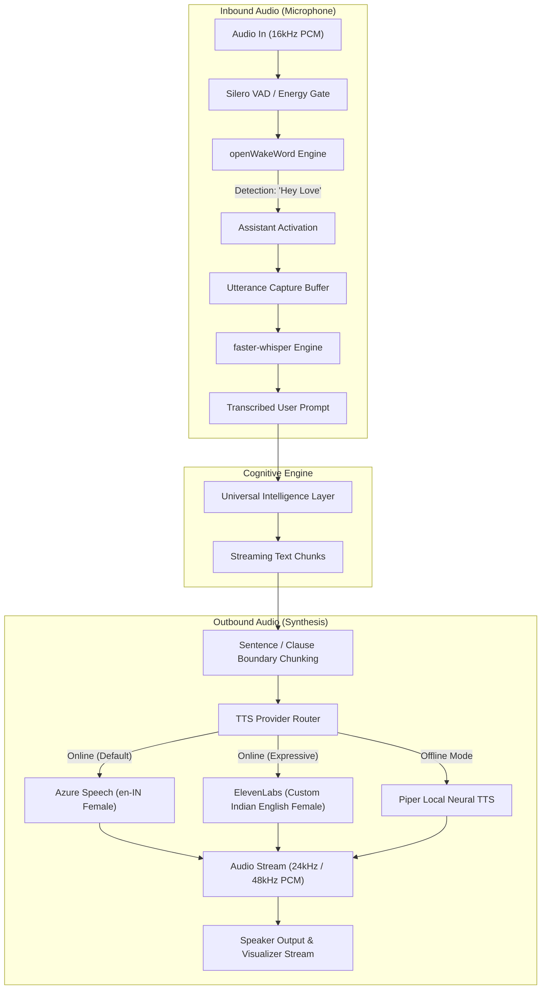

# Official LOVE Voice Specification

## 1. Identity & Persona Definition

The LOVE vocal identity is modeled to achieve an authoritative, articulate, and empathetic acoustic profile inspired by JARVIS and FRIDAY, distinctively voiced with an Indian English accent.

### Vocal Identity Profile:
- **Assistant Name:** LOVE
- **Vocal Gender:** Female
- **Accent:** Indian English (articulate, cultured, urban Indian English)
- **Vocal Style:** Hybrid Cinematic + Natural
  - *Cinematic Elements:* Crisp articulation, unhurried cadence, subtle dynamic presence, poised authority.
  - *Natural Elements:* Micro-inflections, warm pitch modulation, empathetic pacing, natural breath grouping.
- **Personality Attributes:**
  - Intelligent and intellectually agile.
  - Elegant and refined.
  - Calm and unflappable, particularly under operational stress.
  - Confident without condescension or obsequiousness.

---

## 2. Audio Pipeline Architecture

The voice subsystem is completely decoupled from the language model reasoning engine:



---

## 3. Technology Stack & Providers

### A. Wake-Word Engine (Local On-Device)
- **Engine:** `openWakeWord`
- **Activation Phrase:** `"Hey Love"`
- **Target Performance:**
  - On-device inference: < 15ms per frame.
  - False positive rate: < 0.05 / hour.
  - Negligible CPU footprint (< 1.5% single-core on modern systems).

### B. Speech-to-Text (Local On-Device STT)
- **Engine:** `faster-whisper` (CTranslate2 optimized Whisper architecture).
- **Target Models:**
  - *Desktop / Server:* `whisper-small.en` or `whisper-medium.en` (INT8 quantized).
  - *Mobile / Low-Power:* `whisper-base.en` (INT8 quantized).
- **VAD Integration:** Silero VAD for sub-second utterance truncation.

### C. Text-to-Speech (TTS Engine Architecture)

| Provider | Role | Voice Identifier | Characteristics |
| :--- | :--- | :--- | :--- |
| **Azure Speech** | **Primary Cloud Provider** | `en-IN-NeerjaNeural` / `en-IN-KavyaNeural` | High intelligibility, natural Indian English accent, low latency streaming (< 200ms TTFB). |
| **ElevenLabs** | **Secondary Cloud Provider** | Custom Cloned Voice Profile (`love_in_female_v1`) | Exceptional expressive realism, dynamic pauses, cinematic quality. |
| **Piper TTS** | **Offline Local Fallback** | `en_IN-catherine-medium` or local VITS | 100% on-device operation, zero external network dependency, ultra-low latency. |

---

## 4. Voice Decoupling & Configuration

The voice engine must remain completely decoupled from the LLM backend:
- The backend communicates with voice clients via streaming binary audio frames over WebSockets.
- Voice configurations are managed via environment variables and settings:
  ```ini
  VOICE_ENABLED=true
  VOICE_PROVIDER=azure
  VOICE_CLOUD_FALLBACK=elevenlabs
  VOICE_LOCAL_FALLBACK=piper
  VOICE_AZURE_VOICE_NAME=en-IN-NeerjaNeural
  VOICE_PITCH=+0Hz
  VOICE_RATE=+0%
  VOICE_WAKE_WORD="Hey Love"
  ```
- Any failure in external cloud voice services automatically degrades gracefully to local Piper TTS without interrupting the conversation.
