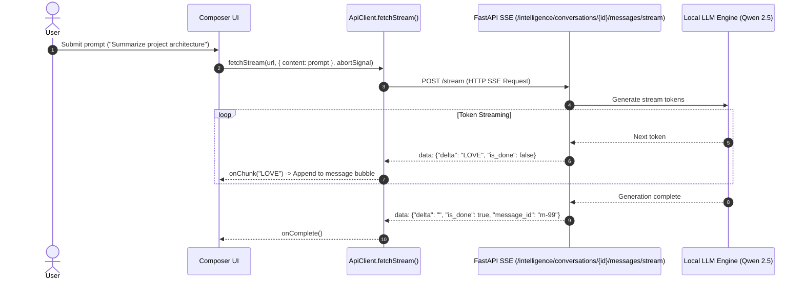

# LOVE Web Application Architecture Specification (Phase 11)

## 1. Executive Summary & Philosophy

The LOVE Web Application is a lightweight, responsive, secure browser interface for LOVE — an independent, personal AI assistant.

Operating as an additional sovereign client within the single-owner assistant architecture, the web application connects to LOVE's local FastAPI backend (`http://127.0.0.1:8000`). It provides continuous access to all core assistant capabilities — fluid conversation streaming, Human-in-the-Loop task approvals, personal episodic memory inspection, real-time hardware telemetry, database health controls, and voice push-to-talk.

### Core Architectural Principles:
1. **Universal Client, Single Assistant Identity:** LOVE remains one singular intelligence with one canonical database (`database/love.db`). The web client acts strictly as a presentation and interaction window, duplicating zero backend business logic or LLM orchestration.
2. **Zero Insecure Browser Storage for Secrets:** In compliance with strict application security standards, long-lived refresh tokens are NEVER stored in browser `localStorage` or `sessionStorage`. Access tokens are held exclusively in short-lived memory, while session persistence is anchored in `HttpOnly`, `SameSite=Lax` browser cookies.
3. **Decoupled Layering:** Strict unidirectional separation between Domain Types (`types/`), Communication Layer (`services/`), Application Contexts (`context/`), and Presentation Components (`components/`).
4. **Resilient Streaming & Graceful Reconnection:** Real-time Server-Sent Events (SSE) streaming for LLM tokens with interactive cancellation (`AbortController`), automatic refresh retry queues on 401 expiration, and live backend health probing.
5. **Aesthetic Consistency & Responsive Minimalism:** A futuristic, dark-mode design system built on Tailwind CSS, featuring subtle borders (`slate-800`), refined glass panels (`slate-900/50 backdrop-blur`), and responsive adaptations for desktop, tablet, and mobile browsers.

---

## 2. Technology Stack

| Layer | Technology | Version | Purpose |
| :--- | :--- | :--- | :--- |
| **Runtime & Bundler** | Node.js + Vite | Node v24+, Vite 8.3 | High-performance ES module bundler & local dev server |
| **Language** | TypeScript | 7.0 (ES2022) | Strict compile-time type safety across all backend API contracts |
| **UI Framework** | React | 19.3 | Declarative UI component tree and state hooks |
| **Styling** | Tailwind CSS + PostCSS | 3.4 / 8.5 | Utility-first responsive design tokens, slate dark-palette |
| **Icons** | Lucide React | 1.76 | Vector iconography for navigation, status, and telemetry badges |
| **Testing** | Vitest + Testing Library | Vitest 5.1, RTL 16.3 | Fast unit and integration tests with JSDOM environment |
| **Build Artifacts** | Static SPA (`dist/`) | ~351 kB JS / 32 kB CSS | Zero external CDN runtime dependencies |

---

## 3. Directory Structure

```
web/
├── index.html                   # HTML entry point with dark viewport meta and theme styling
├── package.json                 # Dependency definitions, build and test scripts
├── vite.config.ts               # Vite configuration with port 5174, base './', and API reverse proxy
├── tsconfig.json                # TypeScript compiler configuration (strict mode)
├── tailwind.config.js           # Design system tokens, color scale, fonts, border radii
├── postcss.config.js            # PostCSS configuration for Tailwind and Autoprefixer
├── screenshots/                 # Captured high-fidelity UI verifications across 6 views
├── src/
│   ├── main.tsx                 # Application bootstrap with root providers
│   ├── App.tsx                  # Root component orchestrating AuthScreen vs AppLayout
│   ├── index.css                # Global styles, scrollbar styling, KaTeX/markdown reset
│   ├── types/                   # Typed API contracts mirroring FastAPI Pydantic models
│   │   ├── auth.ts              # User, Token, Device, Login/Register payloads
│   │   ├── intelligence.ts      # Conversation, Message, ModelStatus, StreamChunk
│   │   ├── work.ts              # Task, TaskAction, PlanStep, PendingApproval
│   │   ├── memory.ts            # MemoryItem, MemorySuggestion, MemoryStats
│   │   ├── sync.ts              # SyncStatus, SyncSettings, SyncCursor
│   │   ├── system.ts            # HardwareMetricsCard, DatabaseHealth, ActivityItem
│   │   └── voice.ts             # VoiceStatus, STT/TTS Provider, PersonalityProfile
│   ├── services/                # Typed HTTP and SSE API clients
│   │   ├── apiClient.ts         # Singleton fetch client with in-memory token, refresh queue, SSE
│   │   ├── authService.ts       # Login, register, me, refresh, logout
│   │   ├── intelligenceService.ts # Conversations, message dispatch, SSE streaming
│   │   ├── workService.ts       # Task management, action approve/reject
│   │   ├── memoryService.ts     # Memory CRUD, suggestion consent approve/reject
│   │   ├── syncService.ts       # Cross-device synchronization status and settings
│   │   ├── systemService.ts     # Hardware metrics, DB status, manual backup trigger
│   │   └── voiceService.ts      # Voice status, audio transcription upload, TTS synthesis
│   ├── context/                 # Global React State Management
│   │   ├── AuthContext.tsx      # In-memory authentication state and session lifecycle
│   │   └── AppContext.tsx       # Active navigation view, assistant status, pending counters
│   ├── components/              # Modular UI Components
│   │   ├── auth/                # Login and user registration forms
│   │   │   └── AuthScreen.tsx
│   │   ├── layout/              # Universal shell and navigation
│   │   │   ├── AppLayout.tsx    # Header, Sidebar, Main Workspace grid layout
│   │   │   ├── Header.tsx       # Assistant status pill, hardware indicators, modal triggers
│   │   │   ├── Sidebar.tsx      # Responsive navigation, conversation list, new chat
│   │   │   └── StatusBadge.tsx   # Color-coded state indicators (idle, thinking, speaking)
│   │   ├── chat/                # Conversation Workspace
│   │   │   ├── ChatWorkspace.tsx# Conversation manager and active dialogue orchestrator
│   │   │   ├── MessageList.tsx  # Message stream container with auto-scroll
│   │   │   ├── MessageItem.tsx  # User vs Assistant bubble, copy button, metadata
│   │   │   ├── Composer.tsx     # Multiline auto-expanding prompt input with keyboard shortcuts
│   │   │   └── MarkdownRenderer.tsx # XSS-safe Markdown parsing, code blocks, copy action
│   │   ├── dashboard/           # Command & Telemetry Workspace
│   │   │   ├── CommandDashboard.tsx # Overview dashboard grid
│   │   │   ├── HardwareMetricsCard.tsx # CPU, RAM, GPU VRAM progress gauges
│   │   │   ├── DatabaseHealthCard.tsx # SQLite WAL status, record count, 1-click backup
│   │   │   └── ActivityTimeline.tsx # Chronological system audit timeline
│   │   ├── work/                # Work & Task Orchestration
│   │   │   ├── WorkWorkspace.tsx # Task list and pending approvals workspace
│   │   │   ├── ApprovalQueue.tsx # Human-in-the-Loop review card with risk badges
│   │   │   └── TaskDetailModal.tsx # Multi-step execution plan viewer
│   │   ├── memory/              # Personal Memory Workspace
│   │   │   ├── MemoryWorkspace.tsx # Episodic memory list, search, category filters
│   │   │   └── SuggestionCard.tsx # Explicit consent approve/reject card
│   │   ├── voice/               # Voice Engine Workspace
│   │   │   ├── VoiceWorkspace.tsx # Push-to-talk microphone, provider inspection
│   │   │   └── AudioRecorder.tsx # Web Audio API MediaRecorder with visual levels
│   │   ├── settings/            # Device & Sync Settings
│   │   │   ├── SettingsModal.tsx # Backend URL config, active device list
│   │   │   └── SyncSettingsSection.tsx # Standalone vs Multi-device sync toggle
│   │   └── status/              # Diagnostics Modal
│   │       └── SystemStatusModal.tsx # LLM providers, active model, DB schema
│   └── test/                    # Comprehensive Vitest Test Suite (24 tests)
```

---

## 4. Communication & Session Architecture

### A. Authentication & Refresh Flow

```mermaid
sequenceDiagram
    autonumber
    actor User
    participant Browser as Web Browser (React)
    participant Memory as In-Memory State
    participant Backend as FastAPI Backend (/api/v1/auth)
    participant DB as SQLite (love.db)

    Note over Browser, Backend: 1. Login Request
    User->>Browser: Enters credentials (email/username, password)
    Browser->>Backend: POST /login { email_or_username, password, device_identifier }
    Backend->>DB: Verify Argon2id password hash & register device
    DB-->>Backend: Success
    Backend-->>Browser: 200 OK { access_token, user, token_type }<br/>Set-Cookie: love_refresh_token=...; HttpOnly; SameSite=Lax; Path=/api/v1/auth
    Browser->>Memory: Store access_token (In-Memory Only)

    Note over Browser, Backend: 2. Authenticated API Turn
    Browser->>Backend: GET /api/v1/intelligence/conversations<br/>Headers: { Authorization: "Bearer <token>" }
    Backend-->>Browser: 200 OK [Conversations JSON]

    Note over Browser, Backend: 3. Token Expiration & Non-Blocking Refresh
    Browser->>Backend: GET /api/v1/work/approvals (Token expired)
    Backend-->>Browser: 401 Unauthorized
    Note over Browser: Intercept 401. Queue concurrent calls.
    Browser->>Backend: POST /api/v1/auth/refresh (credentials: 'include')<br/>Cookie: love_refresh_token=...
    Backend->>DB: Verify & rotate RefreshTokenSession
    DB-->>Backend: Valid
    Backend-->>Browser: 200 OK { access_token } + New Rotated HttpOnly Cookie
    Browser->>Memory: Update in-memory access_token
    Note over Browser: Replay queued requests with new token
    Browser->>Backend: GET /api/v1/work/approvals { Authorization: "Bearer <new_token>" }
    Backend-->>Browser: 200 OK [Approvals JSON]
```

### B. Real-Time Chat Streaming (SSE)



---

## 5. Security & Isolation Boundaries

1. **Cross-Origin Resource Sharing (CORS):**
   - Configured strictly in `backend/app/config/settings.py` for authorized web ports (`http://localhost:5174`, `http://127.0.0.1:5174`, `http://localhost:5173`, `http://127.0.0.1:5173`).
   - `Access-Control-Allow-Credentials: true` is strictly enforced to permit browser delivery of HttpOnly session cookies.
2. **XSS Protection:**
   - React's virtual DOM escapes all string literals by default.
   - Markdown rendering in `MarkdownRenderer.tsx` uses a safe tokenized parser without `dangerouslySetInnerHTML`.
   - Access tokens are never readable via JavaScript `document.cookie` (since refresh cookie is `HttpOnly`).
3. **CSRF Mitigation:**
   - All state-altering API endpoints require `Authorization: Bearer <access_token>`.
   - Refresh cookie uses `SameSite=Lax`, preventing cross-site POST attacks from unauthenticated third-party origins.
4. **Human-in-the-Loop Task Authorization:**
   - Tasks requiring destructive or external system actions cannot be executed autonomously by the backend.
   - The web client presents pending actions in `ApprovalQueue.tsx` with risk badges (`low`, `medium`, `high`, `critical`) requiring explicit user action (`approve` or `reject`).
