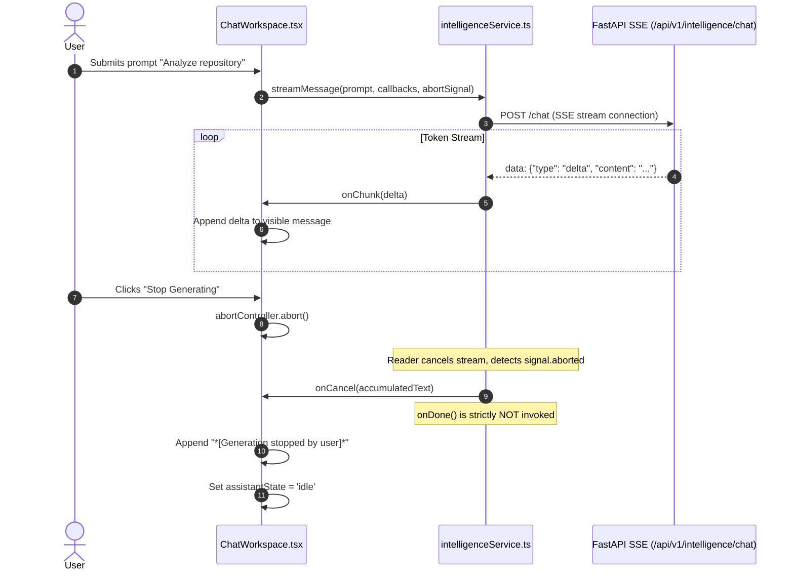

# LOVE Web Authentication Lifecycle & Session Architecture

**Version:** 1.0  
**Phase:** 11.5 Web Security & Authentication Audit  
**Target:** Web Application (`web/`), FastAPI Backend (`backend/app/api/v1/endpoints/auth.py`), SQLite Database (`database/love.db`)  

---

## 1. Overview & Architectural Principles

LOVE maintains a unified backend and canonical SQLite database for both native desktop and web clients. The web client operates in an untrusted browser environment with distinct security constraints:
1. **Zero Persistent JavaScript Token Storage:** Refresh tokens are never stored in `localStorage`, `sessionStorage`, or IndexedDB.
2. **Dual-Token Architecture:**
   - **Access Token:** Short-lived JWT (60 minutes). Held exclusively in private JavaScript class memory (`ApiClient.accessToken`).
   - **Refresh Token:** Long-lived credential (14 days). Stored in an `HttpOnly`, `SameSite=Lax` cookie (`love_refresh_token`) scoped to `/api/v1/auth`.
3. **Single-Flight Concurrency Control:** Simultaneous API requests encountering an expired access token coalesce into a single refresh request.
4. **Synchronized Logout:** Logging out purges in-memory state and issues an RFC 6265bis-compliant `Set-Cookie` deletion header.

---

## 2. Authentication Lifecycle Sequence Diagrams

### 2.1 Initial Login & Dual Token Issuance

```mermaid
sequenceDiagram
    autonumber
    actor User
    participant Browser as React Web Client (AuthScreen)
    participant ApiClient as ApiClient (Private Memory)
    participant AuthAPI as FastAPI Backend (/api/v1/auth/login)
    participant DB as SQLite (database/love.db)

    User->>Browser: Enters username & password
    Browser->>ApiClient: login({ username, password, device_identifier })
    ApiClient->>AuthAPI: POST /api/v1/auth/login
    AuthAPI->>DB: Verify Argon2id password hash
    AuthAPI->>DB: Register or update device record
    AuthAPI->>DB: Create RefreshTokenSession record (hashed token)
    AuthAPI-->>ApiClient: 200 OK<br/>Set-Cookie: love_refresh_token=...; HttpOnly; SameSite=Lax; Path=/api/v1/auth<br/>Body: { access_token, user, device_id }
    ApiClient->>ApiClient: Store access_token in private memory
    ApiClient-->>Browser: Resolve login Promise
    Browser->>Browser: Redirect to Main Assistant Workspace
```

---

### 2.2 In-Flight Request 401 Interception & Refresh Queue Coalescing

```mermaid
sequenceDiagram
    autonumber
    participant UI as Chat / Work Workspace
    participant ApiClient as ApiClient
    participant SubQueue as Refresh Subscribers Queue
    participant AuthAPI as FastAPI Backend (/api/v1/auth/refresh)
    participant DB as SQLite (database/love.db)

    par Request A (List Conversations)
        UI->>ApiClient: request('/api/v1/intelligence/conversations')
        ApiClient->>AuthAPI: GET /conversations (Bearer Token [Expired])
        AuthAPI-->>ApiClient: 401 Unauthorized
    and Request B (List Tasks)
        UI->>ApiClient: request('/api/v1/work/tasks')
        ApiClient->>AuthAPI: GET /tasks (Bearer Token [Expired])
        AuthAPI-->>ApiClient: 401 Unauthorized
    end

    Note over ApiClient: First 401 triggers refreshSession()<br/>isRefreshing = true
    ApiClient->>SubQueue: Enqueue Request B resolver

    ApiClient->>AuthAPI: POST /api/v1/auth/refresh (Cookie: love_refresh_token)<br/>Origin: http://localhost:5174
    AuthAPI->>AuthAPI: Validate Origin against allowed CORS
    AuthAPI->>DB: Validate session, verify device active
    AuthAPI->>DB: Rotate refresh token (revoke old, issue new)
    AuthAPI-->>ApiClient: 200 OK<br/>Set-Cookie: love_refresh_token=new_token; HttpOnly; Path=/api/v1/auth<br/>Body: { access_token: new_jwt }

    Note over ApiClient: try...finally ensures isRefreshing = false<br/>notifySubscribers(new_jwt)
    ApiClient->>ApiClient: Update in-memory accessToken

    par Replay Request A
        ApiClient->>AuthAPI: GET /conversations (Bearer Token [New])
        AuthAPI-->>ApiClient: 200 OK (Conversations list)
        ApiClient-->>UI: Return Conversations
    and Replay Queued Request B
        SubQueue->>ApiClient: Replay GET /tasks (Bearer Token [New])
        ApiClient->>AuthAPI: GET /tasks (Bearer Token [New])
        AuthAPI-->>ApiClient: 200 OK (Tasks list)
        ApiClient-->>UI: Return Tasks
    end
```

---

### 2.3 Token Reuse Detection & Revocation Security

```mermaid
sequenceDiagram
    autonumber
    actor Attacker
    actor LegitimateUser
    participant Backend as FastAPI Backend (/api/v1/auth/refresh)
    participant DB as SQLite (database/love.db)

    Note over Backend,DB: Token Rotation: each refresh token can be used exactly once
    LegitimateUser->>Backend: POST /refresh with Token R1
    Backend->>DB: Revoke R1, issue Token R2
    Backend-->>LegitimateUser: 200 OK (Cookie: R2)

    Note over Attacker,Backend: Compromised or replayed token R1
    Attacker->>Backend: POST /refresh with Token R1
    Backend->>DB: Lookup Token R1 -> Status: REVOKED!
    Note over Backend,DB: SECURITY ALERT: Token reuse detected!
    Backend->>DB: Invalidate ALL active sessions for this device family
    Backend-->>Attacker: 401 Unauthorized<br/>Set-Cookie: love_refresh_token=; Max-Age=0 (Dead Cookie Cleared)
```

---

### 2.4 Synchronized Logout & Session Purge

```mermaid
sequenceDiagram
    autonumber
    actor User
    participant Browser as React Web Client
    participant ApiClient as ApiClient
    participant AuthAPI as FastAPI Backend (/api/v1/auth/logout)
    participant DB as SQLite (database/love.db)

    User->>Browser: Clicks "Sign Out"
    Browser->>ApiClient: logout()
    ApiClient->>AuthAPI: POST /api/v1/auth/logout (Cookie: love_refresh_token)
    AuthAPI->>AuthAPI: Validate Origin against allowed CORS
    AuthAPI->>DB: Mark session status = 'revoked'
    AuthAPI-->>ApiClient: 200 OK<br/>Set-Cookie: love_refresh_token=; Max-Age=0; Path=/api/v1/auth; HttpOnly; SameSite=Lax
    ApiClient->>ApiClient: Clear in-memory access token
    ApiClient->>ApiClient: Clear user profile & conversation state
    Browser->>Browser: Redirect to AuthScreen
    Note over Browser: Browser network stack removes cookie permanently
```

---

### 2.5 Real-Time SSE Stream Cancellation



---

## 3. Cookie Scope & Environment Configuration

| Setting | Dev / Test Value | Production Value | Description |
| :--- | :--- | :--- | :--- |
| `COOKIE_NAME` | `love_refresh_token` | `love_refresh_token` | Canonical cookie key |
| `COOKIE_PATH` | `/api/v1/auth` | `/api/v1/auth` | Narrow path scope restricted to auth endpoints |
| `COOKIE_HTTPONLY` | `True` | `True` | Inaccessible to JavaScript `document.cookie` |
| `COOKIE_SAMESITE` | `lax` | `lax` | Defends against cross-site POST attacks |
| `COOKIE_SECURE` | `False` | `True` | Enforced over HTTPS in production |
| `COOKIE_DOMAIN` | `None` (host-only) | `None` or explicit | Prevents subdomain leakage |
| `COOKIE_MAX_AGE` | `1,209,600` (14 days) | `1,209,600` (14 days) | Synchronized with session DB lifespan |

---

## 4. Multi-Client Authentication Matrix

| Capability | Desktop Client (Electron) | Web Client (Browser) | CLI Tools |
| :--- | :--- | :--- | :--- |
| **Primary Credential** | Long-lived Bearer Refresh Token | HttpOnly Refresh Cookie | Pre-shared API Key / Bearer |
| **In-Memory Token** | Yes (`ApiClient.accessToken`) | Yes (`ApiClient.accessToken`) | Optional |
| **Origin Check** | Bypassed (native client) | Enforced against whitelist | Bypassed |
| **Token Storage** | Encrypted OS Store / In-Memory | Browser Cookie Engine | Environment Variable |
| **Device Binding** | UUID bound to machine | UUID stored in localStorage | Hostname-based UUID |
| **Revocation Control** | Remote from Dashboard | Remote from Dashboard | Remote from Dashboard |
