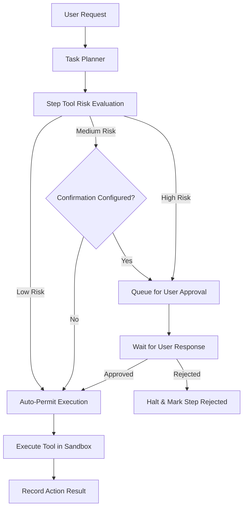

# LOVE — Universal Work Intelligence & Safe Tool Orchestration Architecture

**Phase:** Phase 05  
**Version:** 0.5.0  
**Status:** IMPLEMENTED & VERIFIED  
**Date:** November 2026  

---

## 1. Executive Summary & Design Philosophy

LOVE's **Universal Work Intelligence Layer** empowers the assistant to understand what the user wants to accomplish, determine when specialized actions or tools are necessary, construct structured multi-step execution plans, safely execute authorized operations, and present synthesized outcomes back to the user.

### Key Architectural Pillars

1. **Automatic Intent Recognition (No Manual Category Selection):** The user never has to pick "math", "coding", "file management", or "writing". LOVE analyzes user prompts heuristically and contextually to identify whether an action or tool is required (`requires_action: bool`).
2. **Provider-Independence:** LOVE's task execution and identity do not depend permanently on Gemini, OpenAI, or Ollama. Built-in tools and deterministic execution engines operate independently of external AI model availability.
3. **Strict Security Boundaries & Confinement:**
   - **Path Traversal Guards:** All file tools are confined within the workspace directory using canonical path common-prefix checks. Any attempt to access files outside the workspace (e.g. `../`) raises `PathTraversalError`.
   - **Sensitive File Protection:** Automatic blocking of `.env*`, `*.pem`, `*.key`, `id_rsa*`, credentials, tokens, secrets, and database files (`love.db`).
   - **Zero Arbitrary Execution:** No arbitrary shell commands, no `subprocess` shells, no `eval()`, and no unrestricted code execution. Coding tools perform static analysis, symbol indexing, diffs, and patch application only.
4. **Human-in-the-Loop Permission Management:** Tools are tiered into Low, Medium, and High operational risk. Medium and High risk actions require explicit user confirmation or approval before execution.

---

## 2. Intent Understanding & Action Classification

The enhanced `IntentClassifier` (`backend/app/intelligence/intent.py`) evaluates prompts against capability signatures:

| Capability | Detected Signal | Suggested Tool | Action Required? |
| :--- | :--- | :--- | :--- |
| **Math / Arithmetic** | Numeric expressions, percentages, math operators | `calculator` | Yes |
| **DateTime & Timezone** | "what time is it", date math, timezone query | `datetime_tool` | Yes |
| **File Inspection** | "list files", "directory tree", "show files" | `workspace_list_files` | Yes |
| **File Reading** | "read file", "open file", "view file" | `workspace_read_file` | Yes |
| **File Writing** | "create file", "write to file", "save to file" | `workspace_create_file` | Yes |
| **File Editing** | "edit file", "update file", "modify file" | `workspace_edit_file` | Yes |
| **File Search** | "search files", "grep", "find in files" | `workspace_search_files` | Yes |
| **Code Inspection** | "inspect codebase", "code structure" | `code_inspect_structure` | Yes |
| **Symbol Search** | "find function", "find class", "symbol" | `code_search_symbols` | Yes |
| **Code Diff** | "propose changes", "generate diff" | `code_propose_changes` | Yes |
| **Code Patch** | "apply patch", "apply changes" | `code_apply_patch` | Yes |
| **Web Research** | "search the web", "research online" | `research_search` | Yes |
| **Pure Conversation** | Greetings, questions like "What is an algorithm?" | *None* | **No** (pure LLM turn) |

### Ambiguity Handling

Short, underspecified commands (e.g., `"calculate"`, `"search"`, `"create file"`, `"do it"`) are flagged as `is_ambiguous = True`, generating a clarifying prompt asking the user for essential details rather than guessing or executing unsafe default operations.

---

## 3. Tool Architecture & Registry

All tools inherit from the abstract `BaseTool` (`backend/app/work/tools/base.py`):

```python
class BaseTool(ABC):
    name: str
    description: str
    category: str
    risk_level: RiskLevel
    permission_level: PermissionLevel
    timeout_seconds: int
    is_available: bool
    input_schema: Dict[str, Any]
    output_schema: Dict[str, Any]

    async def execute(self, **kwargs) -> ToolResult: ...
    async def run(self, **kwargs) -> Dict[str, Any]: ...
```

### Registered Built-in Safe Tools

| Tool Identifier | Category | Risk Level | Permission Policy | Description |
| :--- | :--- | :--- | :--- | :--- |
| `calculator` | `math` | `LOW` | Auto-permit | AST-based sandboxed arithmetic, trig, log, sqrt, percentages. No `eval()`. |
| `datetime_tool` | `datetime` | `LOW` | Auto-permit | Current time in ISO 8601, timezone conversions, date difference and arithmetic. |
| `workspace_list_files` | `file` | `LOW` | Auto-permit | Safe, path-confined directory listing with depth control. |
| `workspace_read_file` | `file` | `LOW` | Auto-permit | Safe file reader with line-window slicing and byte-budget capping. |
| `workspace_create_file`| `file` | `MEDIUM` | Requires Confirmation | Writes/creates workspace files. Confinement and sensitive-file guarded. |
| `workspace_edit_file` | `file` | `MEDIUM` | Requires Confirmation | Exact substring replacement with occurrence count tracking. |
| `workspace_search_files`| `file` | `LOW` | Auto-permit | Substring and regex text search across workspace files. |
| `research_search` | `research` | `LOW` | Auto-permit | Provider-independent search with citations and offline mock fallback. |
| `code_inspect_structure`| `code` | `LOW` | Auto-permit | Project structure analysis, file counts by extension, estimated LOC. |
| `code_search_symbols` | `code` | `LOW` | Auto-permit | AST-based symbol extraction for Python, regex for other code files. |
| `code_propose_changes` | `code` | `LOW` | Auto-permit | Computes unified diff comparing original vs proposed content without writing. |
| `code_apply_patch` | `code` | `MEDIUM` | Requires Confirmation | Applies changes to workspace file with automatic `.bak` backup creation. |

---

## 4. Permission & Approval Workflow

LOVE implements a **Human-in-the-Loop (HITL)** permission engine (`backend/app/work/permissions.py`):



### Risk Tier Definitions

1. **LOW (Auto-Permit):** Non-destructive read operations, mathematical computations, date/time calculations, symbol searches, and diff previews.
2. **MEDIUM (Configurable Confirmation):** Workspace file creation, file modifications, patch applications. Enabled by default (`TOOL_REQUIRE_CONFIRMATION_FOR_MEDIUM_RISK = True`).
3. **HIGH (Explicit Approval):** Destructive actions, bulk file deletions, permanent state alterations. Execution is blocked until explicit authorization is received via the `/approvals` API.

### Approval Security Hardening (Phase 05.5)

- **Replay Protection:** Actions must be strictly in `pending` approval state to be processed. Any subsequent approval/rejection attempt on already-resolved actions raises `ToolPermissionDeniedError` (`HTTP 400 Bad Request`).
- **Approval Window Expiration:** Approvals are bounded by a 24-hour expiration window. Any approval request submitted after 24 hours is rejected automatically to prevent stale or orphaned state execution.
- **Cryptographic Tamper Detection:** Action payloads are bound to a SHA-256 idempotency key generated from `task_id:step_index:tool_name:canonical_json_args`. The execution engine re-computes this hash immediately prior to invoking any tool. If database records were modified or arguments tampered with, execution is immediately halted.
- **Multi-Tenant Owner Isolation:** All task and approval endpoints verify ownership against the authenticated user (`user_id`). Users cannot view, approve, reject, or execute actions belonging to another user.
- **Cold Restart Durability:** State transitions are committed transactionally to SQLite. If the backend process crashes or restarts while a task is in `awaiting_approval`, the task and pending actions persist. Upon restart, Server 2 retrieves the pending approval with zero unapproved auto-execution. The user can safely approve on Server 2 to resume execution.

---

## 5. Controlled Execution Engine

The `TaskExecutor` (`backend/app/work/executor.py`) enforces:

- **Strict Timeouts:** Asynchronous timeout enforcement (`asyncio.wait_for`) with configurable ceilings per tool.
- **Permission Guard:** Evaluates current approval state against tool risk tier immediately before invocation.
- **Idempotency Protection:** Generates SHA-256 idempotency keys (`task_id:step:tool_name:args`) preventing duplicate unintended runs.
- **Exception Isolation:** Unhandled exceptions in individual tools are caught, isolated, and formatted into clean error reports without crashing the backend or disrupting other conversation turns.

---

## 6. Database Models & Schema Persistence

Applied via Alembic migration `322b6c8a37b0` to `database/love.db`:

### `tasks` Table
- `id`: UUID primary key (String(36))
- `user_id`: Foreign key to `users.id` (CASCADE, Indexed)
- `conversation_id`: Foreign key to `conversations.id` (SET NULL, Indexed)
- `title`: String(255)
- `description`: Text (user natural language goal)
- `status`: String(32) (`pending`, `planning`, `in_progress`, `awaiting_approval`, `completed`, `failed`, `cancelled`)
- `plan_json`: Text (JSON serialized plan steps)
- `result_summary`: Text (synthesized final outcome)
- `error_message`: Text
- `total_steps`: Integer
- `completed_steps`: Integer
- `completed_at`: DateTime(timezone=True)
- `created_at`, `updated_at`: DateTime(timezone=True)

### `task_actions` Table
- `id`: UUID primary key (String(36))
- `task_id`: Foreign key to `tasks.id` (CASCADE, Indexed)
- `step_index`: Integer (execution order)
- `title`: String(255)
- `tool_name`: String(100) (Indexed)
- `risk_level`: String(20) (`low`, `medium`, `high`)
- `input_json`: Text (JSON serialized arguments)
- `output_json`: Text (JSON serialized tool results)
- `status`: String(32) (`pending`, `awaiting_approval`, `approved`, `rejected`, `running`, `completed`, `failed`, `cancelled`)
- `approval_state`: String(20) (`not_required`, `pending`, `approved`, `rejected`)
- `approved_by`: String(36)
- `approved_at`: DateTime(timezone=True)
- `error_message`: Text
- `execution_time_ms`: Float
- `idempotency_key`: String(64) (Indexed)
- `created_at`, `updated_at`: DateTime(timezone=True)

---

## 7. REST API Endpoints (`/api/v1/work`)

All endpoints require JWT Bearer authentication and enforce owner-level data isolation.

| Method | Endpoint | Description |
| :--- | :--- | :--- |
| `GET` | `/api/v1/work/tools` | List registered tools and parameter schemas |
| `POST` | `/api/v1/work/tasks` | Create and optionally start a new multi-step task |
| `GET` | `/api/v1/work/tasks` | List user tasks with pagination and status filters |
| `GET` | `/api/v1/work/tasks/{task_id}` | Retrieve complete task details and step action history |
| `POST` | `/api/v1/work/tasks/{task_id}/execute` | Execute or resume a paused/waiting task |
| `POST` | `/api/v1/work/tasks/{task_id}/cancel` | Cancel an active or waiting task |
| `GET` | `/api/v1/work/approvals` | List all actions awaiting explicit user approval |
| `POST` | `/api/v1/work/approvals/{action_id}` | Approve or reject a pending action |

---

## 8. Integration with Intelligence Layer

Integrated into `IntelligenceOrchestrator` (`backend/app/intelligence/orchestrator.py`):
1. **Conversational Turn Preservation:** Conversational questions and casual dialogue (`requires_action = False`) bypass tool orchestration completely, preserving fast inference with zero overhead.
2. **Work Intelligence Triggering:** When `requires_action = True`, `WorkService` creates a structured task and executes permitted tools.
3. **Approval Prompting:** When actions require confirmation, LOVE notifies the user in chat and provides the pending action details.
4. **Deterministic Answering:** Safe math and time queries provide instant, verified answers even when external LLMs are offline or unavailable.
