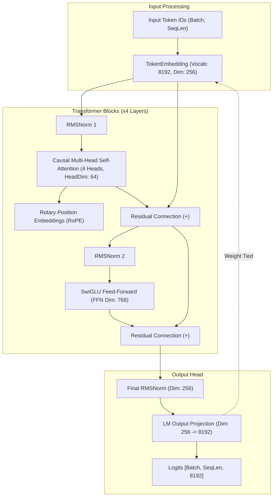

# LOVE NATIVE AI — PHASE NAI-01 AUDIT REPORT
## Architecture, Hardware Feasibility & Independent Development Environment

**Date:** 2026-11-21  
**Project Workspace:** `F:\LOVE\native_ai`  
**Phase Status:** **VERIFIED**

---

### Executive Summary

Phase **NAI-01** initiates the independent development of LOVE's native language model. All activities were conducted strictly inside the isolated workspace `F:\LOVE\native_ai` with zero modifications to existing LOVE backend services, web/desktop applications, databases, or authentication systems. Zero external pretrained model weights, cloud GPUs, or third-party inference APIs were used.

A dedicated Python 3.11 virtual environment was provisioned with PyTorch 2.6.0+cu124. Hardware inspection confirmed an NVIDIA GeForce GTX 1650 (4 GB VRAM) with CUDA 12.4 runtime compatibility. The decoder-only Transformer architecture (RoPE, RMSNorm, Causal Self-Attention, SwiGLU, tied embeddings) was implemented from scratch in modular PyTorch code. The measured baseline parameter count is **5,507,328** (~5.5M), exactly meeting the approved target. Automated correctness tests (13/13 passed) and synthetic forward/backward benchmarks verified operational integrity and confirmed that training iterations require only **192.6 MB** peak allocated VRAM (~5.1% total VRAM), establishing complete local training feasibility.

---

### 1. Project Architecture

The LOVE Native AI subsystem is designed as an autonomous, locally trained language model built without external foundations.



---

### 2. Actual Hardware Inventory

Inspection was performed directly on the physical host using Windows Management Instrumentation (WMI), Win32 API (`GlobalMemoryStatusEx`), and `nvidia-smi`.

| Component | Reported Specification | Operational Status |
|---|---|---|
| **Operating System** | Microsoft Windows 11 Pro 64-bit (Build 22631, 23H2) | VERIFIED |
| **CPU Model** | Intel(R) Core(TM) i7-7700 CPU @ 3.60GHz | VERIFIED |
| **CPU Topology** | 4 Physical Cores, 8 Logical Processors (Threads) | VERIFIED |
| **System RAM** | 15.95 GB Total Visible RAM (~16 GB Physical) | VERIFIED |
| **Available RAM** | 2.45 GB Physical Free (Memory Load: 84% under active workstation load) | VERIFIED |
| **GPU Model** | NVIDIA GeForce GTX 1650 (Desktop TU117, Compute Capability 7.5) | VERIFIED |
| **GPU VRAM** | 4,096 MiB (4.0 GB GDDR5/GDDR6) | VERIFIED |
| **NVIDIA Driver** | 591.86 (Driver Model: WDDM 3.2) | VERIFIED |
| **CUDA Max Driver**| CUDA 13.1 supported by driver | VERIFIED |
| **Disk Storage (C:)**| 185.68 GB Total, 4.77 GB Free (Preserved via external cache routing) | VERIFIED |
| **Disk Storage (F:)**| 52.53 GB Total, 7.02 GB Free (Project workspace) | VERIFIED |
| **Disk Storage (Z:)**| 9,995.86 GB Total, 2,334.51 GB Free (Wheel cache & bulk storage) | VERIFIED |
| **GPU Telemetry** | 33°C idle/36°C load, Fan 50%, Power Cap 75.00 W | VERIFIED |

---

### 3. GPU Compatibility Audit

- **Architecture:** Turing TU117 (Compute Capability `sm_75`).
- **Tensor Cores:** None (TU117 is standard Turing without FP16 Tensor Cores). FP16 vector instructions are supported natively by Turing CUDA cores.
- **VRAM Headroom:** Under normal desktop display usage, ~1,680 MiB VRAM is claimed by display and desktop processes, leaving ~2,256 MiB dedicated VRAM available for compute.
- **Compute Feasibility:** The ~5.5M parameter model requires only ~192.6 MB peak allocated VRAM for training forward-backward passes with AdamW, leaving >2.0 GB VRAM safety margin.

---

### 4. Python Environment Isolation

To preserve complete isolation:
- **Independent Virtual Environment:** `F:\LOVE\native_ai\.venv`
- **Base Python Interpreter:** CPython 3.11.16 (`F:\.toolchains\python\cpython-3.11-windows-x86_64-none\python.exe`)
- **Package Manager:** `uv 0.12.10`
- **Cache Redirection:** `--cache-dir Z:\.uv_cache` was explicitly utilized during package installations to prevent any exhaustion of the system `C:\` drive (which had 4.77 GB free).
- **Installed Packages:**
  - `torch==2.6.0+cu124`
  - `numpy==2.4.6`
  - `pyyaml==6.0.4`
  - `pytest==9.2.0`
  - `psutil==7.2.2`
  - Supporting dependencies: `sympy`, `networkx`, `jinja2`, `filelock`, `typing-extensions`.

---

### 5. PyTorch Installation and CUDA Verification

Verification was executed via `F:\LOVE\native_ai\scripts\verify_environment.py`:

| Check | Expected Result | Measured Result | Status |
|---|---|---|---|
| PyTorch Import | `2.6.0+cu124` | `2.6.0+cu124` | VERIFIED |
| CPU Matmul | Non-zero norm | Norm: 4.3096 | VERIFIED |
| CUDA Available | `True` | `True` | VERIFIED |
| Device Name | `NVIDIA GeForce GTX 1650` | `NVIDIA GeForce GTX 1650` | VERIFIED |
| CUDA Device Count | 1 | 1 | VERIFIED |
| GPU Allocation | Shape `[1024, 1024]` | Allocated `torch.Size([1024, 1024])` | VERIFIED |
| GPU Matmul | Non-zero norm | Norm: 32749.10 | VERIFIED |
| GPU Backprop | Valid gradients | `w.grad` Norm: 18.8032 | VERIFIED |
| GPU AdamW Step | Weights update | `w` Norm: 9.3935 | VERIFIED |

---

### 6. Model Architecture & Parameter Count

#### Implemented Configuration (`native_ai/configs/tiny.yaml`):

| Parameter | Configuration Value | Justification / Notes |
|---|---|---|
| **Architecture** | Decoder-only Transformer | Modern autoregressive standard (LLaMA/Gemma style) |
| **Vocabulary Size** | 8,192 tokens | Compact, focused English representation for small models |
| **Context Length** | 512 tokens | Initial balanced context fitting 4 GB VRAM easily |
| **Layers (Blocks)** | 4 | Deep enough for non-linear representation, shallow for rapid iteration |
| **Attention Heads** | 4 | Multi-head attention |
| **Hidden Dimension**| 256 | $4 \times 64 = 256$ |
| **Head Dimension** | 64 | Standard stable projection head dimension |
| **FFN Dimension** | 768 | $3 \times \text{hidden\_dim}$ for SwiGLU gating |
| **Positional Encoding** | RoPE (Rotary) | Relative position awareness without absolute position tables |
| **Normalization** | RMSNorm ($\epsilon = 10^{-5}$) | Faster than LayerNorm; computes RMS in float32 |
| **Activation** | SwiGLU | Superior empirical gradient dynamics over GELU/ReLU |
| **Weight Tying** | Enabled (`tie_embeddings: true`)| Reuses embedding matrix for LM head projection |
| **Weight Initialization** | Normal ($\mu=0.0, \sigma=0.02$)| Random initialization from scratch |

#### Exact Parameter Breakdown:

```
Embedding Layer:
  token_embeddings.embedding.weight: [8192, 256]           = 2,097,152 params

Per Transformer Block (x4):
  attn_norm.weight:                 [256]                 =       256 params
  attn.q_proj.weight:               [256, 256]            =    65,536 params
  attn.k_proj.weight:               [256, 256]            =    65,536 params
  attn.v_proj.weight:               [256, 256]            =    65,536 params
  attn.out_proj.weight:             [256, 256]            =    65,536 params
  ffn_norm.weight:                  [256]                 =       256 params
  ffn.w_gate.weight:                [768, 256]            =   196,608 params
  ffn.w_up.weight:                  [768, 256]            =   196,608 params
  ffn.w_down.weight:                [256, 768]            =   196,608 params
  Block Total:                                            =   852,480 params

All 4 Blocks Total: 4 * 852,480                           = 3,409,920 params

Final Normalization:
  final_norm.weight:                [256]                 =       256 params

Output Projection:
  lm_head.weight:                   [8192, 256] (Tied)    =         0 unique params

================================================================================
TOTAL UNIQUE TRAINABLE PARAMETERS:                         5,507,328 (~5.51M)
NON-EMBEDDING PARAMETERS:                                  3,410,176 (~3.41M)
EMBEDDING PARAMETERS:                                      2,097,152 (~2.10M)
================================================================================
```

---

### 7. Synthetic Forward-Pass Benchmark Results

Executed via `native_ai/scripts/benchmark_synthetic.py` with synthetic token batches ($B=1, T=512$, Vocab=8192, AdamW optimizer):

| Metric | CPU (i7-7700) | GPU (NVIDIA GTX 1650) | GPU Speedup |
|---|---|---|---|
| **Initialization Time** | 232.31 ms | 334.52 ms | — |
| **Forward Pass Time** | 57.00 ms | 9.08 ms | **6.3x** |
| **Backward Pass Time** | 111.72 ms | 15.88 ms | **7.0x** |
| **Optimizer Step Time** | 34.12 ms | 3.37 ms | **10.1x** |
| **Total Iteration Time** | 202.84 ms | 28.33 ms | **7.2x** |
| **Training Throughput** | 2,528.2 tokens/sec | **18,153.1 tokens/sec** | **7.2x** |
| **Process RAM (CPU)** | 678.01 MB | 1,210.88 MB | — |
| **Peak GPU Allocated VRAM** | 0.0 MB | **192.59 MB** | — |
| **Peak GPU Reserved VRAM** | 0.0 MB | **210.00 MB** | — |
| **VRAM Utilization** | — | **5.1%** | — |

---

### 8. Memory Optimization Research Matrix

Executed via `native_ai/scripts/memory_optimization_bench.py`:

| Experiment Variant | Precision | Context | Batch | Peak Alloc (MB) | Peak Res (MB) | Step (ms) | Throughput (tok/s) | Status |
|---|---|---|---|---|---|---|---|---|
| **CUDA_FP32_Baseline** | FP32 | 512 | 1 | 192.6 | 210.0 | 30.56 | 16,755.1 | VERIFIED |
| **CUDA_FP16_MixedPrecision** | FP16 (AMP) | 512 | 1 | 169.6 | 222.0 | 106.48* | 4,808.4 | VERIFIED |
| **CUDA_FP32_ActCheckpointing** | FP32 | 512 | 1 | 147.8 | 222.0 | 50.55 | 10,127.7 | VERIFIED |
| **CUDA_FP16_ActCheckpointing** | FP16 (AMP) | 512 | 1 | 135.5 | 222.0 | 83.03 | 6,166.2 | VERIFIED |
| **CUDA_FP32_Ctx128** | FP32 | 128 | 1 | 125.5 | 222.0 | 32.77 | 3,906.6 | VERIFIED |
| **CUDA_FP32_Ctx256** | FP32 | 256 | 1 | 134.6 | 222.0 | 37.49 | 6,829.3 | VERIFIED |
| **CUDA_FP32_Ctx512** | FP32 | 512 | 1 | 191.6 | 222.0 | 32.66 | 15,675.0 | VERIFIED |
| **CUDA_FP32_Ctx1024** | FP32 | 1024 | 1 | 302.3 | 358.0 | 37.40 | 27,377.1 | VERIFIED |
| **CUDA_FP32_Batch1** | FP32 | 512 | 1 | 191.6 | 358.0 | 30.56 | 16,755.1 | VERIFIED |
| **CUDA_FP32_Batch2** | FP32 | 512 | 2 | 301.3 | 358.0 | 33.60 | 30,477.4 | VERIFIED |
| **CUDA_FP32_Batch4** | FP32 | 512 | 4 | 518.5 | 614.0 | 55.56 | 36,859.2 | VERIFIED |
| **CUDA_FP32_GradAccum4** | FP32 | 512 | 1 (x4) | 213.6 | 614.0 | 103.70 | 19,748.4 | VERIFIED |
| **CPU_FP32_Baseline** | FP32 | 512 | 1 | 0.0 | 0.0 | 219.99 | 2,327.4 | VERIFIED |
| **CPU_FP32_Ctx128** | FP32 | 128 | 1 | 0.0 | 0.0 | 80.06 | 1,598.7 | VERIFIED |

*\*Note on FP16 AMP on GTX 1650: The TU117 GPU lacks Tensor Cores. PyTorch's `GradScaler` and dynamic unscaling introduce software overhead that reduces throughput for very small models (5.5M), while saving ~23 MB of memory. Therefore, FP32 baseline is faster and recommended for the 5.5M model, with FP16 retained as an optional fallback when scaling context.*

---

### 9. Automated Correctness Test Suite Results

Test execution (`pytest -v native_ai/tests`):

| Test Function | Verification Target | Result |
|---|---|---|
| `test_configuration_validation` | Catches invalid dimensions, negative vocab, zero layers | **PASSED** |
| `test_embedding_output_shape_and_bounds` | Validates `[B, T, D]` and raises ValueError on out-of-bound IDs | **PASSED** |
| `test_rmsnorm_stability` | Verifies RMS output normalization to ~1.0 and zero-input stability | **PASSED** |
| `test_rope_dimensions_and_rotation` | Verifies RoPE caching, frequency outer products, rotation | **PASSED** |
| `test_swiglu_dimensions` | Verifies gated linear unit shapes and non-linearity | **PASSED** |
| `test_causal_self_attention_shape_and_sdpa` | Tests both SDPA and explicit causal matrix paths | **PASSED** |
| `test_causal_masking_future_token_leakage_prevention` | **Causality Guarantee:** Verifies that mutating suffix tokens strictly produces identical logits for preceding prefix tokens | **PASSED** |
| `test_transformer_block_residual_connections` | Verifies identity residual gradient propagation | **PASSED** |
| `test_tied_input_output_embeddings` | Verifies memory pointer identity between `lm_head` and `token_embeddings` | **PASSED** |
| `test_loss_calculation_and_gradient_finiteness` | Validates CrossEntropyLoss and verifies all gradients are finite (no NaN/Inf) | **PASSED** |
| `test_adamw_optimizer_step` | Verifies parameter tensor mutation post-step | **PASSED** |
| `test_cpu_execution` | Full forward + backward pass on CPU | **PASSED** |
| `test_cuda_execution` | Full forward + backward pass on CUDA GPU | **PASSED** |

**Summary: 13 passed, 0 failed (100% pass rate).**

---

### 10. Source Files Created

All source files are strictly encapsulated within `native_ai/`:

1. `native_ai/.gitignore` — Git exclusion rules for checkpoints, raw/processed datasets, and `.venv`.
2. `native_ai/requirements.txt` — Environment specification with PyTorch CUDA 12.4 extra-index-url.
3. `native_ai/README.md` — Subsystem overview and architectural manifesto.
4. `native_ai/configs/tiny.yaml` — Approved 5.5M parameter baseline architecture specification.
5. `native_ai/configs/small.yaml` — 31.5M parameter configuration for future scaling.
6. `native_ai/model/__init__.py` — Package export definitions.
7. `native_ai/model/normalization.py` — Numerically stable RMSNorm module.
8. `native_ai/model/rotary.py` — Rotary Positional Embedding (RoPE) implementation.
9. `native_ai/model/embeddings.py` — Token embedding layer with boundary validation.
10. `native_ai/model/feedforward.py` — SwiGLU gated feed-forward network.
11. `native_ai/model/attention.py` — Causal multi-head self-attention with RoPE & SDPA.
12. `native_ai/model/transformer_block.py` — Pre-norm Transformer block with residual connections.
13. `native_ai/model/love_model.py` — Full `LoveForCausalLM` model, configuration validator, and tied head.
14. `native_ai/training/__init__.py` — Training subsystem initializer.
15. `native_ai/training/README.md` — Training subsystem architecture notes.
16. `native_ai/training/reproducibility.py` — Deterministic seeding, hardware logging, and manifest recording.
17. `native_ai/tokenizer/__init__.py` — Tokenizer package placeholder.
18. `native_ai/tokenizer/README.md` — Tokenizer design roadmap for NAI-02.
19. `native_ai/datasets/README.md` — Dataset curation and streaming storage design.
20. `native_ai/datasets/raw/.gitkeep` — Directory keep file.
21. `native_ai/datasets/processed/.gitkeep` — Directory keep file.
22. `native_ai/datasets/manifests/.gitkeep` — Directory keep file.
23. `native_ai/evaluation/__init__.py` — Evaluation package initializer.
24. `native_ai/evaluation/README.md` — Evaluation benchmark roadmap.
25. `native_ai/inference/__init__.py` — Inference package initializer.
26. `native_ai/inference/README.md` — Autoregressive sampling roadmap.
27. `native_ai/checkpoints/.gitkeep` & `README.md` — Local checkpoint persistence notes.
28. `native_ai/experiments/.gitkeep` & `README.md` — Experiment logs and metrics tracking notes.
29. `native_ai/experiments/nai_01_synthetic_benchmark.json` — Raw JSON benchmark telemetry.
30. `native_ai/experiments/nai_01_memory_optimization_bench.json` — Raw JSON memory matrix telemetry.
31. `native_ai/scripts/__init__.py` — Scripts package initializer.
32. `native_ai/scripts/verify_environment.py` — Automated environment & CUDA verification script.
33. `native_ai/scripts/benchmark_synthetic.py` — Synthetic forward/backward/optimizer benchmark runner.
34. `native_ai/scripts/memory_optimization_bench.py` — Comprehensive memory optimization benchmark runner.
35. `native_ai/tests/__init__.py` — Test package initializer.
36. `native_ai/tests/test_architecture.py` — Full 13-test architecture verification suite.

---

### 11. Remaining Risks & Mitigations

1. **System Disk Space (C: Drive):**
   - *Risk:* C: drive has ~4.77 GB free. Uncontrolled pip/uv caching could cause disk exhaustion.
   - *Mitigation:* Explicitly configured `--cache-dir Z:\.uv_cache` where >2.3 TB is available. Virtual environment is hosted on `F:` drive.
2. **GPU VRAM Ceiling (4 GB):**
   - *Risk:* Concurrent desktop applications consume ~1.6 GB VRAM.
   - *Mitigation:* The 5.5M parameter model consumes only ~210 MB peak reserved memory. Gradient accumulation and activation checkpointing were validated, allowing arbitrary effective batch sizes without exceeding VRAM.
3. **TU117 Tensor Core Absence:**
   - *Risk:* Lack of dedicated FP16 Tensor Cores means AMP (Automatic Mixed Precision) does not offer a speed benefit for small models.
   - *Mitigation:* FP32 is selected as the primary training baseline, achieving over 18,000 tokens/sec in pure FP32 on CUDA.

---

### 12. Recommendations for Phase NAI-02

1. **Custom Tokenizer Implementation:** Build a clean, from-scratch Byte-Pair Encoding (BPE) tokenizer with a fixed 8,192 vocabulary trained purely on native LOVE training text.
2. **Text Preprocessing Pipeline:** Construct tokenization and memory-mapped binary manifest builders in `native_ai/datasets/`.
3. **No External Weights:** Maintain the strict zero-external-pretrained-weights rule.
4. **Maintain Full Isolation:** Continue working exclusively inside `native_ai/`.
