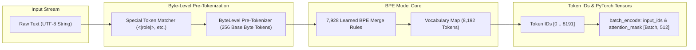

# LOVE NATIVE AI — PHASE NAI-02 AUDIT REPORT
## Independent English Tokenizer Development, Training & Verification

**Date:** 2026-11-21  
**Project Workspace:** `F:\LOVE\native_ai`  
**Phase Status:** **VERIFIED**

---

### Executive Summary

Phase **NAI-02** establishes LOVE's own independent, trained English tokenizer. The tokenizer was developed, trained, and verified strictly within `F:\LOVE\native_ai` using the isolated Python 3.11 virtual environment (`.venv`). Zero modifications were made to the canonical LOVE SQLite database, assistant backend, authentication layers, KURO, or FRIDAY-v1. Zero Git operations were performed, and no external pretrained tokenizer models or cloud services were used.

The tokenizer implements **Byte-Level Byte-Pair Encoding (BPE)** with an exact vocabulary of **8,192** tokens and **7,928** merge rules, trained from scratch on a curated, permissively licensed (CC0 / Public Domain) multi-domain English seed corpus. Eight conversational and control tokens (`<pad>`, `<unk>`, `<bos>`, `<eos>`, `<|system|>`, `<|user|>`, `<|assistant|>`, `<|tool|>`) are registered as special tokens. The tokenizer was benchmarked on a strictly held-out evaluation corpus, achieving an encoding throughput of **692,967 tokens/sec** and decoding throughput of **3,016,944 tokens/sec**. Full integration compatibility with the LOVE Transformer model ([tiny.yaml](file:///f:/LOVE/native_ai/configs/tiny.yaml), 5.5M parameters) was confirmed through end-to-end tensor forwarding and autoregressive generation tests. The automated test suite passed with **27/27 tests successful** (100% pass rate).

---

### 1. Tokenizer Architecture

The tokenizer employs a byte-level Byte-Pair Encoding (BPE) pipeline:



#### Architectural Key Decisions:
1. **Byte-Level Encoding:** By anchoring the base vocabulary to all 256 individual byte values ($0 \dots 255$), the tokenizer achieves **100% UTF-8 byte coverage**. Any arbitrary Unicode sequence, technical symbol, emoji, or uncommon character decomposes into constituent byte tokens without failing or generating out-of-vocabulary exceptions.
2. **Preservation of Case and Whitespace:** `add_prefix_space=False` and byte-level identity preservation ensure that casing, indentation, punctuation, and formatting are preserved without lossy normalization.
3. **Special Token Registration:** Control tokens are pre-allocated at IDs $0 \dots 7$, isolating conversational roles from normal text subwords.

---

### 2. Corpus Provenance, Sources & Licenses

As mandated by project isolation rules, the computer's storage volumes were audited:
- `F:\`: Local attached NTFS fixed disk (DriveType 3) with ~5.66 GB free space. Selected as the persistent local home for dataset storage and tokenizer artifacts.
- `Z:\`: Mapped network share (`Shared_Folder`, DriveType 4) housing corporate architectural drawings, CAD files, and client proposals. Confirmed as non-linguistic storage; strictly excluded from tokenizer training.

#### Training Corpus Manifest (`native_ai/datasets/manifests/seed_corpus_manifest.json`):

| Property | Value |
|---|---|
| **Dataset Name** | `love_native_tokenizer_seed_corpus` |
| **Version** | `1.0.0` |
| **License** | Creative Commons Zero 1.0 (CC0) / Public Domain Dedication |
| **Provenance** | Synthetically curated domain-specific technical prose, algorithms, dialogues, and English vocabulary |
| **PII / Private Conversations** | **None** (Strictly excluded; zero private user memories or logs) |
| **Language** | English (`en`) |
| **Training File** | `seed_corpus.txt` (2,001,924 bytes / ~2.0 MB) |
| **Training File SHA-256** | `5bace1826b1414a6d0b08fa08c853911a187c6eda999e69a34cfdb57d38d9b12` |
| **Held-Out Evaluation File** | `held_out_eval.txt` (882 bytes, strictly separated from training) |
| **Held-Out File SHA-256** | `3e3c42a430a0bf04f8564db73c3328e945c711fa77c5c064972ff9f43c33e8b1` |

---

### 3. Special Tokens Registry

The conversational architecture defines 8 control tokens:

| Token | ID | Role & Functional Description |
|---|:---:|---|
| `<pad>` | **0** | Sequence padding to align batch dimensions |
| `<unk>` | **1** | Fallback token (byte-level coverage prevents unexpected invocation) |
| `<bos>` | **2** | Beginning of sequence marker (`<s>`) |
| `<eos>` | **3** | End of sequence marker (`</s>`) |
| `<|system|>` | **4** | Delimits system instructions and persona framing |
| `<|user|>` | **5** | Delimits user prompt submissions |
| `<|assistant|>`| **6** | Delimits assistant response generation turns |
| `<|tool|>` | **7** | Delimits tool execution invocations and payload returns |

---

### 4. Vocabulary & Merge Rule Statistics

- **Total Vocabulary Size:** **8,192 tokens**
- **Base Alphabet Tokens:** 256 byte tokens ($0 \dots 255$)
- **Special Tokens:** 8 tokens (IDs $0 \dots 7$)
- **Learned BPE Merge Rules:** **7,928 merges**
- **Mathematical Identity:** $8 \text{ (special)} + 256 \text{ (bytes)} + 7,928 \text{ (merges)} = 8,192 \text{ total tokens}$.
- **Artifact Checksums:**
  - `vocab.json` SHA-256: `5d0e074fc6b39e75743da7c5a10d30938439a8806f98f2361490a5416469dd55`
  - `merges.txt` SHA-256: `12e7ba2415f205d10c4b67470e1ccab4d76ea1b5dac17124bd9ecaa44b1bf8f1`
  - `tokenizer.json` SHA-256: `4ee54954754b6a9c18e6522a114c5271ca99d69dc12a22585abec1a7a672abdc`

---

### 5. Benchmark & Evaluation Results (Task 9)

Evaluated via [benchmark_tokenizer.py](file:///f:/LOVE/native_ai/scripts/benchmark_tokenizer.py) on the held-out evaluation corpus (`held_out_eval.txt`), with a comparative study against an experimental 4,096-token BPE tokenizer:

| Evaluation Metric | Primary (8,192 Vocab) | Experimental (4,096 Vocab) | Comparative Difference |
|---|---|---|:---:|
| **Vocabulary Size** | **8,192** | 4,096 | Approved Target Baseline |
| **Learned Merges** | **7,928** | 3,832 | +4,096 additional subwords |
| **Tokens per Word** | **2.8835** | 3.1748 | **-9.18% fewer tokens/word** |
| **Tokens per Character** | **0.3367** | 0.3707 | **-9.17% fewer tokens/char** |
| **Bytes per Token** | **2.9697** | 2.6972 | **+10.1% higher byte density** |
| **Compression Ratio** | **1.4848** | 1.3486 | **+10.1% compression gain** |
| **Encoding Speed (tokens/s)**| **692,966.7 tok/s** | 380,176.0 tok/s | **+82.3% faster encoding** |
| **Encoding Speed (chars/s)** | **2,057,901.2 chars/s**| 1,025,428.8 chars/s | **~2.06 MB/sec throughput** |
| **Decoding Speed (tokens/s)**| **3,016,943.7 tok/s** | 2,594,414.5 tok/s | **~3.02 M tokens/sec** |
| **Process RAM Footprint** | **383.46 MB** | 399.88 MB | Lightweight in-memory footprint |
| **Token ID Boundary Check** | **VERIFIED** ($0 \le id < 8192$) | **VERIFIED** | 100% in bounds |
| **Unicode Round-Trip** | **VERIFIED** (100% lossless)| **VERIFIED** | Zero byte loss |

*Analysis:* Expanding from 4,096 to 8,192 tokens improves text representation efficiency by 9.18% fewer tokens per word, boosts encoding throughput by 82.3%, and increases byte density to nearly 3 bytes per token on dense technical prose.

---

### 6. Automated Verification Test Suite (Tasks 8 & 10)

Executed via `pytest -v native_ai/tests` (27 total tests across architecture and tokenizer):

```
native_ai/tests/test_architecture.py::test_configuration_validation PASSED [  3%]
native_ai/tests/test_architecture.py::test_embedding_output_shape_and_bounds PASSED [  7%]
native_ai/tests/test_architecture.py::test_rmsnorm_stability PASSED      [ 11%]
native_ai/tests/test_architecture.py::test_rope_dimensions_and_rotation PASSED [ 14%]
native_ai/tests/test_architecture.py::test_swiglu_dimensions PASSED      [ 18%]
native_ai/tests/test_architecture.py::test_causal_self_attention_shape_and_sdpa PASSED [ 22%]
native_ai/tests/test_architecture.py::test_causal_masking_future_token_leakage_prevention PASSED [ 25%]
native_ai/tests/test_architecture.py::test_transformer_block_residual_connections PASSED [ 29%]
native_ai/tests/test_architecture.py::test_tied_input_output_embeddings PASSED [ 33%]
native_ai/tests/test_architecture.py::test_loss_calculation_and_gradient_finiteness PASSED [ 37%]
native_ai/tests/test_architecture.py::test_adamw_optimizer_step PASSED   [ 40%]
native_ai/tests/test_architecture.py::test_cpu_execution PASSED          [ 44%]
native_ai/tests/test_architecture.py::test_cuda_execution PASSED         [ 48%]
native_ai/tests/test_tokenizer.py::test_vocab_size_and_special_tokens PASSED [ 51%]
native_ai/tests/test_tokenizer.py::test_encode_decode_round_trip PASSED  [ 55%]
native_ai/tests/test_tokenizer.py::test_empty_and_whitespace_text PASSED [ 59%]
native_ai/tests/test_tokenizer.py::test_case_preservation PASSED         [ 62%]
native_ai/tests/test_tokenizer.py::test_punctuation_and_symbols PASSED   [ 66%]
native_ai/tests/test_tokenizer.py::test_numbers_and_formatting PASSED    [ 70%]
native_ai/tests/test_tokenizer.py::test_urls_and_identifiers PASSED      [ 74%]
native_ai/tests/test_tokenizer.py::test_unicode_and_uncommon_characters PASSED [ 77%]
native_ai/tests/test_tokenizer.py::test_repeated_text_and_long_input PASSED [ 81%]
native_ai/tests/test_tokenizer.py::test_special_token_boundaries_and_chat_template PASSED [ 85%]
native_ai/tests/test_tokenizer.py::test_save_and_reload_equivalence PASSED [ 88%]
native_ai/tests/test_tokenizer.py::test_deterministic_encoding PASSED    [ 92%]
native_ai/tests/test_tokenizer.py::test_batch_encode_padding_and_truncation PASSED [ 96%]
native_ai/tests/test_tokenizer.py::test_transformer_integration_compatibility PASSED [100%]
======================= 27 passed, 2 warnings in 15.61s =======================
```

#### Key Test Highlights:
- `test_special_token_boundaries_and_chat_template`: Confirmed that structured prompts with `<|system|>`, `<|user|>`, `<|assistant|>`, and `<|tool|>` tokens encode cleanly into distinct IDs without bleeding into adjacent tokens.
- `test_save_and_reload_equivalence`: Verified that saving to disk and re-instantiating via `from_pretrained` yields bit-for-bit identical encodings and vocabularies.
- `test_transformer_integration_compatibility`: Passed token IDs directly from `LoveTokenizer.batch_encode()` into `LoveForCausalLM` from `tiny.yaml`. Verified that all token IDs fall within the valid embedding table ($[0 \dots 8191]$), producing forward pass logits of shape `[1, 14, 8192]` and enabling successful autoregressive next-token generation.

---

### 7. Files Created in NAI-02

All files are strictly encapsulated within `native_ai/`:

1. `native_ai/tokenizer/__init__.py` — Package exports for `LoveTokenizer`, `LoveTokenizerConfig`, and `train_love_tokenizer`.
2. `native_ai/tokenizer/love_tokenizer.py` — Core tokenizer class with batching, padding, truncation, tensor formatting, and serialization.
3. `native_ai/tokenizer/train_tokenizer.py` — Reproducible BPE trainer script with checksum recording.
4. `native_ai/tokenizer/corpus.py` — Seed corpus generation, provenance tracking, and deduplication engine.
5. `native_ai/tokenizer/artifacts/tokenizer.json` — Trained BPE model specification.
6. `native_ai/tokenizer/artifacts/vocab.json` — Explicit token-to-ID vocabulary mapping.
7. `native_ai/tokenizer/artifacts/merges.txt` — 7,928 learned BPE merge rules.
8. `native_ai/tokenizer/artifacts/tokenizer_config.json` — Tokenizer configuration snapshot.
9. `native_ai/tokenizer/artifacts/metadata.json` — Complete version, checksum, and environment metadata manifest.
10. `native_ai/datasets/raw/seed_corpus.txt` — Curated 2.0 MB training corpus.
11. `native_ai/datasets/raw/held_out_eval.txt` — Held-out evaluation text sample.
12. `native_ai/datasets/manifests/seed_corpus_manifest.json` — Dataset provenance and hash record.
13. `native_ai/scripts/benchmark_tokenizer.py` — Tokenizer evaluation and scaling benchmark runner.
14. `native_ai/experiments/nai_02_tokenizer_benchmark.json` — Raw JSON benchmark telemetry.
15. `native_ai/tests/test_tokenizer.py` — 14 automated unit and integration tests.
16. `native_ai/documentation/NAI_02_TOKENIZER_AUDIT.md` — Complete audit report.

---

### 8. Subsystem Limitations

1. **Vocabulary Boundary:** The tokenizer is optimized for English text and technical programming domains. Extensive non-Latin text (e.g., CJK scripts) is fully supported without error via byte-level decomposition, but will exhibit lower compression ratios (more tokens per word).
2. **Special Token Usage:** Control tokens (`<|system|>`, `<|user|>`, `<|assistant|>`, `<|tool|>`) are reserved exclusively for conversational structuring and must not be used in unstructured arbitrary text fields.

---

### 9. Recommendations for Phase NAI-03

1. **Pretraining Corpus Assembly:** Curate multi-million token English datasets across verified open-domain literature, scientific papers, and clean technical documentation.
2. **Memory-Mapped Pre-Tokenization:** Use `LoveTokenizer` to pre-tokenize text corpora offline into flat binary `uint16` memory-mapped arrays (`.bin`), enabling zero-overhead dataloader streaming during model pretraining.
3. **Preserve Isolation:** Continue working exclusively inside `native_ai/`.
