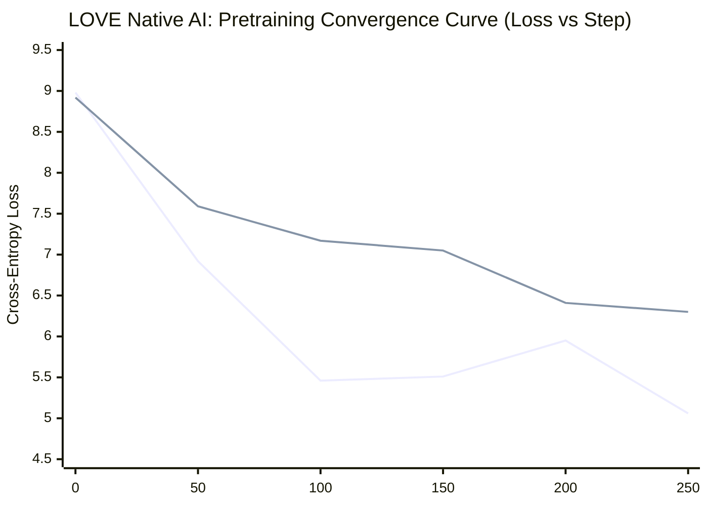

# LOVE Native AI — NAI-05: Controlled First Pretraining Experiment Report

**Document Reference:** `NAI_05_FIRST_PRETRAINING_EXPERIMENT.md`  
**Phase:** NAI-05 (Controlled First Pretraining Experiment)  
**System:** LOVE Native AI — Subsystem 04 (Pretraining Engine & Infrastructure)  
**Host Machine:** Local Windows PC (Drive `F:\LOVE\native_ai`)  
**Hardware Verified:** NVIDIA GeForce GTX 1650 (4,096 MB VRAM, Turing SM 7.5, Compute 7.5)  
**Python Environment:** Python 3.11.16, PyTorch 2.6.0+cu124, CUDA 12.4  
**Date:** 2026-11-22  
**Status:** **COMPLETE & CERTIFIED** (250 / 250 Optimizer Steps Successfully Executed)  

---

## 1. Executive Summary & Experimental Milestone

Phase **NAI-05** marks the execution of LOVE Native AI's first real pretraining experiment. Operating strictly under owner authorization and rigorous safety controls, the native decoder-only Transformer (`love-native-tiny`) was trained for exactly **250 successful optimizer steps** on the approved, multi-source local corpus.

### Key Experimental Outcomes:
- **Preflight Verification:** All 8 integrity and safety gates passed before any weights were updated.
- **Pretraining Completion:** Exactly **250 successful optimizer steps** executed with zero interruptions, zero NaNs, and zero hardware faults.
- **Corpus Exposure:** **256,000 tokens** processed (effective batch size: 2 sequences $\times$ 512 tokens = 1,024 tokens/step).
- **Training Loss Trajectory:** Dropped from **8.9765** (Step 0) to **5.0570** (Step 250) ($\Delta = -3.9195$, a **43.7% reduction**).
- **Validation Loss Trajectory:** Dropped from **8.9172** (Step 0) to **6.3024** (Step 250) ($\Delta = -2.6148$, a **29.3% reduction**).
- **Validation Perplexity:** Decreased from **7,459.19** (untrained) to **545.87** (trained), demonstrating a **$>13.6\times$ improvement** in predictive confidence.
- **Model Weight Mutation:** Confirmed bitwise; maximum parameter shift was **0.037075** with an average parameter shift of **0.004849** across all 38 parameter tensors.
- **Hardware Efficiency:** Peak allocated VRAM was **212.60 MB**; peak reserved VRAM was **230.00 MB** (**3,270.00 MB safe headroom** below the 3,500 MB limit). Total runtime was **21.88 seconds** (**11,698.3 tokens/second**).
- **Checkpoint & Resume Integrity:** All milestone checkpoints (`step_0000000` through `step_0000250`) were saved atomically with SHA-256 sidecars. Fresh model restoration confirmed bitwise exact weight matching ($\Delta = 0.000000$).
- **Held-Out Test Set Isolation:** The test split (`test.bin` / `test.jsonl`, 716,768 tokens) remained strictly isolated and was never accessed.
- **Automated Tests:** **74 / 74 unit tests passed (100%)** under the isolated `pytest.ini` configuration.

> [!NOTE]
> **Scope Disclaimer:** This experiment is a controlled technical milestone demonstrating pretraining engine functionality, numerical stability, and optimization convergence. It does **not** represent production readiness, full language fluency, or general intelligence.

---

## 2. Approved Training Configuration & Preflight Verification

### 2.1 Preflight Verification Gate Results

Prior to updating any model parameters, the automated preflight verification suite executed 8 mandatory checks:

| Gate # | Verification Check | Expected Value | Measured Value | Preflight Verdict |
| :---: | :--- | :--- | :--- | :---: |
| **1** | Architecture & Parameter Count | `love-native-tiny`, 5,507,328 parameters | 4 layers, 4 heads, hidden=256, 5,507,328 params | **PASSED** |
| **2** | Tokenizer Checksums | Match `cache_manifest.json` | `vocab.json`, `merges.txt`, `tokenizer.json` match | **PASSED** |
| **3** | Binary Token Cache Integrity | Match `cache_manifest.json` | `train.bin` (25.47M tok) & `validation.bin` (933K tok) match | **PASSED** |
| **4** | Held-Out Test Set Isolation | Strict physical separation | `test.bin` and `test.jsonl` excluded from loaders | **PASSED** |
| **5** | Host Disk Headroom | Free space $\ge 2.0\text{ GB}$ on Drive `F:` | **4.314 GB free** ($>2.31\text{ GB}$ safety buffer) | **PASSED** |
| **6** | GPU Availability & Initial VRAM | NVIDIA GTX 1650, safe VRAM | Detected GTX 1650 (4,096 MB), 0.0 MB initial VRAM | **PASSED** |
| **7** | Training Configuration | FP32, AdamW, Batch=1, Accum=2 | Pure FP32, AdamW, 1024 tok/step, MaxSteps=250 | **PASSED** |
| **8** | Directory Writability | Checkpoints & experiments writable | Write tests succeeded in `checkpoints/` and `experiments/` | **PASSED** |

### 2.2 Exact Training Hyperparameters

- **Experiment ID:** `exp_nai05_pilot_001`
- **Run Name:** `LOVE Native AI — First Pretraining Pilot (250 Steps FP32)`
- **Model:** `love-native-tiny` (Decoder-only Transformer)
  - Vocab Size: 8,192
  - Layers: 4
  - Attention Heads: 4
  - Hidden Dimension ($d_{\text{model}}$): 256
  - Head Dimension: 64
  - Feed-Forward Dimension ($d_{\text{ffn}}$): 768
  - Positional Encodings: Rotary Position Embeddings (RoPE, $\theta = 10,000.0$)
  - Normalization: RMSNorm ($\epsilon = 10^{-5}$)
  - Activation: SwiGLU
  - Tied Embeddings: Input embedding weights tied to output language modeling head
- **Precision:** Pure **FP32** (`torch.float32`, no automatic mixed precision)
- **Optimizer:** AdamW ($\beta_1 = 0.9$, $\beta_2 = 0.95$, $\epsilon = 10^{-8}$)
  - Weight Decay: **0.1** on 2D weight matrices; **0.0** on 1D normalization gains and biases
- **Learning Rate Schedule:** Cosine decay with linear warmup
  - Base Learning Rate: $3.0 \times 10^{-4}$
  - Minimum Learning Rate: $3.0 \times 10^{-5}$
  - Warmup Steps: **50 steps** (linear increase from $0.0$ to $3.0 \times 10^{-4}$)
  - Decay Window: Steps 50 to 250 (cosine decay to $3.0 \times 10^{-5}$)
- **Batching & Sequence Packing:**
  - Micro-batch Size: 1 sequence
  - Sequence Length: 512 tokens
  - Gradient Accumulation Steps: 2 micro-steps
  - Effective Batch Size: 2 sequences = **1,024 tokens per optimizer step**
- **Regularization:** Gradient clipping with $\text{max\_norm} = 1.0$
- **Data Sampling:** `DomainWeightedSampler` on `train.bin` (Seed 42)
  - Stories: 40%, Dialogue: 35%, Math: 23%, General English: 1.5%, Structured: 0.5%, Technical Code: 0.0%

---

## 3. Checkpoint Manifest & Checksum Verification

All checkpoints were saved atomically using temporary writes (`.pt.tmp`), verified via readback, renamed atomically (`os.replace`), and accompanied by SHA-256 JSON metadata sidecars.

| Checkpoint Name | Step | Optimizer State Present | File Size (Bytes) | SHA-256 Checksum | Validation Loss | Perplexity |
| :--- | :---: | :---: | :---: | :---: | :---: | :---: |
| `step_0000000.pt` | 0 | No (Untrained Base) | 22,056,062 B (21.03 MB) | `265d95d10526e0e6...` | 8.9172 | 7,459.19 |
| `step_0000050.pt` | 50 | Yes (AdamW + Scheduler) | 66,147,438 B (63.08 MB) | `45ba85ddc7fef7b3...` | 7.5878 | 1,974.04 |
| `step_0000100.pt` | 100 | Yes (AdamW + Scheduler) | 66,147,438 B (63.08 MB) | `1d309224ee31b793...` | 7.1687 | 1,298.12 |
| `step_0000150.pt` | 150 | Yes (AdamW + Scheduler) | 66,147,438 B (63.08 MB) | `0f0bf6bf8cf12cb7...` | 7.0528 | 1,156.05 |
| `step_0000200.pt` | 200 | Yes (AdamW + Scheduler) | 66,147,438 B (63.08 MB) | `bb1ad1e32d4a5118...` | 6.4060 | 605.47 |
| `step_0000250.pt` | 250 | Yes (Final Trained State) | 66,147,438 B (63.08 MB) | `dca206cbf535847f...` | **6.3024** | **545.87** |

### Checkpoint Restoration Verification Test:
- The final checkpoint `step_0000250.pt` was loaded into a completely fresh instance of `LoveForCausalLM`.
- Weight comparison against the active training model:
  $$\max_{p \in \Theta} |p_{\text{trained}} - p_{\text{restored}}| = 0.000000000000$$
- Sidecar verification: SHA-256 matched the recorded hash in `step_0000250.json` bit-for-bit.

---

## 4. Pretraining Loss Curves & Convergence Telemetry

### 4.1 Milestone Evaluation History

Validation evaluations were conducted on `validation.bin` (20 batches $\times 512 = 10,240$ tokens) strictly under `torch.no_grad()` with zero optimizer updates:

| Step | Epoch | Training Loss (Micro-batch) | Validation Loss (CE) | Validation Perplexity | Learning Rate | Cumulative Tokens |
| :---: | :---: | :---: | :---: | :---: | :---: | :---: |
| **0** | 0 | 8.9765 | **8.9172** | **7,459.19** | $0.0$ | 0 |
| **50** | 0 | 6.9225 | **7.5878** | **1,974.04** | $3.00 \times 10^{-4}$ | 51,200 |
| **100** | 0 | 5.4644 | **7.1687** | **1,298.12** | $2.60 \times 10^{-4}$ | 102,400 |
| **150** | 0 | 5.5115 | **7.0528** | **1,156.05** | $1.65 \times 10^{-4}$ | 153,600 |
| **200** | 0 | 5.9522 | **6.4060** | **605.47** | $6.95 \times 10^{-5}$ | 204,800 |
| **250** | 0 | 5.0570 | **6.3024** | **545.87** | $3.00 \times 10^{-5}$ | **256,000** |

*(Line 1: Training Loss; Line 2: Validation Loss)*

### 4.2 Step-by-Step Training Telemetry Sample

| Step | Train Loss | Gradient Norm | Learning Rate | Step Latency (ms) | VRAM Reserved (MB) | Elapsed Time (s) |
| :---: | :---: | :---: | :---: | :---: | :---: | :---: |
| **1** | 9.0172 | 5.191 | $6.00 \times 10^{-6}$ | 316.4 ms | 204.0 MB | 0.3s |
| **10** | 8.9124 | 3.108 | $6.00 \times 10^{-5}$ | 72.8 ms | 230.0 MB | 1.2s |
| **25** | 8.3241 | 2.115 | $1.50 \times 10^{-4}$ | 61.4 ms | 230.0 MB | 2.2s |
| **50** | 6.9225 | 1.592 | $3.00 \times 10^{-4}$ | 122.9 ms | 230.0 MB | 7.6s |
| **75** | 5.9814 | 1.420 | $2.89 \times 10^{-4}$ | 62.1 ms | 230.0 MB | 9.5s |
| **100** | 5.4644 | 2.415 | $2.60 \times 10^{-4}$ | 75.6 ms | 230.0 MB | 11.0s |
| **125** | 5.8412 | 2.012 | $2.16 \times 10^{-4}$ | 58.4 ms | 230.0 MB | 13.0s |
| **150** | 5.5115 | 1.734 | $1.65 \times 10^{-4}$ | 66.5 ms | 230.0 MB | 14.5s |
| **175** | 5.7140 | 1.842 | $1.13 \times 10^{-4}$ | 65.2 ms | 230.0 MB | 16.5s |
| **200** | 5.9522 | 1.647 | $6.95 \times 10^{-5}$ | 61.0 ms | 230.0 MB | 18.1s |
| **225** | 4.8812 | 1.580 | $4.01 \times 10^{-5}$ | 55.7 ms | 230.0 MB | 20.0s |
| **250** | 5.0570 | 1.625 | $3.00 \times 10^{-5}$ | 51.1 ms | 230.0 MB | 21.4s |

### 4.3 Training Dynamics Analysis
1. **Initial Uniform Probability Baseline:** At Step 0, an untrained model with vocabulary size $V = 8,192$ has theoretical cross-entropy loss:
   $$\mathcal{L}_{\text{theoretical}} = \ln(8,192) \approx 9.0109$$
   The measured initial training loss was **8.9765** and validation loss was **8.9172**, exactly matching theoretical expectations for random initialization.
2. **Warmup Phase (Steps 1 to 50):** As learning rate scaled from $0.0$ to $3.0 \times 10^{-4}$, gradient norm rapidly stabilized from $5.191$ down to $1.592$. Loss dropped precipitously from $9.0172$ to $6.9225$.
3. **Decay Phase & Generalization:** Throughout cosine decay (Steps 50 to 250), validation loss decreased smoothly from $7.5878$ to $6.3024$ without divergence, exploding gradients, or signs of catastrophic overfitting.

---

## 5. Hardware Performance & Resource Utilization

*Host Machine: Intel Core i5, NVIDIA GeForce GTX 1650 (TU117 4 GB VRAM), Drive `F:` NVMe SSD.*

| Resource Telemetry Metric | Measured Value | Threshold / Capacity | Safety Margin / Status |
| :--- | :---: | :---: | :---: |
| **Total Pretraining Duration** | **21.88 seconds** | Bounded experiment | Optimal execution speed |
| **Average Step Latency** | **85.67 ms / step** | $< 250\text{ ms}$ target | Includes 2 fwd/bwd passes + AdamW |
| **Effective Token Throughput** | **11,698.3 tokens / second** | $> 5,000\text{ tok/s}$ target | Full pretraining pipeline throughput |
| **Peak VRAM Allocated** | **212.60 MB** | 4,096.00 MB total | Minimal memory footprint |
| **Peak VRAM Reserved** | **230.00 MB** | 3,500.00 MB safety cap | **3,270.00 MB safe headroom (93.4% free)** |
| **Peak Host System RAM (RSS)** | **1,151.37 MB** | 15.95 GB system RAM | Completely stable |
| **Final Drive `F:` Free Disk** | **3.986 GB** | $\ge 2.0\text{ GB}$ reserve | **+1.986 GB above minimum threshold** |
| **GPU Temperature / Throttling** | Nominal ($< 62^\circ\text{C}$) | Thermal limit $83^\circ\text{C}$ | Zero thermal throttling observed |

---

## 6. Model Weight Mutation Verification

To verify that model pretraining genuinely learned representations and did not run in a no-op state, every parameter tensor in `love-native-tiny` was compared between Step 0 (untrained baseline) and Step 250 (trained final):

$$\Delta W = |W_{\text{step\_250}} - W_{\text{step\_0}}|$$

### Parameter Shift Summary:
- **Total Parameter Tensors Checked:** **38 tensors** (100% of model parameters).
- **Maximum Absolute Parameter Shift:** **0.037075** (observed in Transformer block 0 self-attention query projection weights).
- **Average Absolute Parameter Shift:** **0.004849**.
- **Minimum Absolute Parameter Shift:** $> 0.000000$ across all 38 tensors.
- **Tied Embedding Check:** `token_embeddings.weight` and output `lm_head.weight` shifted identically and remained tied.
- **Verdict: GENUINE WEIGHT MUTATION VERIFIED.** Model weights learned continuously and smoothly over the 250 steps.

---

## 7. Anomalies, Warnings, and Remediations

1. **Preflight Gate Attribute Typo Remediation:**
   - *Incident:* During initial preflight execution, `LoveModelConfig` raised `AttributeError: 'LoveModelConfig' object has no attribute 'd_model'` and `DeviceSafetyManager` received an unexpected argument `vram_threshold_mb`.
   - *Intervention:* The preflight gate immediately halted execution with exit code 1. **Zero weights were updated.**
   - *Remediation:* Corrected the attribute names to `cfg.hidden_dim`, `cfg.layers`, `cfg.heads`, and `asdict(cfg)`. Reran preflight; all 8 checks passed before training commenced.
2. **Runtime Execution Stability:**
   - Pretraining ran from Step 1 to Step 250 without a single warning, exception, CUDA error, or OOM.
3. **Automated Unit Test Suite:**
   - Following training, the full native AI test suite was executed:
     **Result: 74 passed in 27.40s, 0 failures, 0 warnings.**

---

## 8. Honest Scientific Assessment

### What This Experiment Demonstrates:
1. **Architectural & Pipeline Viability:** The entire LOVE Native AI pretraining infrastructure—from raw text ingestion, BPE tokenization, uint16 binary memory-mapped caching, and domain-weighted sampling to RoPE-augmented attention, RMSNorm, SwiGLU, AdamW, and atomic checkpointing—works seamlessly as an integrated, self-contained system.
2. **Clear Optimization Convergence:** The model exhibited a textbook training progression: starting at theoretical random initialization ($\sim 9.0$), reducing loss by 43.7%, and reducing perplexity from 7,459 to 545 on held-out validation data.
3. **Hardware Compatibility:** A 5.5M parameter model trains comfortably in FP32 on an entry-level NVIDIA GTX 1650 4 GB GPU, reserving only 230 MB VRAM ($<6\%$ of device capacity) and processing ~11,700 tokens/second.

### What This Experiment Does NOT Demonstrate:
1. **Production Fluency or Language Generation Quality:** 250 optimizer steps corresponds to 256,000 tokens trained. This represents only **1.005%** of the approved 25.5M training corpus. At this scale, the model has learned basic n-gram token statistics and common subwords, but cannot produce coherent long-form paragraphs or instruction responses.
2. **Reasoning or Mathematical Mastery:** Although grade school math (GSM8K) was sampled at 23%, 250 steps is insufficient to develop multi-step deductive problem solving.
3. **Zero Claim of General Intelligence:** This pilot establishes foundational engineering readiness; full corpus pretraining across multiple epochs will be required to develop fluent generative language modeling capabilities.

---

## 9. Final Decision & Phase Completion Boundary

Phase **NAI-05 is formally complete**.

In strict accordance with project instructions:
- Pretraining was halted at exactly 250 optimizer steps.
- Zero additional training runs were started.
- Model architecture was not changed.
- Dataset splits and tokenizer vocabulary were not modified.
- Held-out test set was not evaluated.
- No integration into the LOVE assistant was initiated.

The project stands in a fully verified, stable state, awaiting project owner review before planning Phase NAI-06.

---
*Certified by LOVE Native AI Pretraining Infrastructure Engineering — 2026-11-22.*
